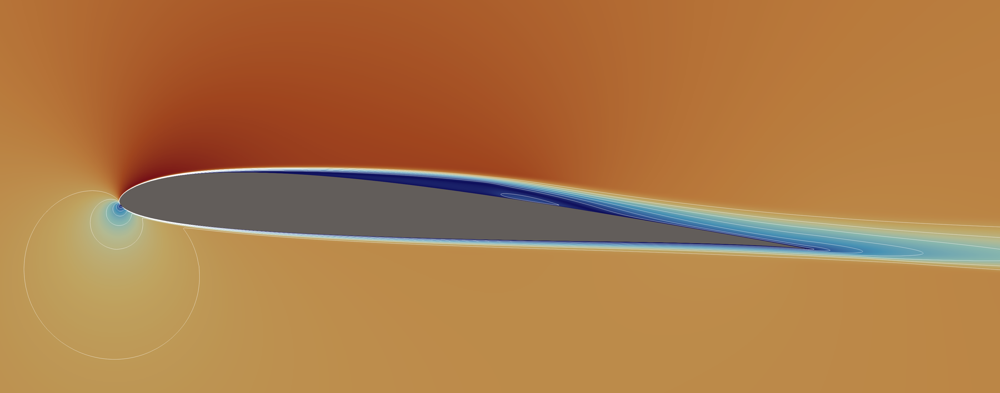

# PyAeroFlow

2D unstructured cell-centred finite-volume Navier–Stokes/RANS solver in
JAX, developed as a companion to
[PyAero](https://github.com/chiefenne/PyAero).
Command and package: `pyaeroflow`. Formerly named *aerojax* (renamed in 0.8;
not related to other projects of that name).

**Status:** 0.9. Steady and unsteady incompressible laminar, inviscid and
RANS flow (Spalart–Allmaras SA-neg and k-ω SST, SU2 INC formulation) with the
transition models BCM, SA-AFT2019b and Langtry–Menter γ-Re_θ, a Newton–Krylov
solver and BDF2 dual time stepping. Verified and validated against Couette and
Poiseuille flow, the lid-driven cavity, the DFG cylinder benchmarks, the NASA
TMR flat plate and NACA 0012, ERCOFTAC T3, the Eppler 387 and the SD7003
([validation](docs/validation.md)). Meshes come from PyAero (`.su2`) or Gmsh
(`.msh`). The path to 1.0 is in
[requirements §4a](docs/requirements.md#4a-milestone-10-proposed-2026-10-27-to-be-confirmed).



*SD7003, α = 4°, Re = 60 000, k-ω SST-2003m with Langtry–Menter 2009
transition: laminar separation bubble on the upper surface.*

## Documentation

- [Requirements](docs/requirements.md): decisions, planned features, stage plan
- [Case configuration](docs/configuration.md): TOML case-file reference
- [From a PyAero mesh to a result](docs/pyaero.md): mesh settings (y⁺, farfield), case file, log, limits
- [Choosing a model](docs/models.md): SA, SST, BCM, AFT or LM for which flow
- [Verification and validation](docs/validation.md): every case with its reference, numbers and figure

## Installation

PyAeroFlow needs a conda environment from conda-forge. On Intel Macs this is the
only source of `jaxlib`.

```
conda env create -f environment.yml
conda activate pyaeroflow
pip install -e . --no-deps
```

Where JAX wheels exist, plain `pip` works too (Python 3.11 or newer; JAX is
pulled in as a dependency; tested on Linux), in a virtual environment:

```
pip install git+https://github.com/chiefenne/pyaeroflow
pyaeroflow --version
```

Optional extras: `pip install "pyaeroflow[plot]"` for the plot scripts. The
package is not on PyPI.

## Running a case

From a PyAero (or Gmsh) airfoil mesh to a case file:

```
pyaeroflow check-mesh naca.su2 --re 6e6        # y+, surface points, farfield distance
pyaeroflow init-case naca.su2 --model sst --re 6e6 --alpha 4   # writes naca_sst.toml
```

Then:

```
pyaeroflow check case.toml        # validate, print the resolved configuration
pyaeroflow run case.toml          # solve; writes <name>.log, .history.csv, .vtu
```

Example case files are in `examples/cases/` (generate their meshes first with
`python examples/cases/make_meshes.py`; `examples/meshes/` holds three PyAero
meshes of the NACA 0012: 5- and 25-chord tunnels with 113 points per
airfoil side, and a 5-chord tunnel with 472). The case-file reference is
[docs/configuration.md](docs/configuration.md); the same setup is available
from Python through `pyaeroflow.driver.IncompressibleProblem`.

## Tests and examples

```
pytest                         # fast tests
pytest -m slow                 # order-of-accuracy studies, benchmarks
python examples/stage0_meshes.py
python examples/stage1_convection_diffusion.py
python examples/stage2_laminar.py [--re1000]
python examples/stage3_benchmarks.py
python examples/stage4_unsteady.py
python examples/stage5_rans.py
python examples/stage6_naca0012.py [--medium]
```

The examples write VTU files (for ParaView) and plots to `examples/output/`.

## License

MIT, see [LICENSE](LICENSE).
