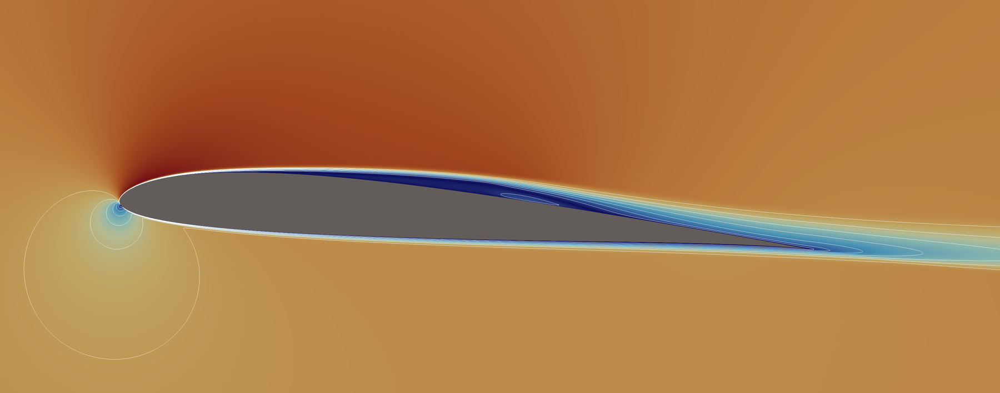
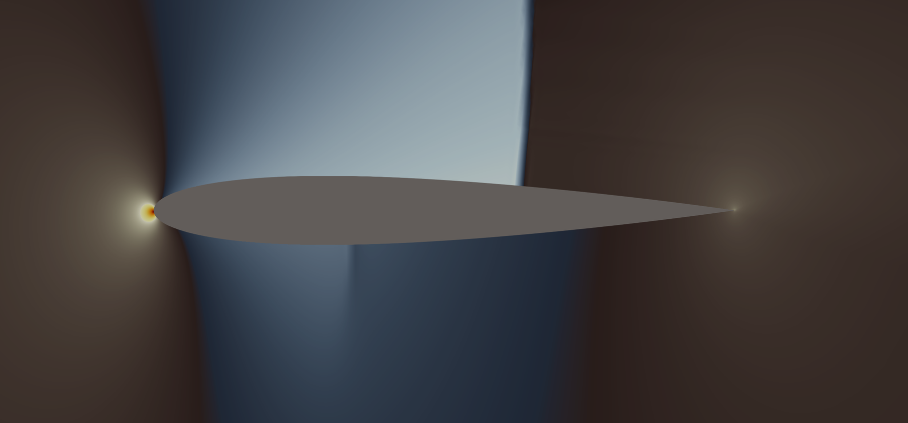

# PyAeroFlow

2D unstructured cell-centred finite-volume Navier–Stokes/RANS solver in
JAX, developed as a companion to
[PyAero](https://github.com/chiefenne/PyAero).
Command and package: `pyaeroflow`.

**Status:** version 1.7.0 (see the [changelog](CHANGELOG.md)).

**Incompressible flow** (artificial compressibility, `physics.flow = "incompressible"`)
- Models: laminar, inviscid (Euler), and RANS with Spalart–Allmaras (SA-neg) or k-ω SST
- Transition: BCM, SA-AFT2019b and Langtry–Menter γ-Re_θ on SST
- Steady (Newton–Krylov) and unsteady (BDF2 dual time stepping) solvers
- Validated against Couette and Poiseuille flow, the lid-driven cavity, DFG cylinder,
  NASA TMR flat plate and NACA 0012, ERCOFTAC T3, Eppler 387 and SD7003
  ([validation](docs/validation.md))

**Compressible flow** (density-based, `physics.flow = "compressible"`, steady only)
- Models: Euler, laminar Navier–Stokes, RANS with SA-neg and k-ω SST
- Convective flux: SLAU2 by default, Roe optional; MUSCL reconstruction
- Validated on oblique shock, transonic NACA 0012, Mach 0.5 laminar NACA 0012, SA and SST
  ([validation §12–16](docs/validation.md#sec-12))

**Post-processing**
- Derived VTU fields: Q-criterion, vorticity, cp, total pressure loss, entropy, numerical schlieren
- Point probes written to CSV
- `pyaeroflow plot`: convergence logs, wall Cp/Cf, polars and probe spectra, with reference overlays and built-in NASA data ([plotting guide](docs/plotting.md))

**Solver and workflow**
- Control files (`.stop`, `.result_N`) and restart and backup files
- Meshes from PyAero (`.su2`) or Gmsh (`.msh`); airfoil workflow with `init-case` and `check-mesh`
- `pyaeroflow run`, `pyaeroflow polar` (angle-of-attack sweeps), and a Python API

**Not yet available**
- Unsteady compressible flow
- Vortex correction for compressible farfields
- Turbulence models beyond SA-neg and SST

The 1.0 milestone is recorded in
[requirements §4a](docs/requirements.md#4a-milestone-10-reached-2026-10-30).



*SD7003, α = 4°, Re = 60 000, k-ω SST-2003m with Langtry–Menter 2009
transition: laminar separation bubble on the upper surface.*



*NACA 0012, α = 1.25°, M∞ = 0.8, inviscid (compressible Euler, Roe flux with
second-order MUSCL reconstruction): transonic flow with a supersonic pocket on
each side, terminated by a shock at about 62 % chord on the upper surface and
about 35 % on the lower surface. 49k-cell O-grid, C<sub>L</sub> = 0.344,
C<sub>D</sub> = 0.0225 (pure wave drag); see
[validation §12](docs/validation.md#sec-12).*

More examples with the commands to run them: [example gallery](docs/gallery.md).

## Documentation

- [Example gallery](docs/gallery.md): pictures of selected cases with the commands that reproduce them
- [Case catalogue](docs/cases.md): the 45 example cases and the templates of `pyaeroflow init`
- [Recipes](docs/recipes.md): commands for everyday tasks (polars, restarts, plots, control files, refinement)
- [Requirements](docs/requirements.md): decisions, planned features, stage plan
- [Case configuration](docs/configuration.md): TOML case-file reference
- [From a PyAero mesh to a result](docs/pyaero.md): mesh settings (y⁺, farfield), case file, log, limits
- [Choosing a model](docs/models.md): SA, SST, BCM, AFT or LM for which flow
- [Verification and validation](docs/validation.md): every case with its reference, numbers and figure

## Installation

PyAeroFlow needs a conda environment from conda-forge. On Intel Macs this is the
only source of `jaxlib`.

```
conda env create -f environment.yml
conda activate pyaeroflow
pip install -e . --no-deps
```

Where JAX wheels exist, plain `pip` works too (Python 3.11 or newer; JAX is
pulled in as a dependency; tested on Linux), in a virtual environment:

```
pip install git+https://github.com/chiefenne/pyaeroflow
pyaeroflow --version
```

Optional extras: `pip install "pyaeroflow[plot]"` for the plot scripts. The
package is not on PyPI.

## Running a case

A ready-to-run case with its mesh (`pyaeroflow templates` lists them):

```
pyaeroflow init plate-sa -o my_plate
pyaeroflow run my_plate/flat_plate_rans.toml
```

From a PyAero (or Gmsh) airfoil mesh to a case file:

```
pyaeroflow check-mesh naca.su2 --re 6e6        # y+, surface points, farfield distance
pyaeroflow init-case naca.su2 --model sst --re 6e6 --alpha 4   # writes naca_sst.toml
```

Then:

```
pyaeroflow check case.toml        # validate, print the resolved configuration
pyaeroflow run case.toml          # solve; writes <name>.log, .history.csv, .vtu
pyaeroflow refine case.toml       # only make the [refinement.band] mesh, as VTU
```

Example case files are in `examples/cases/` (generate the meshes of the
simple cases first with `python examples/cases/make_meshes.py`; the plate
meshes of the transition cases come from `examples/cases/make_plate_lm.py`).
`examples/meshes/` holds the meshes of the validation cases (NACA 0012,
Eppler 387, SD7003, and a RAE 2822 mesh for later), described in
[examples/meshes/README.md](examples/meshes/README.md). The case-file reference
is [docs/configuration.md](docs/configuration.md); the same setup is available
from Python through `pyaeroflow.driver.IncompressibleProblem`.

`pyaeroflow plot` makes PNG figures of a run: the convergence history from the `.log`,
Cp and Cf along a wall, polars and probe time series and spectra. It can overlay
reference data, including built-in NASA TMR and NASA TM 4062 data, e.g.
`pyaeroflow plot output/case.log` or
`pyaeroflow plot output/case.wall_airfoil.csv --ref builtin:tmr_naca0012_cp_cfl3d_sa:alpha=10`.
See [docs/plotting.md](docs/plotting.md). It needs `pip install pyaeroflow[plot]`.
`plot_log.py` in the repository root is kept as a shortcut for `pyaeroflow plot log`.

## Tests and examples

```
pytest                         # fast tests
pytest -m slow                 # order-of-accuracy studies, benchmarks
python examples/stage0_meshes.py
python examples/stage1_convection_diffusion.py
python examples/stage2_laminar.py [--re1000]
python examples/stage3_benchmarks.py
python examples/stage4_unsteady.py
python examples/stage5_rans.py
python examples/stage6_naca0012.py [--medium]
```

The examples write VTU files (for ParaView) and plots to `examples/output/`.

## Acknowledgements

PyAeroFlow owes a great deal to [SU2](https://su2code.github.io), the
open-source CFD suite developed by its worldwide community. Its documentation,
its published papers and the openness with which its developers share their
experience shaped many choices in this code: the incompressible formulation,
the SST and Langtry–Menter setups, solution limits, convergence criteria and
much of the practical know-how behind a robust implicit solver. Many thanks to
its developers and community for that work.

PyAeroFlow is an independent, clean-room implementation in Python and JAX. It
contains no source code taken from other solvers; models and numerics are
implemented from the published literature (see the references in the
[docs](docs/validation.md)).

## License

MIT, see [LICENSE](LICENSE).
