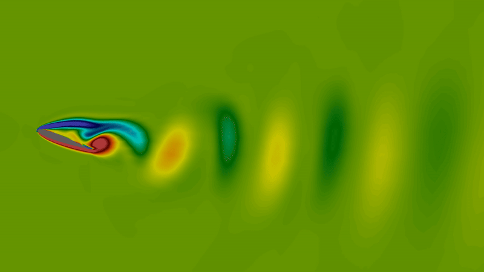
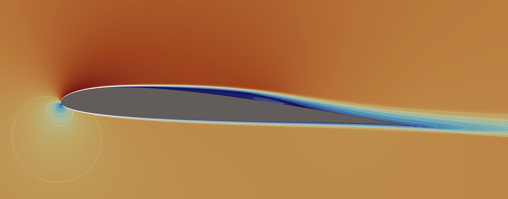
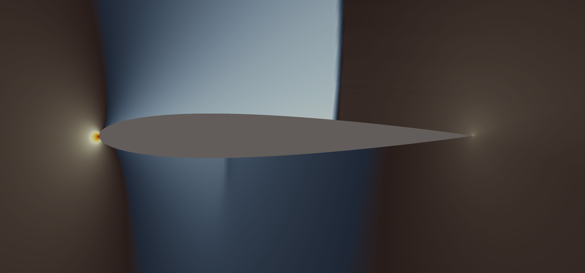
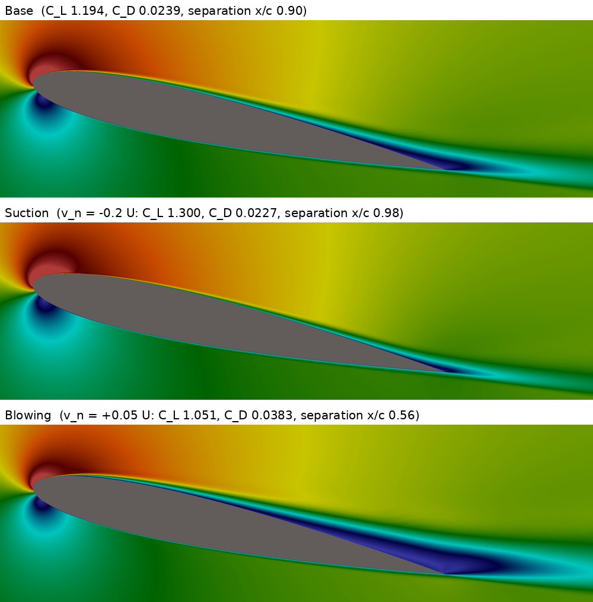
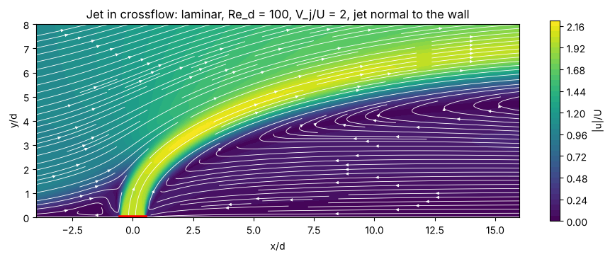
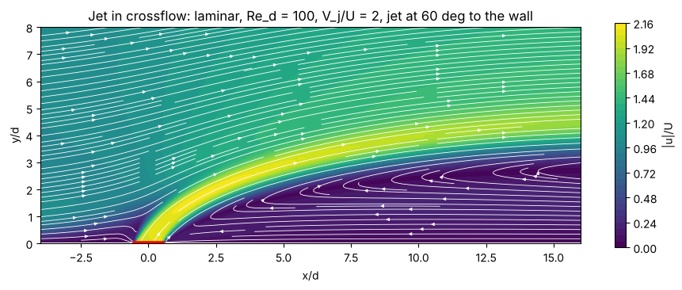
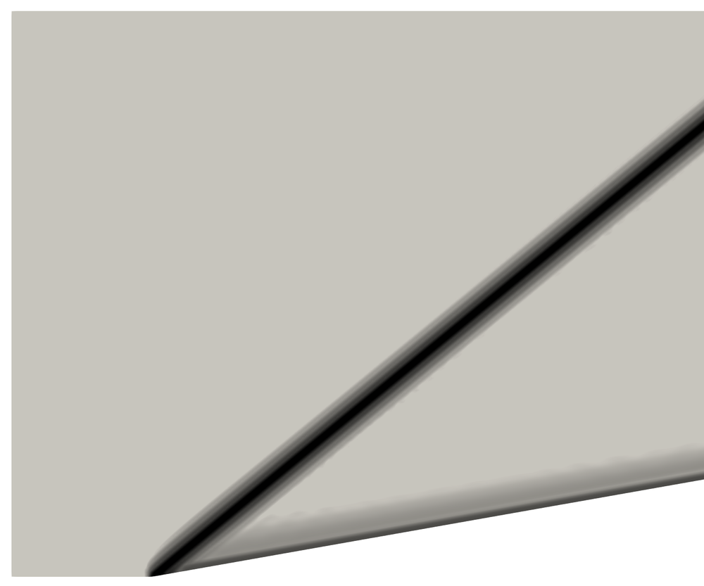
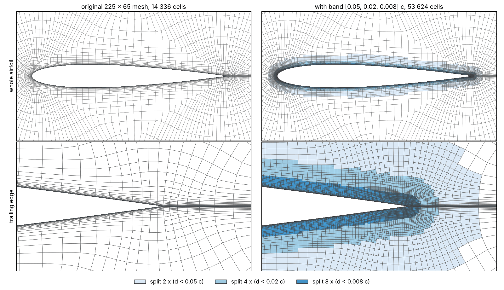
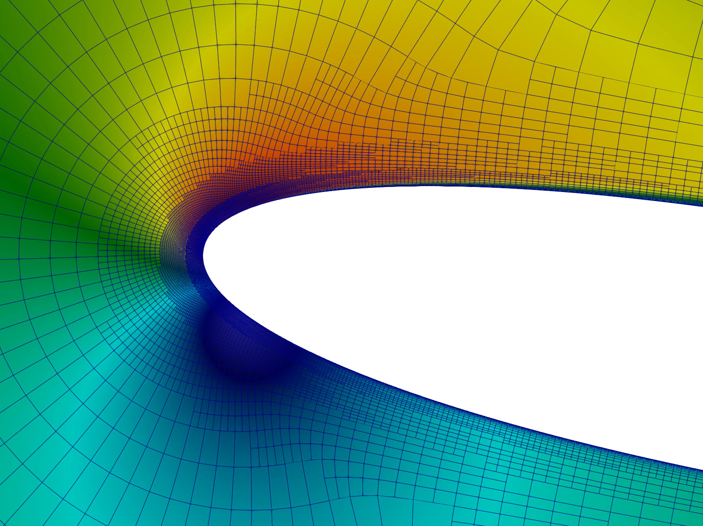
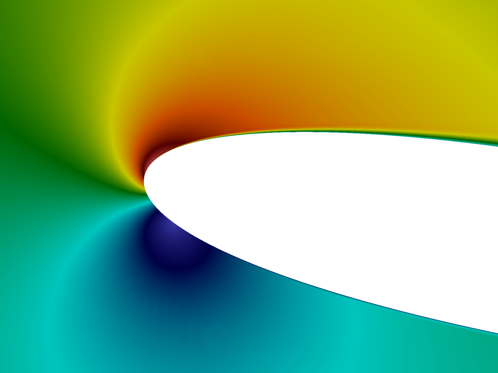

# Example gallery

What PyAeroFlow computes, one picture per case, with the commands that
reproduce it. Numbers and comparisons with reference data are in
[Verification and validation](validation.md); commands for everyday tasks
(polars, restarts, plots, control files) are in [Recipes](recipes.md).

All commands run from the repository root unless a `cd` says otherwise.
Case files are in `examples/cases/`, meshes in `examples/meshes/`
([mesh list](../examples/meshes/README.md)).

| # | Example | Flow | Model |
|---|---|---|---|
| 1 | [Vortex shedding behind a NACA 0012 at α = 20°](#shedding) | incompressible, unsteady | laminar |
| 2 | [Laminar separation bubble on the SD7003](#sd7003-bubble) | incompressible, steady | SST + Langtry–Menter |
| 3 | [Transonic NACA 0012 with shocks](#transonic) | compressible, steady | Euler |
| 4 | [Suction and blowing through a slot on a NACA 0012](#airfoil-slot) | incompressible, steady | SA-neg |
| 5 | [Jet in crossflow over a flat plate](#jet-crossflow) | incompressible, steady | laminar |
| 6 | [Oblique shock on a Mach 2 compression ramp](#ramp) | compressible, steady | Euler |
| 7 | [Refinement band around a NACA 0012](#band) | incompressible, steady | SA-neg |

---

<a id="shedding"></a>
## 1. Vortex shedding behind a NACA 0012 at α = 20°



At α = 20° the flow separates from the whole upper surface and the airfoil
sheds a vortex street. The run has two phases: a spin-up from an impulsive
start until the time-averaged C_L has settled, then a restart that writes a
field file every 2 time steps for the animation (ParaView: open the `.pvd`,
File > Save Animation; step by step in [recipe 7](recipes.md#video)).

| | |
|---|---|
| Mesh | O-grid, 108k cells, farfield 30 chords, made by `make_naca0012_shedding_mesh.py` |
| Flow | Re = 1000, α = 20°, BDF2 dual time stepping, Δt = 0.02 c/U |
| Case files | `naca0012_re1000_a20_spinup.toml`, `naca0012_re1000_a20_video.toml` |

```
python examples/meshes/make_naca0012_shedding_mesh.py examples/cases/naca0012_shedding.su2
cd examples/cases
pyaeroflow run naca0012_re1000_a20_spinup.toml
pyaeroflow plot output/naca0012_re1000_a20/naca0012_re1000_a20.probes.csv --spectrum v
# set initial.restart (last backup of the spin-up) and end_time in the video case, then
pyaeroflow run naca0012_re1000_a20_video.toml
```

`pyaeroflow restart-info FILE` shows the time of a backup. The video case
writes about 14 MB per field file.

[↑ back to top](#example-gallery)

---

<a id="sd7003-bubble"></a>
## 2. Laminar separation bubble on the SD7003



At Re = 60 000 the laminar boundary layer on the upper surface separates,
transition happens in the free shear layer, and the turbulent flow
reattaches: a laminar separation bubble, captured by the Langtry–Menter
γ-Re_θ transition model on k-ω SST.

| | |
|---|---|
| Mesh | `sd7003_C10_W25_320k_cells.su2` (PyAero C-mesh, 320k cells) |
| Flow | Re = 6·10⁴, α = 4°, Tu = 0.1 %, SST-2003m-LM2009 |
| Case file | `lm_sd7003.toml` |
| Validation | [§10 Langtry–Menter on SST](validation.md#sec-10) |

```
cd examples/cases
pyaeroflow run lm_sd7003.toml
pyaeroflow plot output/lm_sd7003/lm_sd7003.wall_airfoil.csv
```

The 320k mesh is best run with PARDISO (`pip install pypardiso`, the case
file already selects it).

[↑ back to top](#example-gallery)

---

<a id="transonic"></a>
## 3. Transonic NACA 0012 with shocks



At M∞ = 0.8 a supersonic pocket forms on each side of the airfoil and ends
in a shock, at about 62 % chord on the upper and 35 % on the lower surface.
The drag is pure wave drag.

| | |
|---|---|
| Mesh | O-grid 192 × 64, farfield 100 chords, made by `make_meshes.py` |
| Flow | M∞ = 0.8, α = 1.25°, compressible Euler, Roe flux, MUSCL |
| Case file | `naca0012_euler_m08.toml` (`naca0012_euler_m08_slau2.toml`: SLAU2 flux) |
| Validation | [§12 Compressible Euler](validation.md#sec-12) |

```
python examples/cases/make_meshes.py
cd examples/cases
pyaeroflow run naca0012_euler_m08.toml
```

[↑ back to top](#example-gallery)

---

<a id="airfoil-slot"></a>
## 4. Suction and blowing through a slot on a NACA 0012



From top to bottom: base, suction (v_n = −0.2 U), blowing (v_n = +0.05 U). Colour: velocity magnitude |u|/U, clamped to 0 … 2.

A slot on the upper surface near the leading edge moves the trailing-edge
separation: suction (v_n = −0.2 U) thins the boundary layer and moves it
from x/c = 0.90 to 0.98, blowing (v_n = +0.05 U) moves it forward to 0.56.
The slot is only 3 wall faces wide (2.1 % chord), so the jet itself is
hardly visible in the field; the effect shows in the separation and in the
forces. For a resolved jet see [example 5](#jet-crossflow).

| | |
|---|---|
| Mesh | `naca0012_tmr_449x129_slot.su2` (TMR C-grid, slot marker cut out by `split_marker.py`) |
| Flow | Re = 5·10⁵, α = 12°, SA-neg, slot as `transpiration-wall` |
| Case files | `naca0012_slot_base.toml`, `naca0012_slot_suction.toml`, `naca0012_slot_blowing.toml` |
| Result | C_L 1.194 (base), 1.300 (suction), 1.051 (blowing) |

```
cd examples/cases
pyaeroflow run naca0012_slot_base.toml
pyaeroflow run naca0012_slot_suction.toml
pyaeroflow run naca0012_slot_blowing.toml
pyaeroflow plot output/naca0012_slot_base/naca0012_slot_base.wall_airfoil.csv \
    output/naca0012_slot_suction/naca0012_slot_suction.wall_airfoil.csv \
    output/naca0012_slot_blowing/naca0012_slot_blowing.wall_airfoil.csv \
    --label base --label suction --label blowing
```

A validated suction case on a wall-mounted hump is in
[§17 NASA hump](validation.md#17-wall-suction-nasa-wall-mounted-hump-cfdval2004-case-3).

[↑ back to top](#example-gallery)

---

<a id="jet-crossflow"></a>
## 5. Jet in crossflow over a flat plate





A jet leaves a slot in the wall and is bent over by the crossflow. Behind
the normal jet a long recirculation zone forms, and in front of it a small
bubble where the boundary layer meets the jet. The jet at 60° to the wall
penetrates less and has no bubble in front. A demonstration case: in 2D the
jet blocks the flow like a fence, and the length of the recirculation
depends on the size of the domain.

| | |
|---|---|
| Mesh | structured quads, 29.9k cells, 32 faces across the slot, made by `make_jet_crossflow.py` |
| Flow | Re_d = 100 (slot width d), V_j/U = 2, laminar, slot as `velocity-inlet` |
| Case files | `jet_crossflow.toml` (normal jet), `jet_crossflow_inclined.toml` (60°) |

```
python examples/meshes/make_jet_crossflow.py examples/cases/jet_crossflow.su2
cd examples/cases
pyaeroflow run jet_crossflow.toml
pyaeroflow run jet_crossflow_inclined.toml
```

Each case converges 8 orders in about 2 minutes on a laptop.

[↑ back to top](#example-gallery)

---

<a id="ramp"></a>
## 6. Oblique shock on a Mach 2 compression ramp



Supersonic flow at M = 2 turns at a 10° ramp through an oblique shock,
shown as numerical schlieren (the field `density_gradient`, |∇ρ|). The exact
solution is a weak shock at 39.31° with p₂/p₁ = 1.7066.

| | |
|---|---|
| Mesh | 96 × 64 quads, or 192 × 128 for the picture (sharper shock); made by `make_meshes.py` |
| Flow | M = 2, compressible Euler |
| Case files | `ramp_10deg_m2.toml` (96 × 64), `ramp_10deg_m2_fine.toml` (192 × 128, needs PARDISO) |
| Validation | [§12 Compressible Euler](validation.md#sec-12) |

```
python examples/cases/make_meshes.py
cd examples/cases
pyaeroflow run ramp_10deg_m2_fine.toml
```

Colour the VTU by `density_gradient` with a log scale and the X Ray (white to black) colour map. The last column of cells at the outlet shows an artefact in this field (the boundary face carries the freestream state); clip it off or colour by `density`.

[↑ back to top](#example-gallery)

---

<a id="band"></a>
## 7. Refinement band around a NACA 0012



Left the TMR 225 × 65 C-grid, right the same mesh with a refinement band of
three levels, split with hanging nodes before the run. Cells closer than
0.05, 0.02 and 0.008 chords to the wall are split 2, 4 and 8 times along the
wall; the band wraps the whole airfoil, trailing edge and near wake included,
so no hanging node sits on the wall. New wall nodes go on a smooth spline
through the original ones (`wall_curve = "straight"` keeps the faceted
contour). The band mesh runs from freestream like the original one.





Velocity magnitude around the leading edge on the band mesh, with and
without the cell edges: the field is smooth across the steps between the
band levels.

| | |
|---|---|
| Mesh | `naca0012_tmr_225x65.su2` (14 336 cells) → band 53 624 cells |
| Flow | Re = 6·10⁶, α = 10°, SA-neg, Wang limiter |
| Case file | `naca0012_sa_a10_band.toml` |
| Result | 101 iterations from freestream, 7.3 orders; C_L 1.0722, C_D 0.01362 (original mesh, same settings: C_L 1.0732, C_D 0.01495) |
| Reference | NASA TMR, CFL3D SA on the 897 × 257 grid: C_L 1.0909, C_D 0.01231 |

```
cd examples/cases
pyaeroflow refine naca0012_sa_a10_band.toml   # band mesh only: output/naca0012_sa_a10_band/naca0012_sa_a10_band.band.vtu
pyaeroflow run naca0012_sa_a10_band.toml
pyaeroflow plot output/naca0012_sa_a10_band/cycle_0/naca0012_sa_a10_band_cycle_0.wall_airfoil.csv \
    --ref builtin:tmr_naca0012_cp_cfl3d_sa:alpha=10@CFL3D
```

In ParaView colour the `.band.vtu` by `factor_u` (split factor along the
wall) or `band_distance`; Surface With Edges shows the cells. How to set up a
band on your own mesh: [recipe 10](recipes.md#band).

[↑ back to top](#example-gallery)
