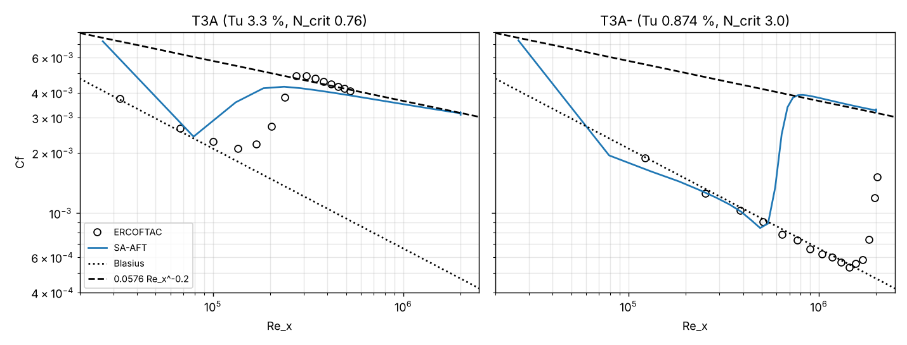
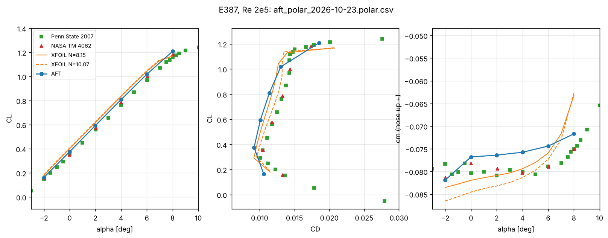
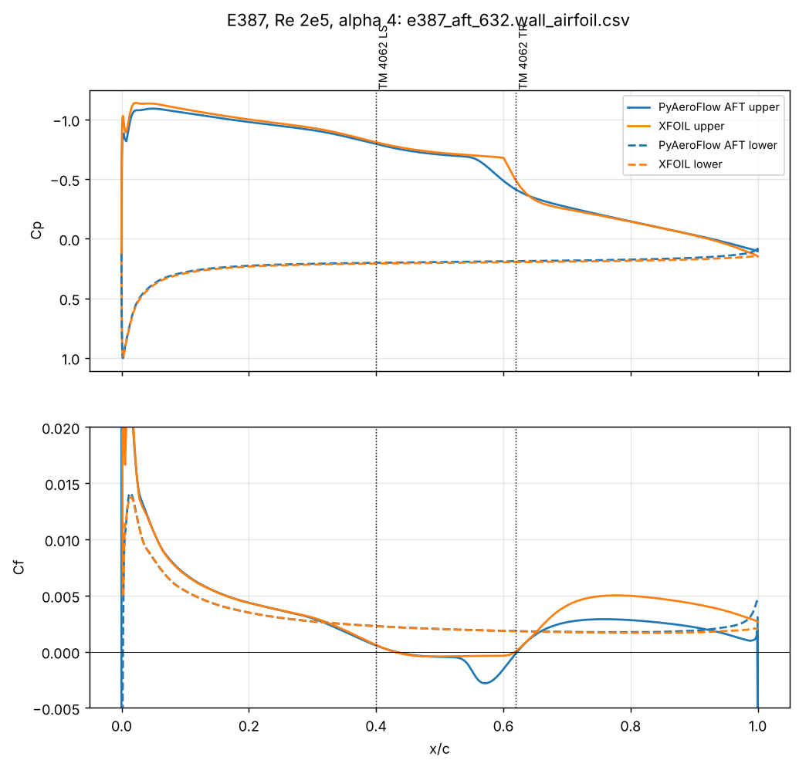
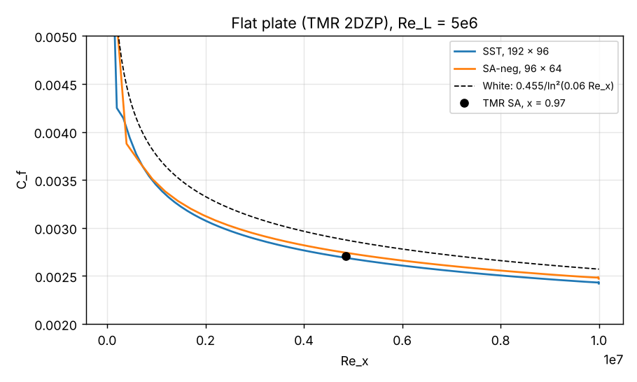
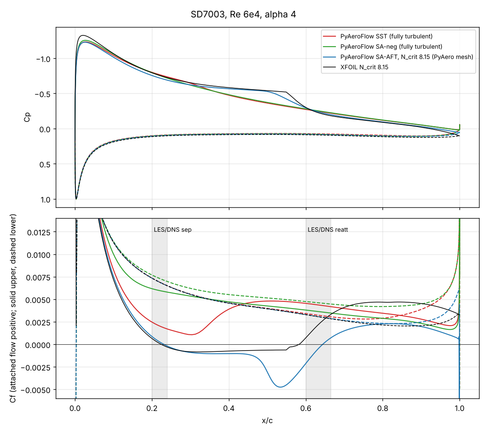
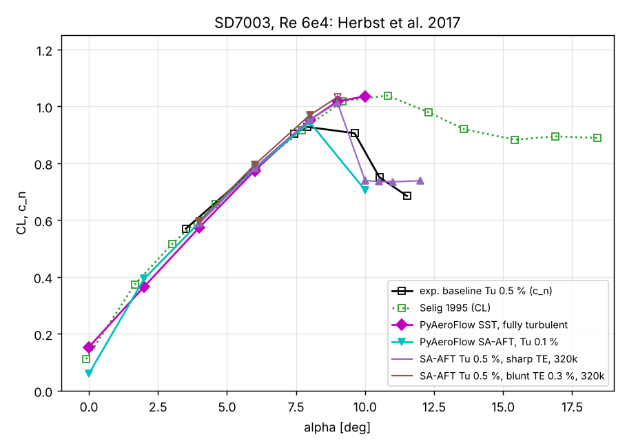
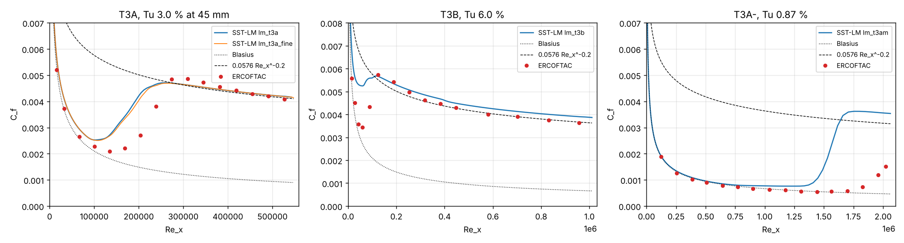

# Verification and validation

What the solver has been checked against, in the order of the stage plan
(`requirements.md`). *Verification* cases have an exact or manufactured
solution and test the discretisation; *validation* cases compare with
benchmark computations or experiments. Every figure is produced by one
example script from the repository root; the numbers are from the runs
behind the figures (iMac 2019, 3.6 GHz 8-core Intel Core i9, 32 GB,
October 2026, v0.7.1; section 7 from the 0.8 development).

Click a case to jump to its section; each section ends with a link back here.

| stage | case | type | reference | script |
|---|---|---|---|---|
| 1 | [convection–diffusion](#sec-1) | verification | manufactured exact solution | `examples/stage1_convection_diffusion.py` |
| 2 | [Poiseuille flow](#sec-2) | verification | exact profile | `examples/stage2_laminar.py --re1000` |
| 2 | [lid-driven cavity](#sec-2) | validation | Ghia, Ghia & Shin 1982 | same |
| 3 | [inviscid cylinder](#sec-3) | verification | potential flow | `examples/stage3_benchmarks.py` |
| 3 | [laminar flat plate](#sec-3) | validation | Blasius | same |
| 3 | [DFG 2D-1 cylinder](#sec-3) | validation | Schäfer & Turek 1996 | same |
| 4 | [Taylor–Green vortex](#sec-4) | verification | exact decaying solution | `examples/stage4_unsteady.py --medium` |
| 4 | [DFG 2D-2 shedding](#sec-4) | validation | Schäfer & Turek 1996 | same |
| 5 | [turbulent flat plate](#sec-5) | validation | NASA TMR, SA | `examples/stage5_rans.py` |
| 6 | [NACA 0012, Re 6·10⁶](#sec-6) | validation | Ladson 1988, Gregory & O'Reilly 1970, NASA TMR | `examples/stage6_pyaero_validation.py` |
| 7 (0.8) | [BCM transition, flat plate](#sec-7-plate) | verification/validation | Blasius, ERCOFTAC T3A | `tests/verification/test_rans_plate.py`, `pyaeroflow run examples/cases/flat_plate_transition.toml` |
| 7 (0.8) | [BCM transition, Eppler 387](#sec-7-e387) | validation | McGhee, Walker & Millard 1988 (NASA TM 4062) | `pyaeroflow polar examples/cases/e387_transition.toml --alpha 4 6 8 2 0 -2` |
| L3 (0.9) | [SA-AFT: flat plate, T3A, E387](#sec-8) | verification/validation | e^N estimate, ERCOFTAC T3A, NASA TM 4062, Penn State 2007, XFOIL | `tests/verification/test_rans_plate.py::test_aft_transition_on_the_plate`, `pyaeroflow polar examples/cases/e387_aft.toml --alpha -2 0 2 4 6 8` |
| L2 (0.9) | [k-ω SST: flat plate, SD7003](#sec-9) | verification/validation | NASA TMR SST, LES/DNS, XFOIL, SA-AFT, Herbst et al. 2017, Selig et al. 1995 | `tests/verification/test_rans_plate.py::test_sst_turbulent_plate`, `pyaeroflow run examples/cases/sst_sd7003.toml` |
| L3 (0.9) | [SST-LM γ-Re_θ: T3A, T3B, T3A−, SD7003](#sec-10) | validation | ERCOFTAC T3 (Roach & Brierley), LES/DNS, SA-AFT | `pyaeroflow run examples/cases/lm_t3a.toml` (mesh: `examples/cases/make_plate_lm.py`), `pyaeroflow run examples/cases/lm_sd7003.toml` |

The figures are committed under `docs/figures/`; `examples/output/` (where
the scripts write) is not tracked.

## 1. Order of accuracy: convection–diffusion

div(a u − ν ∇u) = 0 on the unit square with a = (1, 0.5), ν = 0.25 and the
exact solution u = exp(a · (x − (1, 1)) / ν) as Dirichlet data, on perturbed
meshes of all four cell types, four refinement levels each. The RMS error
falls with second order on every type; the last refinement step gives
orders 2.08 (quadrilaterals), 1.94 (triangles), 1.91 (polygons), 2.11
(mixed). The residual drops eleven orders in 21–28 pseudo-time iterations.

[↑ back to table](#stage-table)

## 2. Laminar flow: Poiseuille and lid-driven cavity

Plane Poiseuille flow on 2048 perturbed triangles: RMS error of u against
the exact parabola 2.1·10⁻⁴ (profile at the right of the figure).

Lid-driven cavity against Ghia, Ghia & Shin (1982), centre-line profiles:

| Re | mesh | iterations | max \|u − Ghia\| | max \|v − Ghia\| |
|---|---|---|---|---|
| 100 | 64 × 64 | 22 | 0.0038 | 0.0076 |
| 1000 | 128 × 128 | 59 | 0.0055 | 0.0168 |

[↑ back to table](#stage-table)

## 3. Inviscid cylinder, Blasius plate, DFG 2D-1

**Inviscid cylinder (Euler mode)** against potential flow, O-grids of
64 × 32 and 128 × 48 cells: max |C_p − exact| 0.043 and 0.016, drag
coefficient 0.0176 and 0.0031 (exact 0), lift 10⁻⁹.

**Laminar flat plate**, Re_L = 10⁵, 12 800 cells: C_f within 0.7–0.8 % of
Blasius for 0.2 < x < 0.9; the velocity profile at x = 0.5 deviates from
f′(η) by at most 0.006.

**DFG 2D-1** (cylinder in a channel, Re = 20, Schäfer & Turek 1996;
reference c_D 5.5795, c_L 0.01062, Δp 0.11752):

| mesh | cells | c_D | c_L | Δp | iterations |
|---|---|---|---|---|---|
| quad | 1 480 | 5.5153 (−1.15 %) | 0.01014 | 0.11175 (−4.9 %) | 18 |
| quad | 4 434 | 5.5425 (−0.66 %) | 0.01195 | 0.11524 (−1.9 %) | 17 |
| quad | 13 087 | 5.5644 (−0.27 %) | 0.01032 | 0.11690 (−0.5 %) | 17 |
| triangles | 8 868 | 5.5541 (−0.45 %) | 0.01050 | 0.11564 (−1.6 %) | 33 |

[↑ back to table](#stage-table)

## 4. Unsteady: Taylor–Green vortex and DFG 2D-2 shedding

**Taylor–Green vortex** (32 × 32 cells, ν = 0.05, t = 1), temporal order
of the dual-time scheme against a reference run with Δt = 0.0125:

| scheme | Δt = 0.2, 0.1, 0.05 | orders |
|---|---|---|
| BDF2 | 2.10·10⁻⁴, 5.18·10⁻⁵, 1.23·10⁻⁵ | 2.02, 2.08 |
| BDF1 | 7.21·10⁻⁴, 3.63·10⁻⁴, 1.82·10⁻⁴ | 0.99, 1.00 |

Three inner Newton–Krylov iterations per time step reach the three-order
inner drop.

**DFG 2D-2** (Re = 100, periodic shedding, Schäfer & Turek 1996; reference
St 0.295–0.305, c_D,max 3.22–3.24, c_L,max 0.99–1.01, Δp 2.46–2.50):

| mesh, Δt | St | c_D,max | c_L,max | Δp |
|---|---|---|---|---|
| 1.5k cells, 0.02 (default) | 0.244 | 3.13 | 0.82 | 2.31 |
| 4.4k cells, 0.01 (`--medium`, figure) | 0.278 (−7 %) | 3.199 (−1 %) | 1.059 (+5 %) | 2.439 (−1.5 %) |

The coarse mesh resolves the wake poorly and the shedding frequency and
amplitude come out low; the medium mesh is within the spread the DFG
participants reported. Both are deliberately small cases (two and ten
minutes); three inner Newton–Krylov iterations per step in both.

[↑ back to table](#stage-table)

## 5. Turbulent flat plate (SA-neg) against NASA TMR

The TMR "2DZP" flat plate, Re_L = 5·10⁶, fully turbulent, SA-neg,
against the TMR SA values (C_f at x = 0.97: 0.0027055, C_D: 0.0028562):

| mesh | cells | C_f(0.97) | C_D | y⁺ max | iterations |
|---|---|---|---|---|---|
| 48 × 48 | 2 880 | 0.002747 (+1.5 %) | 0.002918 (+2.2 %) | 0.64 | 71 |
| 96 × 64 | 7 680 | 0.002742 (+1.3 %) | 0.002908 (+1.8 %) | 0.68 | 87 |

The law of the wall at x = 0.97 (right panel) follows u⁺ = y⁺ in the
sublayer and the log law with κ = 0.41, B = 5.0 up to y⁺ ≈ 10³.

[↑ back to table](#stage-table)

## 6. NACA 0012 at Re 6·10⁶

Fully turbulent SA-neg on two PyAero C-meshes (first cell 5·10⁻⁶ c,
tunnel 5 chords, outlet 25 chords, point-vortex farfield correction): 113
points per airfoil side (100k cells) and 472 (295k cells). Lift and drag
against Ladson's tripped measurements (NASA TM 4074, 80 and 120 grit) and
NASA TMR's CFL3D/SA values; C_p at 10° against Gregory & O'Reilly (NASA
R&M 3726, Re 2.88·10⁶).

| α | CL 472 | CL Ladson 80/120 | CD 472 | CD 113 | CD Ladson 80/120 | TMR CL / CD |
|---|---|---|---|---|---|---|
| 0° | 0.0000 | −0.007 / −0.012 | 0.00825 | 0.00828 | 0.00809 / 0.00807 | 0 / 0.00819 |
| 4° | 0.4448 | 0.427 / 0.428 | 0.00883 | 0.00893 | 0.00823 / 0.00876 | |
| 8° | 0.8771 | 0.856 / 0.862 | 0.01081 | 0.01116 | 0.01028 / 0.00989 | |
| 10° | 1.0827 | 1.059 / 1.067 | 0.01258 | 0.01317 | 0.01191 / 0.01166 | 1.0909 / 0.01231 |
| 12° | 1.2758 | 1.249 / 1.259 | 0.01516 | 0.01612 | 0.01321 / 0.01277 | |

Lift within 1–2 % of the experiment on both meshes (TMR's SA is +2.6 % at
10°); the drag needs the chordwise resolution: with 472 points per side it
is +0.7 % of TMR at 0° and +2.2 % at 10° (pressure drag +3 %, viscous
+2 %). The farfield distance has been ruled out as a drag item with a
25-chord tunnel (`pyaero.md`, section 8). The remaining gap to Ladson at
12° is shared with the SA model and the fully turbulent assumption against
a tripped experiment.

The self-contained O-grid case (`examples/stage6_naca0012.py`, generated
mesh, 500-chord farfield, frozen limiter) reproduces the same lift (1.076
at 10° on 256 × 128) and serves the test suite; its drag at 0° is 13 %
high for the same reason as the 113-point PyAero mesh.

[↑ back to table](#stage-table)

## 7. BCM transition: flat plate and Eppler 387

### Flat plate

The SA-noft2-BCM model (`physics.transition.model = "bcm"`, section 7.1 of
`docs/pyaero.md`) on the TMR plate domain at Re_L = 5·10⁵, laminar
freestream ν̃/ν = 0.1 (`tests/verification/test_rans_plate.py`,
`examples/cases/flat_plate_transition.toml`):

| Tu | mesh | result |
|---|---|---|
| 0.1 % | 48 × 48 | laminar over the whole plate: C_f within 5 % of Blasius for 2.5·10⁵ ≤ Re_x ≤ 9.5·10⁵ |
| 3.3 % (ERCOFTAC T3A) | 96 × 64 | laminar at Re_x = 0.75·10⁵ (C_f −4 % vs Blasius), transition at Re_x = 1.2·10⁵ (boundary-layer ν_t/ν first above 1 at x = 0.236), turbulent from Re_x = 2.5·10⁵ on: C_f = 0.00433 / 0.00355 at Re_x = 2.5·10⁵ / 9.5·10⁵ against 0.00480 / 0.00367 from the 0.0576 Re_x^−0.2 correlation |

In the T3A experiment C_f leaves the laminar curve at Re_x ≈ 1.3·10⁵ and
reaches the turbulent one near 3·10⁵, which the model reproduces with the
2020 correlation constants. One property to know: the intermittency feeds
back on itself through ν_t (the T₂ term), so the discrete problem can have
more than one steady state. On the 48-cell plate at Tu 3.3 % the converged
transition location depends on the start-up path (Re_x = 0.75·10⁵ or
1.2·10⁵ depending on the Jacobian used in the pseudo-time phase); on the
96-cell plate it does not. Resolve the laminar part of the boundary layer
(as PyAero's y⁺ ≈ 1 meshes do) and compare two start-ups when a transition
location matters.

[↑ back to table](#stage-table)

### Eppler 387 at Re 2·10⁵, Tu 0.1 %

`examples/cases/e387_transition.toml` on PyAero's C-mesh
`examples/meshes/e387_pyaero_y1.su2` (209k quads, first cell 2·10⁻⁴ c,
farfield 5 c above and below, point-vortex correction), run with
`pyaeroflow polar`: α = 4° from freestream, the other angles restarted from
the neighbouring one. Reference: Langley LTPT, McGhee, Walker & Millard
(1988), NASA TM 4062: c_l, c_d (wake rake) and c_m about c/4 from fig. 17(c)
(tunnel-wall corrections applied; the angles are the corrected ones),
turbulence level 0.06–0.18 % (the case uses 0.1 %), and the oil-flow
laminar separation (LS) and turbulent reattachment (TR) of table III. The
measurements give no transition location. c_m is nose-up positive, i.e. the
solver's C_M with the opposite sign.

| α | C_L | ref. | C_D | ref. | c_m | ref. | ν_t/ν > 1 at x | oil flow LS / TR |
|---|---|---|---|---|---|---|---|---|
| 0 | 0.3805 | 0.352 | 0.00996 | 0.0105 | −0.0796 | −0.0782 | 0.669 | 0.48 / 0.74 |
| 2 | 0.5956 | 0.574 | 0.01118 | 0.0118 | −0.0787 | −0.0794 | 0.609 | 0.43 / 0.67 |
| 4 | 0.8075 | 0.785 | 0.01293 | 0.0133 | −0.0778 | −0.0803 | 0.555 | 0.40 / 0.62 |
| 6 | 1.0136 | 0.999 | 0.01509 | 0.0144 | −0.0760 | −0.0790 | 0.497 | 0.37 / 0.55 |
| −2 | 0.173–0.178 \* | 0.156 | 0.0114–0.0125 \* | 0.0133 | – | −0.0814 | 0.58, lower 0.15 \* | 0.53 / 0.80 |
| 8 | 1.10–1.20 \* | 1.182 | 0.019–0.035 \* | 0.0174 | – | −0.0751 | 0.04 \* | natural transition at 0.32 |

\* not converged in 400 iterations; ranges over iterations 150–400, the
location from the last iteration. The reference angles are −1.99, 0.01,
2.04, 3.99, 6.04 and 8.03°; the difference to the computed angles (at most
0.04°, about 0.004 in C_L) is not removed.

For the converged angles C_L is 0.015–0.028 above the measurement (lift
slope 0.107 against 0.109 per degree between 0° and 4°), C_D is within
5.3 % and |c_m| within 3.8 %. The location where ν_t/ν first exceeds 1 lies
0.05–0.07 c upstream of the measured reattachment at every angle. At 4° the
wall C_f changes sign at x = 0.401 (laminar separation, measured 0.40) and
at x = 0.686 (reattachment, measured 0.62). This is one grid and one
farfield distance; neither was varied.

At α = −2° and 8° the iteration does not converge: the transition location
keeps moving and the forces drift slowly (8°: C_D 0.019–0.035; −2°: a
lower-surface transition appears at x = 0.15). Whether the discrete problem
has no stable steady state there, or the linearisation with frozen
intermittency (CHANGELOG 0.8) cannot reach it, is open.

With SA-AFT2019b (`physics.transition.model = "aft"`, §8 and the E387 case
`examples/cases/e387_aft.toml`) the converged α = 4° solution (632 iterations
after a restart) has LS 0.430 and TR 0.622, against 0.428 and 0.619 from
XFOIL at N_crit 8.15 and 0.40 / 0.62 from the oil flow. C_L = 0.809 lies
0.023 above the Langley measurement and 0.026 below XFOIL. C_D = 0.0114 lies
14 % below the Langley value, the same drag gap as the polar at α = 0–6°.
The Penn State measurements of Somers & Maughmer (2007) at Tu ≈ 0.045 %
give C_L = 0.762 and C_D = 0.0131 at 4° and agree with the oil flow to 0.03 c.
Known discrepancy, not yet explained: the drag is 9–14 % below both
experiments at α = −2 to 6°. Candidates, not tested: the thickened trailing
edge of the model (0.5 % c, sharp in the mesh) and the 5-chord farfield with
the point-vortex correction.

[↑ back to table](#stage-table)

## 8. SA-AFT2019b transition: flat plate, T3A, Eppler 387

`tests/verification/test_rans_plate.py::test_aft_transition_on_the_plate`.
TMR plate domain, 48 × 12 × 48 cells, Re = 10⁶ per unit length, freestream
ν̃/ν = 0.1, N_crit given directly. Reference: the e^N estimate for a Blasius
layer (H12 = 2.59: Re_θ0 = 237 and dñ/dRe_θ = 0.0103 from the model's own
correlations, Re_θ = 0.664 √Re_x), which is what the ñ equation integrates.

| N_crit | e^N estimate Re_x | Onset Re_x (C_f leaves Blasius) | Iterations to machine zero |
| --- | --- | --- | --- |
| 3 | 6.3·10⁵ | about 6·10⁵ | 827 (4 min) |
| 5 | 1.2·10⁶ | about 1.3·10⁶ | 1279 (3 min) |

The laminar C_f is 5–20 % below Blasius on this coarse mesh (most near the
leading edge), the turbulent C_f 0–12 % above the 0.0576 Re_x^−0.2
correlation. γ
is 1/c_3 = 0.02 in the laminar layer, as the γ̃ equation predicts. Unlike
BCM, the Newton–Krylov iteration converges to machine zero with the exact
JVP (nothing frozen); the F_crit step and the min/max of F_onset did not
stall it here. The upstream-moving transition that Coder reports (thousands
of iterations) was not seen: the pseudo-time CFL ramp reaches the Newton
phase in a few hundred iterations.

### ERCOFTAC T3A and T3A−

TMR plate domain at Re = 10⁶ per metre, ν̃/ν = 0.1 in the freestream,
N_crit from the Mack/Drela relation for the case's Tu (T3A 0.033 → N_crit
0.76, T3A− 0.00874 → 3.0). First meshes: plate length 2 m (Re_x up to
2·10⁶), 96 × 64 cells, cells 5 cm long at the leading edge; the T3A onset
needs a finer streamwise mesh, so T3A was repeated on 0.6 m with 150 × 48
cells (4 mm long, Re_x = 4·10³ per cell). All runs converge to machine zero
with the exact JVP (T3A 687, T3A− 769, T3A fine 400 iterations).

| case | Tu | N_crit | ν_t/ν > 1 at Re_x | C_f minimum / maximum at Re_x |
|---|---|---|---|---|
| T3A, 96 cells | 3.3 % | 0.76 | 1.3·10⁵ | 0.8·10⁵ / 2.4·10⁵ |
| T3A, 150 cells (4 mm) | 3.3 % | 0.76 | 1.4·10⁵ | 1.3·10⁵ / 2.3·10⁵ |
| T3A− | 0.874 % | 3.0 | 6.4·10⁵ | 4.9·10⁵ / 8.2·10⁵ |

Reference: the ERCOFTAC T3 data (Roach & Brierley 1992, Rolls-Royce
tables of C_f against Re_x, case 020 of the ERCOFTAC Classic Collection).
The experiment's C_f minimum, its measure of the onset, lies at
Re_x = 1.35·10⁵ for T3A and at 1.44·10⁶ for T3A− (Re_θ = 819); on T3A− the
layer is still transitional at the last station (Re_x = 2.0·10⁶, C_f 0.0015,
H = 1.9).

**T3A.** On the coarse mesh (three cells before Re_x = 1.3·10⁵) the C_f
rise started one cell early and the laminar C_f was 27–80 % off, so that
result was resolution-limited. On the fine mesh the laminar C_f follows the
measurement to 3–8 % up to Re_x = 1.35·10⁵ (it sits on Blasius, as in the
experiment), the C_f minimum is at 1.3·10⁵ (measured 1.35·10⁵) and ν_t/ν
first exceeds 1 at 1.4·10⁵. Two differences remain. The transition is too
abrupt: C_f rises from 0.0019 to 0.0038 between Re_x = 1.3·10⁵ and 1.7·10⁵
and is 1.6–1.7 times the measurement at 1.7–2·10⁵ (the experiment rises
gradually and reaches the turbulent level at 2.7·10⁵, a transition length
of about 1.4·10⁵ against 4·10⁴). And the turbulent C_f is 4–13 % below the
measurement (0.0043 at the maximum against 0.0049; 0.0039 against 0.0041 at
5.3·10⁵). The agreement of the onset is not a strong test: with Re_θ0 = 237
the model cannot amplify before Re_x = (237/0.664)² = 1.3·10⁵, and N_crit =
0.76 only moves the onset a short way past it.

**T3A−.** The laminar C_f agrees with the measurement to 1–11 % for
Re_x ≤ 5·10⁵. The model then transitions at Re_x = 5–6·10⁵ (C_f minimum
4.9·10⁵, ν_t/ν > 1 at 6.4·10⁵) against 1.44·10⁶ in the experiment, about
three times too early, and the C_f in the transition and turbulent region
is 3–6 times the measured value because the experiment is still laminar
(0.00053 at 1.44·10⁶). The e^N relation is the cause, not the solver:
Re_θ0 = 237 plus N_crit/0.0103 gives the same 6.4·10⁵ as the estimate in
the table above. The decay of Tu along the plate (0.874 % at the first
station, 0.5 % from 1.4·10⁶ on) is not modelled and raises N_crit when
included, but with the local value (N_crit 3.9–4.4) the same estimate gives
8.5·10⁵–1.0·10⁶, still short of the measured onset. The Mack/Drela relation
is fitted for Tu below about 1 %, which T3A− is not far from.
T3B (Tu 6 %, bypass) is out of reach for AFT by construction: the layer
cannot amplify before Re_θ0 = 237, i.e. Re_x = 1.3·10⁵, which is the T3A
onset itself, so the case was not run.

### Eppler 387, Re 2·10⁵, N_crit 8.15

`examples/cases/e387_aft.toml` on the mesh of §7 (209k quads), polar by
`pyaeroflow polar`. N_crit 8.15 is Tu 0.1 % (Mack/Drela), the level of the
BCM case. References: NASA TM 4062 (§7), Somers & Maughmer (2007), Penn State
tunnel, Tu ≈ 0.045 %, and XFOIL 6.99 on the mesh contour (repanelled to 260
panels) at N_crit 8.15 and 10.07 (the Mack/Drela value for 0.045 %).

| α | C_L | C_D | ΔC_L Penn State / TM 4062 / XFOIL 8.15 | ΔC_D Penn State / TM 4062 / XFOIL 8.15 |
|---|---|---|---|---|
| −2 \* | 0.163 | 0.0106 | +0.011 / – / −0.016 | −22 % / – / −8 % |
| 0 | 0.376 | 0.0092 | +0.021 / +0.025 / −0.025 | −12 % / −12 % / −4 % |
| 2 | 0.594 | 0.0101 | +0.035 / +0.024 / −0.025 | −14 % / −14 % / −6 % |
| 4 | 0.809 | 0.0114 | +0.047 / +0.023 / −0.027 | −13 % / −14 % / −4 % |
| 6 | 1.018 | 0.0130 | +0.050 / +0.024 / −0.025 | −9 % / −9 % / +3 % |
| 8 \* | 1.208 | 0.0185 | +0.052 / +0.029 / +0.039 | +24 % / +7 % / −10 % |

\* not converged in 2000 iterations. The α = 4° run is converged (632
iterations from a restart at iteration 400, residuals 10⁻⁹ to 10⁻¹², C_L
constant to five digits); the polar CSV flags it 0 because the iteration
counter and residual reference restarted with the file.

Lift is 0.01–0.05 above Penn State and 0.02–0.03 above TM 4062, and 0.025
below XFOIL, so AFT is the closest to the measurements (XFOIL is 0.07 above
Penn State at 4°). Drag is 9–14 % below both experiments from 0° to 6° and
4–6 % below XFOIL from 0° to 4°. At α = 4° the bubble is where XFOIL
and the oil flow put it: separation at x = 0.430, reattachment at 0.622
(XFOIL 0.428 / 0.619, oil flow 0.40 / 0.62, Penn State within 0.03 c), while
ν_t/ν first exceeds 1 at 0.537, 0.06 upstream of XFOIL's transition at 0.600.

Two features are not yet explained. The C_f minimum in the bubble is deeper
(−0.0027 at x = 0.57 against about 0 for XFOIL) and the turbulent C_f
after reattachment is 40 % lower (0.0030 against 0.0050 at x = 0.77); the same
pattern appears on the SD7003 at α = 4° (50 % lower than XFOIL). The drag gap to the experiments, which
may come from the thickened trailing edge of the model (0.5 % c, sharp in
the mesh) or the 5-chord farfield with the vortex correction; neither was
varied. α = −2° and 8° do not converge: the transition location keeps
moving, as with BCM in §7, so the lift and drag there are not reference
values.

## 9. k-ω SST (SST-2003m)

### Flat plate

TMR 2DZP domain, Re_L = 5·10⁶, TMR SST freestream (k = 9·10⁻⁹ a² at
M = 0.2, i.e. k = 2.25·10⁻⁷ U², ω = 125 U/L, μ_t/μ = 0.009), against the
TMR SST values (`flatplate_sst.html`, SST-Vm, finest grid 545 × 385, mean of
CFL3D and FUN3D: C_f(0.97) = 0.0026907, C_D = 0.0028488; on this plate
SST-Vm and SST-2003m coincide, vorticity = strain rate):

| mesh | cells | C_f(0.97) | C_D | y⁺ max | iterations |
|---|---|---|---|---|---|
| 48 × 48 | 2 880 | 0.002684 (−0.2 %) | 0.002869 (+0.7 %) | 0.64 | 153 |
| 96 × 64 | 7 680 | 0.002684 (−0.2 %) | 0.002866 (+0.6 %) | 0.68 | 158 |
| 192 × 96 | 23 040 | 0.002689 (−0.1 %) | 0.002864 (+0.5 %) | 0.74 | 181 |

The solution is grid-converged. It depends on the wall value of ω, which a
cell-centred scheme does not resolve (ω ~ 1/y²): with d₁ = the wall-cell
height (the default, SU2's first mesh spacing on the same points) C_f(0.97)
is 0.002689 (TMR 0.0026907), with d₁ = the centroid distance (ω_wall four
times larger) 0.002630 at 192 × 96, about 2 % lower at every grid level: the
TMR value confirms the wall-cell height.

### SD7003, Re 6·10⁴, α = 4°

O-grid (38 880 cells, 324 surface nodes, first spacing 1.2·10⁻⁴ c, farfield
100 c with the point-vortex correction) around the SD7003 contour of the
PyAero mesh of the AFT runs; SST freestream Tu = 0.1 %, ν_t/ν = 1; SA-neg
with ν̃/ν = 3. SA-AFT values from the run on the PyAero C-mesh
(`examples/cases/aft_sd7003.toml`), XFOIL 6.99 with N_crit 8.15.

| | C_L | C_D | upper surface |
|---|---|---|---|
| SST | 0.575 | 0.0190 | laminar-like to x ≈ 0.3 (C_f minimum 0.0011), no separation, turbulent behind |
| SA-neg (fully turbulent) | 0.583 | 0.0200 | turbulent from the leading edge |
| SA-AFT, N_crit 8.15 | 0.592 | 0.0184 | bubble 0.231–0.644 |
| XFOIL, N_crit 8.15 | 0.620 | 0.0188 | bubble 0.224–0.582, transition 0.550 |
| LES/DNS/FR | 0.59–0.60 | 0.0196–0.0221 | bubble 0.20–0.24 to 0.60–0.665 |

SST converges in 127 iterations (90 Newton–Krylov, 7 orders). With the low
freestream k its production stays small in the laminar leading-edge flow
and the boundary layer becomes turbulent around x = 0.3 without
separating, so there is no laminar bubble and no pressure plateau; the
lower side is turbulent throughout (C_f 0.004 at x = 0.5, XFOIL's laminar
side 0.003). C_L is 3 % below SA-AFT and 7 % below XFOIL. The drag is
close to XFOIL and AFT only because the turbulent lower side compensates
the missing bubble: SST without a transition model is a fully turbulent
baseline at this Reynolds number, not a predictor of the laminar bubble
(that needs γ-Re_θ on SST, L3 step 4).

### SD7003, Re 6·10⁴: polar and bubble at Tu 0.5 % (Herbst et al. 2017)

Herbst, Kähler & Hain (2017) measured the SD7003 at Re 6·10⁴ in the
Atmospheric Wind Tunnel Munich at Tu = 0.5 %: surface pressure on taps up
to x/c = 0.74 (suction side) and PIV of the separation bubble at α = 4° and
8°. SA-AFT, Tu 0.5 % (N_crit 4.29, the Mack/Drela value), is the case
`aft_sd7003.toml` with `turbulence_intensity = 0.005`, on a 320 000-cell
C-mesh, run with a sharp trailing edge and with a blunt one (0.3 % chord).
Polar: `pyaeroflow polar aft_sd7003.toml --alpha 4 6 8 9` with that setting.

| α | C_L sharp TE | C_L blunt TE | C_D sharp TE | C_D blunt TE |
|---|---|---|---|---|
| 4 | 0.589 | 0.597 | 0.0176 | 0.0178 |
| 6 | 0.783 | 0.795 | 0.0218 | 0.0220 |
| 8 | 0.954 | 0.970 | 0.0303 | 0.0305 |
| 9 | 1.013 | 1.033 (not converged) | 0.0390 | 0.0388 |

The blunt trailing edge raises C_L by 1.4–1.7 % and C_D by about 0.0002; it
does not change the bubble. Both meshes stall between 8° and 9°; the
sharp-TE run at 10° is fully stalled (C_L 0.74, flat to 12°).

| α | | x_s | x_tr | x_r |
|---|---|---|---|---|
| 4 | Herbst (PIV, Tu 0.5 %) | 0.25 | 0.58 | 0.73 |
| 4 | TU-BS (PIV, Tu 0.1 %, Ol et al. 2005) | 0.30 | 0.53 | 0.62 |
| 4 | SA-AFT, sharp / blunt TE | 0.251 / 0.251 | 0.46 / 0.46 | 0.593 / 0.590 |
| 8 | Herbst (PIV) | 0.14 | 0.19 | 0.27 |
| 8 | LES (as quoted by Ruiz & D'Ambrosio 2022) | 0.04 | 0.18 | 0.28 |
| 8 | SA-AFT, sharp / blunt TE | 0.033 / 0.032 | 0.11 / 0.11 | 0.225 / 0.218 |

Separation and reattachment are the C_f zero crossings on the upper
surface; transition is the first point with ν_t/ν > 1, and Herbst's is a
Reynolds-stress threshold, so only the order of magnitude is comparable. At
α = 4° the separation point agrees with Herbst and reattachment lies
between the LES/DNS band (0.60–0.665) and TU-BS. Herbst's bubble is the
longest of all the references. At α = 8° the model reproduces the LES
bubble, which starts 0.1 upstream of the one Herbst reads by eye from the
raw images.

How to read the polar. Selig's curve is balance C_L. Herbst's is the normal
force c_n integrated from the taps (to x/c 0.74 and 0.68, drag neglected);
integrating the computed SST pressure over the same tap range gives about
8 % less lift, and Herbst's α values sit 0.2–0.5° below the nominal ones.
The computed lift follows Selig to within about 3 % up to α = 9°, the
fully turbulent SST polar included; that agreement is partly fortuitous,
since SST has no bubble (see above). Against Herbst the difference in the
linear range is about the size of the tap truncation and the angle shift.
The stall angle differs more clearly: Herbst's baseline falls from
c_n 0.91 at 10.1° to 0.75 at nominal 11°, Selig's peaks near 10.8°, and
SA-AFT stalls between 8° and 10°. Herbst also measured Tu = 10 % behind
turbulence grids (integral scale 0.5c, c and 2c): no bubble up to 18° and no
stall, which a steady RANS model cannot represent and which is not used as
a reference here.

[↑ back to table](#stage-table)

## 10. Langtry–Menter γ-Re_θ on SST (SST-2003m-LM2009)

Model and numerics: `docs/configuration.md`, section "Langtry–Menter
γ-Re_θ" (TMR "langtrymenter_4eqn" and SU2's `MENTER_LANGTRY`
implementation, local Tu and dU/ds, nothing frozen in the Newton–Krylov
JVP).

### ERCOFTAC T3A, T3B and T3A−

Plate 1.6 m with the inlet 0.1 m upstream of the leading edge, symmetry
before the plate, farfield top at 0.5 m, Re per metre of the experiment
(T3A 3.44·10⁵, T3B 6.40·10⁵, T3A− 1.31·10⁶ with U = 1), first cell
10⁻⁵ m. Meshes from `examples/cases/make_plate_lm.py`: 120 × 56 cells
(2 mm at the leading edge, growth 1.026 along the plate) and 240 × 80 for
the T3A grid check. The inlet Tu and ν_t/ν are fitted to the measured
freestream decay with the SST decay law k ∝ (1 + β₂ω₀(x − x₀)/U)^(−β*/β₂):

| case | inlet Tu | inlet ν_t/ν | Tu at the first station, computed / measured |
|---|---|---|---|
| T3A | 4.49 % | 12.2 | 3.10 / 3.04 % (x = 45 mm); 1.15 / 1.10 % at 1.495 m |
| T3B | 7.41 % | 100.5 | fitted to 5.95 % (25 mm) and 2.4 % (1.495 m) |
| T3A− | 1.05 % | 7.8 | fitted to 0.874 % (95 mm) and 0.47 % (1.55 m) |

The fitted ν_t/ν agree with the values used by Langtry & Menter (12, 100,
8.7). All runs converge (8.3–9.8 orders of the per-variable measure; T3A
338 iterations / 2.4 min, T3A 240 × 80 455 / 10 min, T3B 200 / 1.3 min,
T3A− 368 / 2 min on 4 cores).

| case | C_f minimum at Re_x, LM / exp. | halfway to turbulent C_f at Re_x | laminar C_f vs exp. | turbulent C_f vs exp. |
|---|---|---|---|---|
| T3A, 120 × 56 | 1.02·10⁵ / 1.35·10⁵ | 1.88·10⁵ (exp. ≈ 2.2·10⁵) | +10–11 % | −5 to +3 % |
| T3A, 240 × 80 | 1.08·10⁵ / 1.35·10⁵ | 1.92·10⁵ | +11–12 % | −5 to +3 % |
| T3B | bypass at the leading edge / 5.9·10⁴ | – | – | −1 to +7 % |
| T3A− | rise from 1.35·10⁶ / 1.44·10⁶ | 1.57·10⁶ (exp. ≈ 2.0·10⁶) | +2–9 % to 7.7·10⁵, +18–35 % to 1.3·10⁶ | – (exp. still transitional) |

**T3A.** The result is grid independent (the two meshes differ by 6 % in
the onset Re_x and by < 1 % downstream). The onset is about 20–25 % early
and the laminar C_f 11 % above the measurement: eddy viscosity from the
3 % freestream turbulence reaches into the laminar layer (γ ≈ 1/c_e2 = 0.02
there, so P_k is suppressed, but k diffuses in), and Re_θt at the wall lags
the edge value (152–181 against 159–228 for x = 0.05–0.4 m), so the onset
follows the lower Tu-correlation value carried from the leading edge.
Transition length and the turbulent C_f (within 5 %) agree. A second-order
convection of the turbulence variables did not converge (ω residual stalls)
and was not pursued.

**T3B.** Bypass transition right behind the leading edge, as in the
experiment (C_f minimum at Re_x = 5.9·10⁴, already 0.0034 there); the C_f
between 1.5·10⁴ and 9·10⁴ is 23–53 % above the data, downstream within
7 % (slightly high, like the SST turbulent level on T3A).

**T3A−.** The decisive case for the low-Tu airfoil cases: LM puts the C_f
rise at Re_x = 1.35·10⁶ against the measured minimum at 1.44·10⁶ (SA-AFT:
5–6·10⁵, three times too early, §8). The transition is too short: LM is
fully turbulent at 1.7·10⁶ (C_f 0.0036, 8 % above the turbulent
correlation) where the experiment is still transitional up to the last
station (0.0015 at 2.0·10⁶). The laminar C_f rises above Blasius from
9·10⁵ on (+18–35 %), the pre-transitional effect of the freestream k.

### SD7003, Re 6·10⁴, α = 4°

39k-cell O-grid (`analysis/sst/sd7003_ogrid.su2`), Tu 0.1 %, ν_t/ν 1 at
the farfield, first-order turbulence convection. After 1400 iterations the
residuals sit 2.6–3 orders down and C_L/C_D still drift slowly
(C_L 0.601, C_D 0.0207).

Result: the upper-side laminar boundary layer separates at x/c = 0.27, which
is close to LES/DNS (0.21–0.23). It **does not reattach**: C_f stays negative
up to the trailing edge, so there is an open laminar separation and no
transition. The cause is that the separated shear layer never triggers. Re_V
only just exceeds the γ_sep threshold 3.235 Re_θc (the ratio peaks at 1.09 at
x/c ≈ 0.7), so γ_sep ≤ 0.18 and k stays at its freestream level of about
1e-6. On this grid LM therefore predicts a laminar open separation, where
LES/DNS reattach at x/c 0.60–0.67. The fine-mesh case
`lm_sd7003.toml` (PyAero 320k mesh) is the actual test of whether this is
a grid-resolution effect.

[↑ back to table](#stage-table)

## References

- Ghia, U., Ghia, K. N., Shin, C. T. (1982): High-Re solutions for
  incompressible flow using the Navier–Stokes equations and a multigrid
  method. J. Comput. Phys. 48, 387–411.
- Schäfer, M., Turek, S. (1996): Benchmark computations of laminar flow
  around a cylinder. In: Flow Simulation with High-Performance Computers
  II, Vieweg, 547–566.
- Turbulence Modeling Resource (TMR, formerly hosted by NASA Langley), 2D
  zero-pressure-gradient flat plate and 2D NACA 0012 airfoil cases,
  https://tmbwg.github.io/turbmodels/ (source repository
  github.com/TMBWG/turbmodels).
- Ladson, C. L. (1988): Effects of independent variation of Mach and
  Reynolds numbers on the low-speed aerodynamic characteristics of the NACA
  0012 airfoil section. NASA TM 4074.
- Gregory, N., O'Reilly, C. L. (1970): Low-speed aerodynamic
  characteristics of NACA 0012 aerofoil section, including the effects of
  upper-surface roughness simulating hoar frost. NPL Aero Report 1308 /
  ARC R&M 3726.
- McGhee, R. J., Walker, B. S., Millard, B. F. (1988): Experimental results
  for the Eppler 387 airfoil at low Reynolds numbers in the Langley
  low-turbulence pressure tunnel. NASA TM 4062.
- Herbst, S. L., Kähler, C. J., Hain, R. (2017): Influence of large-scale
  free-stream turbulence on an SD7003 airfoil at low Reynolds numbers.
  AIAA paper, Universität der Bundeswehr München.
- Selig, M. S., Guglielmo, J. J., Broeren, A. P., Giguère, P. (1995):
  Summary of Low-Speed Airfoil Data, Vol. 1. SoarTech Publications.
- Langtry, R. B., Menter, F. R. (2009): Correlation-based transition
  modeling for unstructured parallelized computational fluid dynamics codes.
  AIAA J. 47(12), 2894–2906.
- Ol, M. V., McAuliffe, B. R., Hanff, E. S., Scholz, U., Kähler, C. J.
  (2005): Comparison of laminar separation bubble measurements on a low
  Reynolds number airfoil in three facilities. 35th AIAA Fluid Dynamics
  Conference.
- Somers, D. M., Maughmer, M. D. (2007): Theoretical and experimental
  results for the Eppler 387 airfoil at low Reynolds numbers in the Penn
  State low-speed, low-turbulence wind tunnel. RDECOM TR 07-D-32.
- Roach, P. E., Brierley, D. H. (1992): The influence of a turbulent
  free-stream on zero pressure gradient transitional boundary layer
  development, Part I: test cases T3A and T3B. In: Numerical Simulation of
  Unsteady Flows and Transition to Turbulence, Cambridge University Press.
  Data: ERCOFTAC Classic Collection, case 020.
