# Verification and validation

What the solver has been checked against, in the order of the stage plan
(`requirements.md`). *Verification* cases have an exact or manufactured
solution and test the discretisation; *validation* cases compare with
benchmark computations or experiments. Every figure is produced by one
example script from the repository root; the numbers are from the runs
behind the figures (iMac 2019, 3.6 GHz 8-core Intel Core i9, 32 GB, October
2026). Versions: sections 1 to 6 are from 0.7.1, section 7 from the 0.8
development (released in 0.9), sections 8 to 10 from 0.9, the LM polar in
section 10 from 1.0 and the positive-linearization measurement there from
1.1, section 18 from 1.7 and section 19 from the 1.8 development (sandbox, 4 cores, November 2026). The meshes are in `examples/meshes/` (`README.md` there), the case
files in `examples/cases/`.

Click a case to jump to its section; each section ends with a link back here.

| stage / step | case | type | reference | script |
|---|---|---|---|---|
| 1 | [convection–diffusion](#sec-1) | verification | manufactured exact solution | `examples/stage1_convection_diffusion.py` |
| 2 | [Poiseuille flow](#sec-2) | verification | exact profile | `examples/stage2_laminar.py --re1000` |
| 2 | [lid-driven cavity](#sec-2) | validation | Ghia, Ghia & Shin 1982 | same |
| 3 | [inviscid cylinder](#sec-3) | verification | potential flow | `examples/stage3_benchmarks.py` |
| 3 | [laminar flat plate](#sec-3) | validation | Blasius | same |
| 3 | [DFG 2D-1 cylinder](#sec-3) | validation | Schäfer & Turek 1996 | same |
| 4 | [Taylor–Green vortex](#sec-4) | verification | exact decaying solution | `examples/stage4_unsteady.py --medium` |
| 4 | [DFG 2D-2 shedding](#sec-4) | validation | Schäfer & Turek 1996 | same |
| 5 | [turbulent flat plate](#sec-5) | validation | NASA TMR, SA | `examples/stage5_rans.py` |
| 6 | [NACA 0012, Re 6·10⁶](#sec-6) | validation | Ladson 1988, Gregory & O'Reilly 1970, NASA TMR | `examples/stage6_pyaero_validation.py` |
| L3 step 1 (0.9) | [BCM transition, flat plate](#sec-7-plate) | verification/validation | Blasius, ERCOFTAC T3A | `tests/verification/test_rans_plate.py`, `pyaeroflow run examples/cases/flat_plate_transition.toml` |
| L3 step 1 (0.9) | [BCM transition, Eppler 387](#sec-7-e387) | validation | McGhee, Walker & Millard 1988 (NASA TM 4062) | `pyaeroflow polar examples/cases/e387_transition.toml --alpha 4 6 8 2 0 -2` |
| L3 step 2 (0.9) | [SA-AFT: flat plate, T3A, E387](#sec-8) | verification/validation | e^N estimate, ERCOFTAC T3A, NASA TM 4062, Penn State 2007, XFOIL | `tests/verification/test_rans_plate.py::test_aft_transition_on_the_plate`, `pyaeroflow polar examples/cases/e387_aft.toml --alpha -2 0 2 4 6 8` |
| L2 (0.9) | [k-ω SST: flat plate, SD7003](#sec-9) | verification/validation | NASA TMR SST, LES/DNS, XFOIL, SA-AFT, Herbst et al. 2017, Selig et al. 1995 | `tests/verification/test_rans_plate.py::test_sst_turbulent_plate`, `pyaeroflow run examples/cases/sst_sd7003.toml`, `sst_sd7003_ogrid.toml` |
| L3 step 4 (0.9) | [SST-LM γ-Re_θ: T3A, T3B, T3A−, SD7003](#sec-10) | validation | ERCOFTAC T3 (Roach & Brierley), LES/DNS, SA-AFT | `pyaeroflow run examples/cases/lm_t3a.toml` (mesh: `examples/cases/make_plate_lm.py`), `pyaeroflow run examples/cases/lm_sd7003.toml`, `pyaeroflow polar examples/cases/lm_sd7003_polar.toml --alpha 4 6 8 9 10 2 0` |
| – | [Known limits of the transition models](#sec-11) | summary | sections 8–10 | – |
| L1 C1 | [Compressible Euler: ramp, NACA 0012](#sec-12) | verification/validation | oblique-shock relations, Vassberg & Jameson 2010, Vassberg et al. 2011 | `python examples/l1_compressible.py [--fine]` |
| L1 C2 | [Compressible laminar: flat plate, NACA 0012 Re 5000](#sec-13) | verification/validation | compressible similarity solution, Swanson & Langer 2016 | `python examples/l1_laminar.py` |
| L1 C3 | [Compressible SA-neg: TMR flat plate M 0.2, NACA 0012 M 0.15](#sec-14) | verification/validation | NASA TMR (CFL3D, FUN3D) | `pyaeroflow run examples/cases/naca0012_sa_m015.toml` |
| L1 C4 | [Compressible SST: TMR flat plate M 0.2, NACA 0012 M 0.15](#sec-15) | verification/validation | NASA TMR SST (CFL3D) | `pyaeroflow run examples/cases/naca0012_sst_m015.toml` |
| IBL (1.7) | [Viscous panel method `pyaeroflow foil`: mfoil, E387, SD7003](#sec-18) | verification/validation | mfoil (corrected copy), NASA TM 4062, Penn State 2007, XFOIL | `python examples/ibl_validation.py` |
| V1 / V2 / V3 (1.8) | [Incompressible energy equation: cavity, heated plates (laminar, variable properties, turbulent), cylinder, channel, non-Boussinesq closed cavity](#sec-19) | verification/validation | de Vahl Davis 1983, Pohlhausen and Howarth–Levy–Lees similarity, Lange et al. 1998, Shah & London, Kays & Crawford, Le Quéré et al. 2005 | `pyaeroflow.cases.heat_transfer`, `tests/verification/test_heat_transfer.py`, `tests/unit/test_closed_domain.py` (case files: `examples/cases/` and the project folder `cases/variable_density_v1/`, `variable_density_v2/`, `closed_domain_v3/`) |

The figures are committed under `docs/figures/`; `examples/output/` (where
the scripts write) is not tracked.

## 1. Order of accuracy: convection–diffusion

div(a u − ν ∇u) = 0 on the unit square with a = (1, 0.5), ν = 0.25 and the
exact solution u = exp(a · (x − (1, 1)) / ν) as Dirichlet data, on perturbed
meshes of all four cell types, four refinement levels each. The RMS error
falls with second order on every type; the last refinement step gives
orders 2.08 (quadrilaterals), 1.94 (triangles), 1.91 (polygons), 2.11
(mixed). The residual drops eleven orders in 21–28 pseudo-time iterations.

[↑ back to table](#stage-table)

## 2. Laminar flow: Poiseuille and lid-driven cavity

Plane Poiseuille flow on 2048 perturbed triangles: RMS error of u against
the exact parabola 2.1·10⁻⁴ (profile at the right of the figure).

Lid-driven cavity against Ghia, Ghia & Shin (1982), centre-line profiles:

| Re | mesh | iterations | max \|u − Ghia\| | max \|v − Ghia\| |
|---|---|---|---|---|
| 100 | 64 × 64 | 22 | 0.0038 | 0.0076 |
| 1000 | 128 × 128 | 59 | 0.0055 | 0.0168 |

[↑ back to table](#stage-table)

## 3. Inviscid cylinder, Blasius plate, DFG 2D-1

**Inviscid cylinder (Euler mode)** against potential flow, O-grids of
64 × 32 and 128 × 48 cells: max |C_p − exact| 0.043 and 0.016, drag
coefficient 0.0176 and 0.0031 (exact 0), lift 10⁻⁹.

**Laminar flat plate**, Re_L = 10⁵, 12 800 cells: C_f within 0.7–0.8 % of
Blasius for 0.2 < x < 0.9; the velocity profile at x = 0.5 deviates from
f′(η) by at most 0.006.

**DFG 2D-1** (cylinder in a channel, Re = 20, Schäfer & Turek 1996;
reference c_D 5.5795, c_L 0.01062, Δp 0.11752):

| mesh | cells | c_D | c_L | Δp | iterations |
|---|---|---|---|---|---|
| quad | 1 480 | 5.5153 (−1.15 %) | 0.01014 | 0.11175 (−4.9 %) | 18 |
| quad | 4 434 | 5.5425 (−0.66 %) | 0.01195 | 0.11524 (−1.9 %) | 17 |
| quad | 13 087 | 5.5644 (−0.27 %) | 0.01032 | 0.11690 (−0.5 %) | 17 |
| triangles | 8 868 | 5.5541 (−0.45 %) | 0.01050 | 0.11564 (−1.6 %) | 33 |

[↑ back to table](#stage-table)

## 4. Unsteady: Taylor–Green vortex and DFG 2D-2 shedding

**Taylor–Green vortex** (32 × 32 cells, ν = 0.05, t = 1), temporal order
of the dual-time scheme against a reference run with Δt = 0.0125:

| scheme | Δt = 0.2, 0.1, 0.05 | orders |
|---|---|---|
| BDF2 | 2.10·10⁻⁴, 5.18·10⁻⁵, 1.23·10⁻⁵ | 2.02, 2.08 |
| BDF1 | 7.21·10⁻⁴, 3.63·10⁻⁴, 1.82·10⁻⁴ | 0.99, 1.00 |

Three inner Newton–Krylov iterations per time step reach the three-order
inner drop.

**DFG 2D-2** (Re = 100, periodic shedding, Schäfer & Turek 1996; reference
St 0.295–0.305, c_D,max 3.22–3.24, c_L,max 0.99–1.01, Δp 2.46–2.50):

| mesh, Δt | St | c_D,max | c_L,max | Δp |
|---|---|---|---|---|
| 1.5k cells, 0.02 (default) | 0.244 | 3.13 | 0.82 | 2.31 |
| 4.4k cells, 0.01 (`--medium`, figure) | 0.278 (−7 %) | 3.199 (−1 %) | 1.059 (+5 %) | 2.439 (−1.5 %) |

The coarse mesh resolves the wake poorly and the shedding frequency and
amplitude come out low; the medium mesh is within the spread the DFG
participants reported. Both are deliberately small cases (two and ten
minutes); three inner Newton–Krylov iterations per step in both.

[↑ back to table](#stage-table)

## 5. Turbulent flat plate (SA-neg) against NASA TMR

The TMR "2DZP" flat plate, Re_L = 5·10⁶, fully turbulent, SA-neg,
against the TMR SA values (C_f at x = 0.97: 0.0027055, C_D: 0.0028562):

| mesh | cells | C_f(0.97) | C_D | y⁺ max | iterations |
|---|---|---|---|---|---|
| 48 × 48 | 2 880 | 0.002747 (+1.5 %) | 0.002918 (+2.2 %) | 0.64 | 71 |
| 96 × 64 | 7 680 | 0.002742 (+1.3 %) | 0.002908 (+1.8 %) | 0.68 | 87 |

The law of the wall at x = 0.97 (right panel) follows u⁺ = y⁺ in the
sublayer and the log law with κ = 0.41, B = 5.0 up to y⁺ ≈ 10³.

[↑ back to table](#stage-table)

## 6. NACA 0012 at Re 6·10⁶

Fully turbulent SA-neg on two PyAero C-meshes (first cell 5·10⁻⁶ c,
tunnel 5 chords, outlet 25 chords, point-vortex farfield correction): 113
points per airfoil side (100k cells) and 472 (295k cells). Lift and drag
against Ladson's tripped measurements (NASA TM 4074, 80 and 120 grit) and
NASA TMR's CFL3D/SA values; C_p at 10° against Gregory & O'Reilly (NASA
R&M 3726, Re 2.88·10⁶).

| α | CL 472 | CL Ladson 80/120 | CD 472 | CD 113 | CD Ladson 80/120 | TMR CL / CD |
|---|---|---|---|---|---|---|
| 0° | 0.0000 | −0.007 / −0.012 | 0.00825 | 0.00828 | 0.00809 / 0.00807 | 0 / 0.00819 |
| 4° | 0.4448 | 0.427 / 0.428 | 0.00883 | 0.00893 | 0.00823 / 0.00876 | |
| 8° | 0.8771 | 0.856 / 0.862 | 0.01081 | 0.01116 | 0.01028 / 0.00989 | |
| 10° | 1.0827 | 1.059 / 1.067 | 0.01258 | 0.01317 | 0.01191 / 0.01166 | 1.0909 / 0.01231 |
| 12° | 1.2758 | 1.249 / 1.259 | 0.01516 | 0.01612 | 0.01321 / 0.01277 | |

Lift within 1–2 % of the experiment on both meshes (TMR's SA is +2.6 % at
10°); the drag needs the chordwise resolution: with 472 points per side it
is +0.7 % of TMR at 0° and +2.2 % at 10° (pressure drag +3 %, viscous
+2 %). The farfield distance has been ruled out as a drag item with a
25-chord tunnel (`pyaero.md`, section 8). The remaining gap to Ladson at
12° is shared with the SA model and the fully turbulent assumption against
a tripped experiment.

The self-contained O-grid case (`examples/stage6_naca0012.py`, generated
mesh, 500-chord farfield, frozen limiter) reproduces the same lift (1.076
at 10° on 256 × 128) and serves the test suite; its drag at 0° is 13 %
high for the same reason as the 113-point PyAero mesh.

[↑ back to table](#stage-table)

## 7. BCM transition: flat plate and Eppler 387

### Flat plate

The SA-noft2-BCM model (`physics.transition.model = "bcm"`, section 7.1 of
`docs/pyaero.md`) on the TMR plate domain at Re_L = 5·10⁵, laminar
freestream ν̃/ν = 0.1 (`tests/verification/test_rans_plate.py`,
`examples/cases/flat_plate_transition.toml`):

| Tu | mesh | result |
|---|---|---|
| 0.1 % | 48 × 48 | laminar over the whole plate: C_f within 5 % of Blasius for 2.5·10⁵ ≤ Re_x ≤ 9.5·10⁵ |
| 3.3 % (ERCOFTAC T3A) | 96 × 64 | laminar at Re_x = 0.75·10⁵ (C_f −4 % vs Blasius), transition at Re_x = 1.2·10⁵ (boundary-layer ν_t/ν first above 1 at x = 0.236), turbulent from Re_x = 2.5·10⁵ on: C_f = 0.00433 / 0.00355 at Re_x = 2.5·10⁵ / 9.5·10⁵ against 0.00480 / 0.00367 from the 0.0576 Re_x^−0.2 correlation |

In the T3A experiment C_f leaves the laminar curve at Re_x ≈ 1.3·10⁵ and
reaches the turbulent one near 3·10⁵, which the model reproduces with the
2020 correlation constants. One property to know: the intermittency feeds
back on itself through ν_t (the T₂ term), so the discrete problem can have
more than one steady state. On the 48-cell plate at Tu 3.3 % the converged
transition location depends on the start-up path (Re_x = 0.75·10⁵ or
1.2·10⁵ depending on the Jacobian used in the pseudo-time phase); on the
96-cell plate it does not. Resolve the laminar part of the boundary layer
(as PyAero's y⁺ ≈ 1 meshes do) and compare two start-ups when a transition
location matters.

[↑ back to table](#stage-table)

### Eppler 387 at Re 2·10⁵, Tu 0.1 %

`examples/cases/e387_transition.toml` on PyAero's C-mesh
`examples/meshes/e387_pyaero_y1.su2` (209k quads, first cell 2·10⁻⁴ c,
farfield 5 c above and below, point-vortex correction), run with
`pyaeroflow polar`: α = 4° from freestream, the other angles restarted from
the neighbouring one. Reference: Langley LTPT, McGhee, Walker & Millard
(1988), NASA TM 4062: c_l, c_d (wake rake) and c_m about c/4 from fig. 17(c)
(tunnel-wall corrections applied; the angles are the corrected ones),
turbulence level 0.06–0.18 % (the case uses 0.1 %), and the oil-flow
laminar separation (LS) and turbulent reattachment (TR) of table III. The
measurements give no transition location. c_m is nose-up positive, i.e. the
solver's C_M with the opposite sign.

| α | C_L | ref. | C_D | ref. | c_m | ref. | ν_t/ν > 1 at x | oil flow LS / TR |
|---|---|---|---|---|---|---|---|---|
| 0 | 0.3805 | 0.352 | 0.00996 | 0.0105 | −0.0796 | −0.0782 | 0.669 | 0.48 / 0.74 |
| 2 | 0.5956 | 0.574 | 0.01118 | 0.0118 | −0.0787 | −0.0794 | 0.609 | 0.43 / 0.67 |
| 4 | 0.8075 | 0.785 | 0.01293 | 0.0133 | −0.0778 | −0.0803 | 0.555 | 0.40 / 0.62 |
| 6 | 1.0136 | 0.999 | 0.01509 | 0.0144 | −0.0760 | −0.0790 | 0.497 | 0.37 / 0.55 |
| −2 | 0.173–0.178 \* | 0.156 | 0.0114–0.0125 \* | 0.0133 | – | −0.0814 | 0.58, lower 0.15 \* | 0.53 / 0.80 |
| 8 | 1.10–1.20 \* | 1.182 | 0.019–0.035 \* | 0.0174 | – | −0.0751 | 0.04 \* | natural transition at 0.32 |

\* not converged in 400 iterations; ranges over iterations 150–400, the
location from the last iteration. The reference angles are −1.99, 0.01,
2.04, 3.99, 6.04 and 8.03°; the difference to the computed angles (at most
0.04°, about 0.004 in C_L) is not removed.

For the converged angles C_L is 0.015–0.028 above the measurement (lift
slope 0.107 against 0.109 per degree between 0° and 4°), C_D is within
5.3 % and |c_m| within 3.8 %. The location where ν_t/ν first exceeds 1 lies
0.05–0.07 c upstream of the measured reattachment at every angle. At 4° the
wall C_f changes sign at x = 0.401 (laminar separation, measured 0.40) and
at x = 0.686 (reattachment, measured 0.62). This is one grid and one
farfield distance; neither was varied.

At α = −2° and 8° the iteration does not converge: the transition location
keeps moving and the forces drift slowly (8°: C_D 0.019–0.035; −2°: a
lower-surface transition appears at x = 0.15). Whether the discrete problem
has no stable steady state there, or the linearisation with frozen
intermittency (CHANGELOG 0.9, "Transition, step 1: SA-BCM") cannot reach it, is open.

With SA-AFT2019b (`physics.transition.model = "aft"`, §8 and the E387 case
`examples/cases/e387_aft.toml`) the converged α = 4° solution (632 iterations
after a restart) has LS 0.430 and TR 0.622, against 0.428 and 0.619 from
XFOIL at N_crit 8.15 and 0.40 / 0.62 from the oil flow. C_L = 0.809 lies
0.023 above the Langley measurement and 0.026 below XFOIL. C_D = 0.0114 lies
14 % below the Langley value, the same drag gap as the polar at α = 0–6°.
The Penn State measurements of Somers & Maughmer (2007) at Tu ≈ 0.045 %
give C_L = 0.762 and C_D = 0.0131 at 4° and agree with the oil flow to 0.03 c.
Known discrepancy, not yet explained: the drag is 9–14 % below both
experiments at α = 0° to 6°. Candidates, not tested: the thickened trailing
edge of the model (0.5 % c, sharp in the mesh) and the 5-chord farfield with
the point-vortex correction.

[↑ back to table](#stage-table)

## 8. SA-AFT2019b transition: flat plate, T3A, Eppler 387

`tests/verification/test_rans_plate.py::test_aft_transition_on_the_plate`.
TMR plate domain, 48 × 12 × 48 cells, Re = 10⁶ per unit length, freestream
ν̃/ν = 0.1, N_crit given directly. Reference: the e^N estimate for a Blasius
layer (H12 = 2.59: Re_θ0 = 237 and dñ/dRe_θ = 0.0103 from the model's own
correlations, Re_θ = 0.664 √Re_x), which is what the ñ equation integrates.

| N_crit | e^N estimate Re_x | Onset Re_x (C_f leaves Blasius) | Iterations to machine zero |
| --- | --- | --- | --- |
| 3 | 6.3·10⁵ | about 6·10⁵ | 827 (4 min) |
| 5 | 1.2·10⁶ | about 1.3·10⁶ | 1279 (3 min) |

The laminar C_f is 5–20 % below Blasius on this coarse mesh (most near the
leading edge), the turbulent C_f 0–12 % above the 0.0576 Re_x^−0.2
correlation. γ
is 1/c_3 = 0.02 in the laminar layer, as the γ̃ equation predicts. Unlike
BCM, the Newton–Krylov iteration converges to machine zero with the exact
JVP (nothing frozen); the F_crit step and the min/max of F_onset did not
stall it here. The upstream-moving transition that Coder reports (thousands
of iterations) was not seen: the pseudo-time CFL ramp reaches the Newton
phase in a few hundred iterations.

### ERCOFTAC T3A and T3A−

TMR plate domain at Re = 10⁶ per metre, ν̃/ν = 0.1 in the freestream,
N_crit from the Mack/Drela relation for the case's Tu (T3A 0.033 → N_crit
0.76, T3A− 0.00874 → 3.0). First meshes: plate length 2 m (Re_x up to
2·10⁶), 96 × 64 cells, cells 5 cm long at the leading edge; the T3A onset
needs a finer streamwise mesh, so T3A was repeated on 0.6 m with 150 × 48
cells (4 mm long, Re_x = 4·10³ per cell). All runs converge to machine zero
with the exact JVP (T3A 687, T3A− 769, T3A fine 400 iterations).

| case | Tu | N_crit | ν_t/ν > 1 at Re_x | C_f minimum / maximum at Re_x |
|---|---|---|---|---|
| T3A, 96 cells | 3.3 % | 0.76 | 1.3·10⁵ | 0.8·10⁵ / 2.4·10⁵ |
| T3A, 150 cells (4 mm) | 3.3 % | 0.76 | 1.4·10⁵ | 1.3·10⁵ / 2.3·10⁵ |
| T3A− | 0.874 % | 3.0 | 6.4·10⁵ | 4.9·10⁵ / 8.2·10⁵ |

Reference: the ERCOFTAC T3 data (Roach & Brierley 1992, Rolls-Royce
tables of C_f against Re_x, case 020 of the ERCOFTAC Classic Collection).
The experiment's C_f minimum, its measure of the onset, lies at
Re_x = 1.35·10⁵ for T3A and at 1.44·10⁶ for T3A− (Re_θ = 819); on T3A− the
layer is still transitional at the last station (Re_x = 2.0·10⁶, C_f 0.0015,
H = 1.9).

**T3A.** On the coarse mesh (three cells before Re_x = 1.3·10⁵) the C_f
rise started one cell early and the laminar C_f was 27–80 % off, so that
result was resolution-limited. On the fine mesh the laminar C_f follows the
measurement to 3–8 % up to Re_x = 1.35·10⁵ (it sits on Blasius, as in the
experiment), the C_f minimum is at 1.3·10⁵ (measured 1.35·10⁵) and ν_t/ν
first exceeds 1 at 1.4·10⁵. Two differences remain. The transition is too
abrupt: C_f rises from 0.0019 to 0.0038 between Re_x = 1.3·10⁵ and 1.7·10⁵
and is 1.6–1.7 times the measurement at 1.7–2·10⁵ (the experiment rises
gradually and reaches the turbulent level at 2.7·10⁵, a transition length
of about 1.4·10⁵ against 4·10⁴). And the turbulent C_f is 4–13 % below the
measurement (0.0043 at the maximum against 0.0049; 0.0039 against 0.0041 at
5.3·10⁵). The agreement of the onset is not a strong test: with Re_θ0 = 237
the model cannot amplify before Re_x = (237/0.664)² = 1.3·10⁵, and N_crit =
0.76 only moves the onset a short way past it.

**T3A−.** The laminar C_f agrees with the measurement to 1–11 % for
Re_x ≤ 5·10⁵. The model then transitions at Re_x = 5–6·10⁵ (C_f minimum
4.9·10⁵, ν_t/ν > 1 at 6.4·10⁵) against 1.44·10⁶ in the experiment, about
three times too early, and the C_f in the transition and turbulent region
is 3–6 times the measured value because the experiment is still laminar
(0.00053 at 1.44·10⁶). The e^N relation is the cause, not the solver:
Re_θ0 = 237 plus N_crit/0.0103 gives the same 6.4·10⁵ as the estimate in
the table above. The decay of Tu along the plate (0.874 % at the first
station, 0.5 % from 1.4·10⁶ on) is not modelled and raises N_crit when
included, but with the local value (N_crit 3.9–4.4) the same estimate gives
8.5·10⁵–1.0·10⁶, still short of the measured onset. The Mack/Drela relation
is fitted for Tu below about 1 %, which T3A− is not far from.
T3B (Tu 6 %, bypass) is out of reach for AFT by construction: the layer
cannot amplify before Re_θ0 = 237, i.e. Re_x = 1.3·10⁵, which is the T3A
onset itself, so the case was not run.

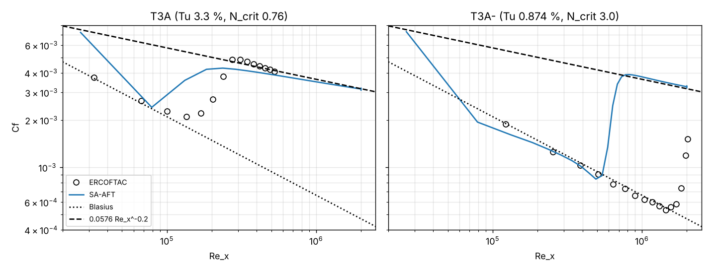

### Eppler 387, Re 2·10⁵, N_crit 8.15

`examples/cases/e387_aft.toml` on the mesh of §7 (209k quads), polar by
`pyaeroflow polar`. N_crit 8.15 is Tu 0.1 % (Mack/Drela), the level of the
BCM case. References: NASA TM 4062 (§7), Somers & Maughmer (2007), Penn State
tunnel, Tu ≈ 0.045 %, and XFOIL 6.99 on the mesh contour (repanelled to 260
panels) at N_crit 8.15 and 10.07 (the Mack/Drela value for 0.045 %).

| α | C_L | C_D | ΔC_L Penn State / TM 4062 / XFOIL 8.15 | ΔC_D Penn State / TM 4062 / XFOIL 8.15 |
|---|---|---|---|---|
| −2 \* | 0.163 | 0.0106 | +0.011 / – / −0.016 | −22 % / – / −8 % |
| 0 | 0.376 | 0.0092 | +0.021 / +0.025 / −0.025 | −12 % / −12 % / −4 % |
| 2 | 0.594 | 0.0101 | +0.035 / +0.024 / −0.025 | −14 % / −14 % / −6 % |
| 4 | 0.809 | 0.0114 | +0.047 / +0.023 / −0.027 | −13 % / −14 % / −4 % |
| 6 | 1.018 | 0.0130 | +0.050 / +0.024 / −0.025 | −9 % / −9 % / +3 % |
| 8 \* | 1.208 | 0.0185 | +0.052 / +0.029 / +0.039 | +24 % / +7 % / −10 % |

\* not converged in 2000 iterations. The α = 4° run is converged (632
iterations from a restart at iteration 400, residuals 10⁻⁹ to 10⁻¹², C_L
constant to five digits); the polar CSV flags it 0 because the iteration
counter and residual reference restarted with the file.

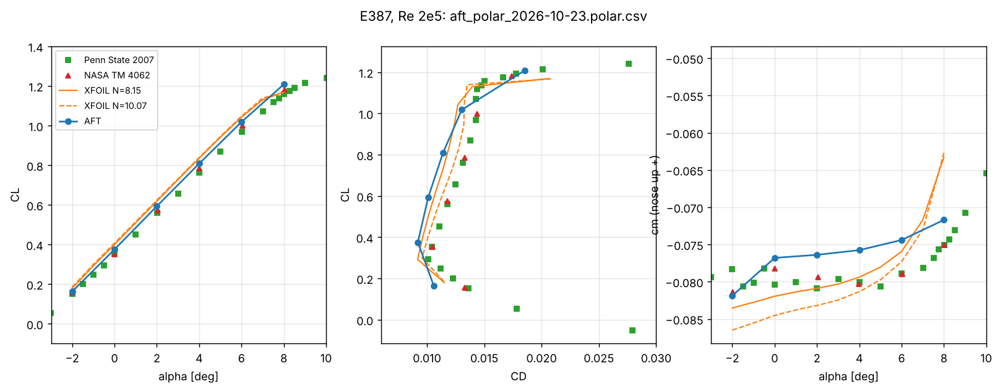

Lift is 0.01–0.05 above Penn State and 0.02–0.03 above TM 4062, and 0.025
below XFOIL, so AFT is the closest to the measurements (XFOIL is 0.07 above
Penn State at 4°). Drag is 9–14 % below both experiments from 0° to 6° and
4–6 % below XFOIL from 0° to 4°. At α = 4° the bubble is where XFOIL
and the oil flow put it: separation at x = 0.430, reattachment at 0.622
(XFOIL 0.428 / 0.619, oil flow 0.40 / 0.62, Penn State within 0.03 c), while
ν_t/ν first exceeds 1 at 0.537, 0.06 upstream of XFOIL's transition at 0.600.

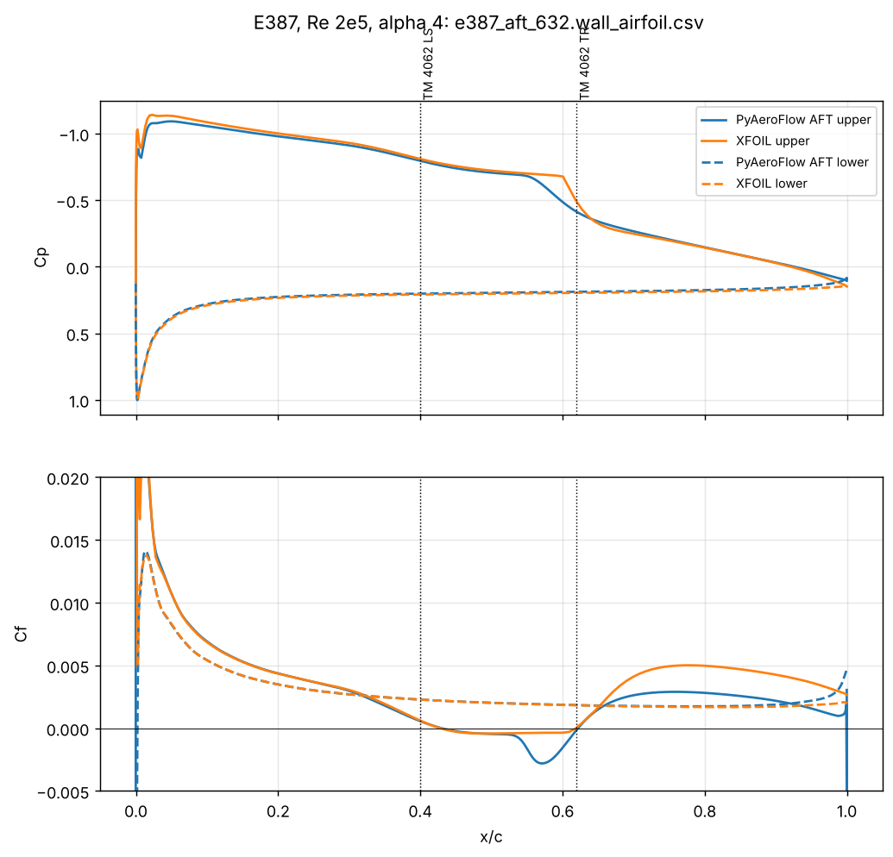

Two features are not yet explained. The C_f minimum in the bubble is deeper
(−0.0027 at x = 0.57 against about 0 for XFOIL) and the turbulent C_f
after reattachment is 40 % lower (0.0030 against 0.0050 at x = 0.77); the same
pattern appears on the SD7003 at α = 4° (50 % lower than XFOIL). The drag gap to the experiments, which
may come from the thickened trailing edge of the model (0.5 % c, sharp in
the mesh) or the 5-chord farfield with the vortex correction; neither was
varied. α = −2° and 8° do not converge: the transition location keeps
moving, as with BCM in §7, so the lift and drag there are not reference
values.

[↑ back to table](#stage-table)

## 9. k-ω SST (SST-2003m)

### Flat plate

TMR 2DZP domain, Re_L = 5·10⁶, TMR SST freestream (k = 9·10⁻⁹ a² at
M = 0.2, i.e. k = 2.25·10⁻⁷ U², ω = 125 U/L, μ_t/μ = 0.009), against the
TMR SST values (`flatplate_sst.html`, SST-Vm, finest grid 545 × 385, mean of
CFL3D and FUN3D: C_f(0.97) = 0.0026907, C_D = 0.0028488; on this plate
SST-Vm and SST-2003m coincide, vorticity = strain rate):

| mesh | cells | C_f(0.97) | C_D | y⁺ max | iterations |
|---|---|---|---|---|---|
| 48 × 48 | 2 880 | 0.002684 (−0.2 %) | 0.002869 (+0.7 %) | 0.64 | 153 |
| 96 × 64 | 7 680 | 0.002684 (−0.2 %) | 0.002866 (+0.6 %) | 0.68 | 158 |
| 192 × 96 | 23 040 | 0.002689 (−0.1 %) | 0.002864 (+0.5 %) | 0.74 | 181 |

The solution is grid-converged. It depends on the wall value of ω, which a
cell-centred scheme does not resolve (ω ~ 1/y²): with d₁ = the wall-cell
height (the default, the first mesh spacing on the same points) C_f(0.97)
is 0.002689 (TMR 0.0026907), with d₁ = the centroid distance (ω_wall four
times larger) 0.002630 at 192 × 96, about 2 % lower at every grid level: the
TMR value confirms the wall-cell height.

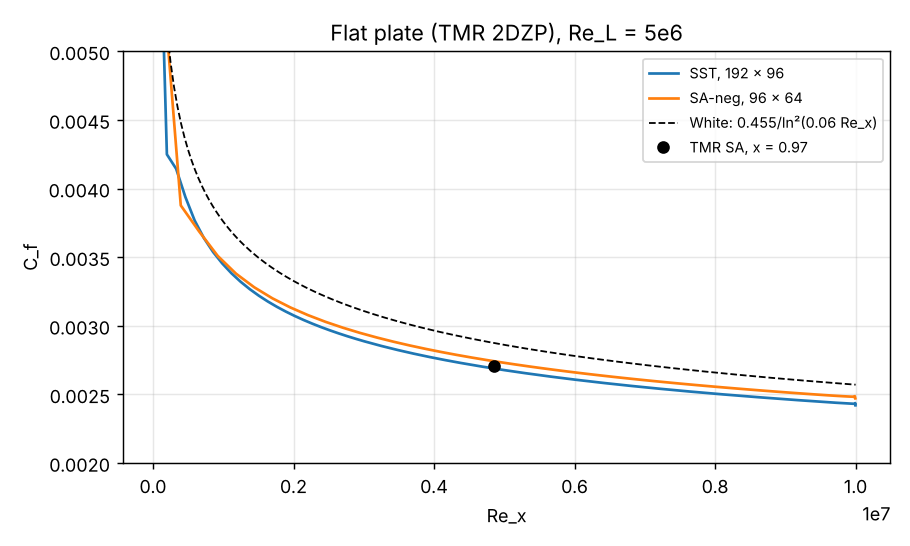

### SD7003, Re 6·10⁴, α = 4°

O-grid (38 880 cells, 324 surface nodes, first spacing 1.2·10⁻⁴ c, farfield
100 c with the point-vortex correction) around the SD7003 contour of the
PyAero mesh of the AFT runs; SST freestream Tu = 0.1 %, ν_t/ν = 1; SA-neg
with ν̃/ν = 3. SA-AFT values from the run on the PyAero C-mesh
(`examples/cases/aft_sd7003.toml`), XFOIL 6.99 with N_crit 8.15.

| | C_L | C_D | upper surface |
|---|---|---|---|
| SST | 0.575 | 0.0190 | laminar-like to x ≈ 0.3 (C_f minimum 0.0011), no separation, turbulent behind |
| SA-neg (fully turbulent) | 0.583 | 0.0200 | turbulent from the leading edge |
| SA-AFT, N_crit 8.15 | 0.592 | 0.0184 | bubble 0.231–0.644 |
| XFOIL, N_crit 8.15 | 0.620 | 0.0188 | bubble 0.224–0.582, transition 0.550 |
| LES/DNS/FR | 0.59–0.60 | 0.0196–0.0221 | bubble 0.20–0.24 to 0.60–0.665 |

SST converges in 127 iterations (90 Newton–Krylov, 7 orders). With the low
freestream k its production stays small in the laminar leading-edge flow
and the boundary layer becomes turbulent around x = 0.3 without
separating, so there is no laminar bubble and no pressure plateau; the
lower side is turbulent throughout (C_f 0.004 at x = 0.5, XFOIL's laminar
side 0.003). C_L is 3 % below SA-AFT and 7 % below XFOIL. The drag is
close to XFOIL and AFT only because the turbulent lower side compensates
the missing bubble: SST without a transition model is a fully turbulent
baseline at this Reynolds number, not a predictor of the laminar bubble
(that needs γ-Re_θ on SST, L3 step 4).

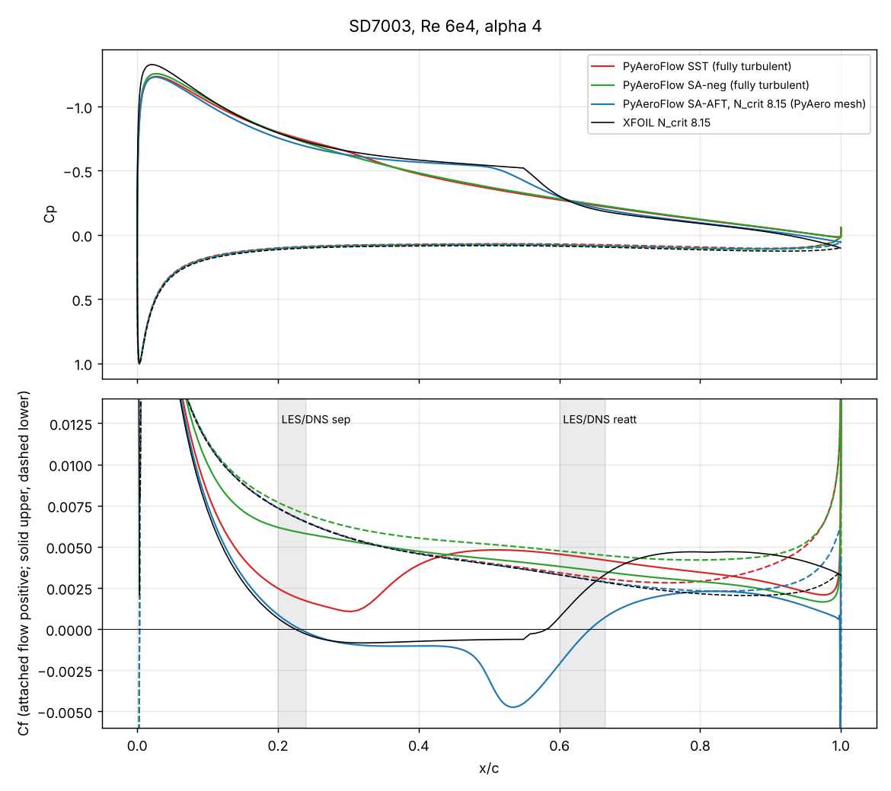

### SD7003, Re 6·10⁴: polar and bubble at Tu 0.5 % (Herbst et al. 2017)

Herbst, Kähler & Hain (2017) measured the SD7003 at Re 6·10⁴ in the
Atmospheric Wind Tunnel Munich at Tu = 0.5 %: surface pressure on taps up
to x/c = 0.74 (suction side) and PIV of the separation bubble at α = 4° and
8°. SA-AFT, Tu 0.5 % (N_crit 4.29, the Mack/Drela value), is the case
`aft_sd7003_tu05.toml` (`turbulence_intensity = 0.005`), on a 320 600-cell
C-mesh (`examples/meshes/sd7003_C10_W25_320k_cells.su2`), run with a sharp trailing edge and with a blunt one (0.3 % chord).
Polar: `pyaeroflow polar examples/cases/aft_sd7003_tu05.toml --alpha 4 6 8 9`; the blunt trailing edge is `aft_sd7003_tu05_blunt.toml` (mesh `…_blunt_TE.su2`).

| α | C_L sharp TE | C_L blunt TE | C_D sharp TE | C_D blunt TE |
|---|---|---|---|---|
| 4 | 0.589 | 0.597 | 0.0176 | 0.0178 |
| 6 | 0.783 | 0.795 | 0.0218 | 0.0220 |
| 8 | 0.954 | 0.970 | 0.0303 | 0.0305 |
| 9 | 1.013 | 1.033 (not converged) | 0.0390 | 0.0388 |

The blunt trailing edge raises C_L by 1.4–1.7 % and C_D by about 0.0002; it
does not change the bubble. Both meshes stall between 8° and 9°; the
sharp-TE run at 10° is fully stalled (C_L 0.74, flat to 12°).

| α | | x_s | x_tr | x_r |
|---|---|---|---|---|
| 4 | Herbst (PIV, Tu 0.5 %) | 0.25 | 0.58 | 0.73 |
| 4 | TU-BS (PIV, Tu 0.1 %, Ol et al. 2005) | 0.30 | 0.53 | 0.62 |
| 4 | SA-AFT, sharp / blunt TE | 0.251 / 0.251 | 0.46 / 0.46 | 0.593 / 0.590 |
| 8 | Herbst (PIV) | 0.14 | 0.19 | 0.27 |
| 8 | LES (as quoted by Ruiz & D'Ambrosio 2022) | 0.04 | 0.18 | 0.28 |
| 8 | SA-AFT, sharp / blunt TE | 0.033 / 0.032 | 0.11 / 0.11 | 0.225 / 0.218 |

Separation and reattachment are the C_f zero crossings on the upper
surface; transition is the first point with ν_t/ν > 1, and Herbst's is a
Reynolds-stress threshold, so only the order of magnitude is comparable. At
α = 4° the separation point agrees with Herbst and reattachment lies
between the LES/DNS band (0.60–0.665) and TU-BS. Herbst's bubble is the
longest of all the references. At α = 8° the model reproduces the LES
bubble, which starts 0.1 upstream of the one Herbst reads by eye from the
raw images.

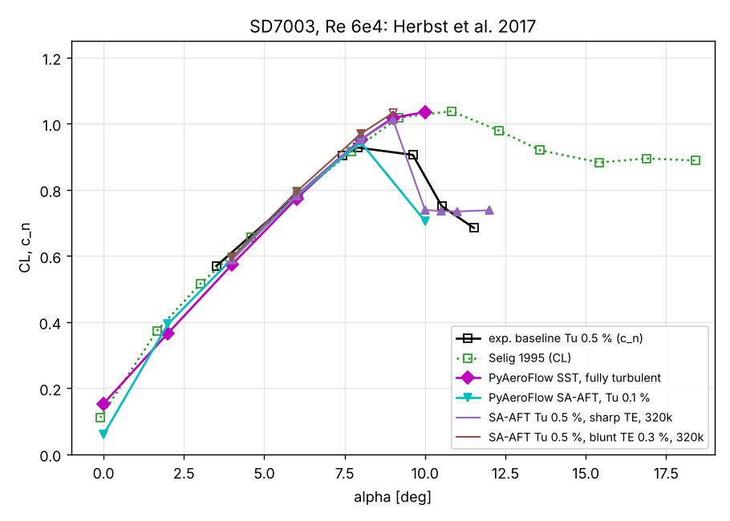

How to read the polar. Selig's curve is balance C_L. Herbst's is the normal
force c_n integrated from the taps (to x/c 0.74 and 0.68, drag neglected);
integrating the computed SST pressure over the same tap range gives about
8 % less lift, and Herbst's α values sit 0.2–0.5° below the nominal ones.
The computed lift follows Selig to within about 3 % up to α = 9°, the
fully turbulent SST polar included; that agreement is partly fortuitous,
since SST has no bubble (see above). Against Herbst the difference in the
linear range is about the size of the tap truncation and the angle shift.
The stall angle differs more clearly: Herbst's baseline falls from
c_n 0.91 at 10.1° to 0.75 at nominal 11°, Selig's peaks near 10.8°, and
SA-AFT stalls between 8° and 10°. Herbst also measured Tu = 10 % behind
turbulence grids (integral scale 0.5c, c and 2c): no bubble up to 18° and no
stall, which a steady RANS model cannot represent and which is not used as
a reference here.

[↑ back to table](#stage-table)

## 10. Langtry–Menter γ-Re_θ on SST (SST-2003m-LM2009)

Model and numerics: `docs/configuration.md`, section "Langtry–Menter
γ-Re_θ" (TMR "langtrymenter_4eqn" with the Langtry–Menter 2009
correlations, local Tu and dU/ds; the Newton–Krylov step uses the exact
JVP with `positive_jacobian = false` and the positive linearization of the γ
source by default since 1.1).

### ERCOFTAC T3A, T3B and T3A−

Plate 1.6 m with the inlet 0.1 m upstream of the leading edge, symmetry
before the plate, farfield top at 0.5 m, Re per metre of the experiment
(T3A 3.44·10⁵, T3B 6.40·10⁵, T3A− 1.31·10⁶ with U = 1), first cell
10⁻⁵ m. Meshes from `examples/cases/make_plate_lm.py`: 120 × 56 cells
(2 mm at the leading edge, growth 1.026 along the plate) and 240 × 80 for
the T3A grid check. The inlet Tu and ν_t/ν are fitted to the measured
freestream decay with the SST decay law k ∝ (1 + β₂ω₀(x − x₀)/U)^(−β*/β₂):

| case | inlet Tu | inlet ν_t/ν | Tu at the first station, computed / measured |
|---|---|---|---|
| T3A | 4.49 % | 12.2 | 3.10 / 3.04 % (x = 45 mm); 1.15 / 1.10 % at 1.495 m |
| T3B | 7.41 % | 100.5 | fitted to 5.95 % (25 mm) and 2.4 % (1.495 m) |
| T3A− | 1.05 % | 7.8 | fitted to 0.874 % (95 mm) and 0.47 % (1.55 m) |

The fitted ν_t/ν agree with the values used by Langtry & Menter (12, 100,
8.7). All runs converge (8.3–9.8 orders of the per-variable measure; T3A
338 iterations / 2.4 min, T3A 240 × 80 455 / 10 min, T3B 200 / 1.3 min,
T3A− 368 / 2 min on 4 cores).

| case | C_f minimum at Re_x, LM / exp. | halfway to turbulent C_f at Re_x | laminar C_f vs exp. | turbulent C_f vs exp. |
|---|---|---|---|---|
| T3A, 120 × 56 | 1.02·10⁵ / 1.35·10⁵ | 1.88·10⁵ (exp. ≈ 2.2·10⁵) | +10–11 % | −5 to +3 % |
| T3A, 240 × 80 | 1.08·10⁵ / 1.35·10⁵ | 1.92·10⁵ | +11–12 % | −5 to +3 % |
| T3B | bypass at the leading edge / 5.9·10⁴ | – | – | −1 to +7 % |
| T3A− | rise from 1.35·10⁶ / 1.44·10⁶ | 1.57·10⁶ (exp. ≈ 2.0·10⁶) | +2–9 % to 7.7·10⁵, +18–35 % to 1.3·10⁶ | – (exp. still transitional) |

**T3A.** The result is grid independent (the two meshes differ by 6 % in
the onset Re_x and by < 1 % downstream). The onset is about 20–25 % early
and the laminar C_f 11 % above the measurement: eddy viscosity from the
3 % freestream turbulence reaches into the laminar layer (γ ≈ 1/c_e2 = 0.02
there, so P_k is suppressed, but k diffuses in), and Re_θt at the wall lags
the edge value (152–181 against 159–228 for x = 0.05–0.4 m), so the onset
follows the lower Tu-correlation value carried from the leading edge.
Transition length and the turbulent C_f (within 5 %) agree. A second-order
convection of the turbulence variables did not converge (ω residual stalls)
and was not pursued.

**T3B.** Bypass transition right behind the leading edge, as in the
experiment (C_f minimum at Re_x = 5.9·10⁴, already 0.0034 there); the C_f
between 1.5·10⁴ and 9·10⁴ is 23–53 % above the data, downstream within
7 % (slightly high, like the SST turbulent level on T3A).

**T3A−.** The decisive case for the low-Tu airfoil cases: LM puts the C_f
rise at Re_x = 1.35·10⁶ against the measured minimum at 1.44·10⁶ (SA-AFT:
5–6·10⁵, three times too early, §8). The transition is too short: LM is
fully turbulent at 1.7·10⁶ (C_f 0.0036, 8 % above the turbulent
correlation) where the experiment is still transitional up to the last
station (0.0015 at 2.0·10⁶). The laminar C_f rises above Blasius from
9·10⁵ on (+18–35 %), the pre-transitional effect of the freestream k.

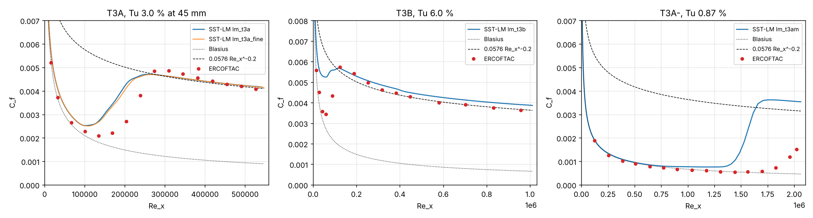

### SD7003, Re 6·10⁴, α = 4°

39k-cell O-grid (`examples/meshes/sd7003_ogrid_39k.su2`, case `examples/cases/sst_sd7003_ogrid.toml`), Tu 0.1 %, ν_t/ν 1 at
the farfield, first-order turbulence convection. After 1400 iterations the
residuals sit 2.6–3 orders down and C_L/C_D still drift slowly
(C_L 0.601, C_D 0.0207).

Result: the upper-side laminar boundary layer separates at x/c = 0.27, which
is close to LES/DNS (0.21–0.23). It **does not reattach**: C_f stays negative
up to the trailing edge, so there is an open laminar separation and no
transition. The cause is that the separated shear layer never triggers. Re_V
only just exceeds the γ_sep threshold 3.235 Re_θc (the ratio peaks at 1.09 at
x/c ≈ 0.7), so γ_sep ≤ 0.18 and k stays at its freestream level of about
1e-6. On this grid LM therefore predicts a laminar open separation, where
LES/DNS reattach at x/c 0.60–0.67. The fine-mesh case
`examples/cases/lm_sd7003.toml` (PyAero 320k mesh) is the actual test of whether this is
a grid-resolution effect.

**320k PyAero mesh** (`lm_sd7003.toml`, Tu 0.1 %, ν_t/ν 1, SER CFL for 1500 iterations, then
`cfl.control = "growth"`). With the SER control the run crept for 1500
iterations (C_D 0.0316 at iteration 500, 0.0219 at 1500, C_L 0.59 falling).
With the growth control the Newton–Krylov phase reached CFL 10¹⁰ within 20
iterations at iteration 2000, the residuals of p, u, v, k and ω fell to
10⁻¹⁰ and C_L, C_D, C_M stood still to five digits from iteration 2060 on:
C_L 0.5931, C_D 0.02276, C_M 0.03926 (targets: C_L 0.60 ± 0.02,
C_D 0.0208 ± 0.0013, C_M 0.033 ± 20 %).

| | SST-LM, 320k | LES/DNS |
|---|---|---|
| Separation x/c | 0.192 | 0.20–0.24 |
| Transition (ν_t/ν > 1) x/c | 0.468 | |
| Reattachment x/c | 0.71 | 0.60–0.67 |
| Bubble length | 0.52 | 0.42–0.45 |

The shear layer triggers through γ_sep at x/c 0.45–0.5 (γ_eff up to 2, k
growing by four orders by 0.65) and the bubble closes; the pressure plateau
and the turbulent C_f of about 0.003 after reattachment (XFOIL 0.0047) are in
the picture. Reattachment is 0.04–0.11 late and
C_D is 3 % above the highest LES/DNS value. Without solution limits on
γ and Re_θt the γ residual stalled at 10⁻⁵·⁴ although all others converged: one cell
in the turbulent layer (x/c 0.843) had fallen to γ = 10⁻¹⁴² (the 99 % step
limiter, 70 iterations) and the derivative of √γ there is about 10⁷⁰. With γ
clipped to [10⁻⁴, 5] and Re_θt to [10⁻⁴, 10¹⁵] after every update, a restart from iteration 2000 converged in 36 Newton–Krylov
iterations to 7.3 orders (all residuals 10⁻¹⁰ to 10⁻¹⁶, γ residual peak
6·10⁻⁵ against 550) at the same forces: C_L 0.59307, C_D 0.022761,
C_M 0.039252. A restart from the old iteration 2500 state instead left the
state (C_L 0.43–0.49) because that state held the dead cell.

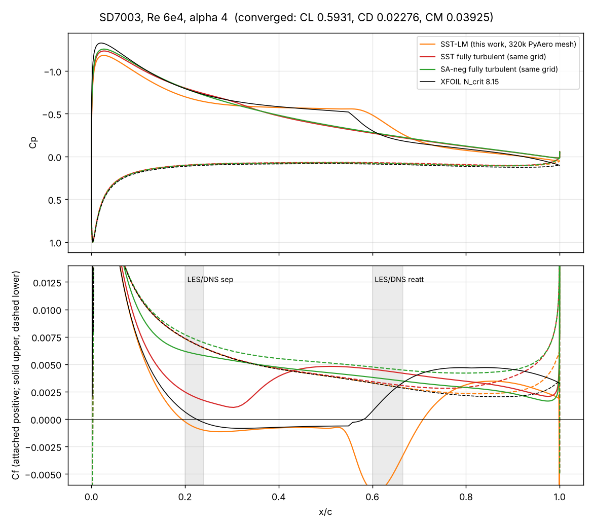

C_p and C_f of the converged 320k run (upper side solid, lower dashed) against
the fully turbulent SST and SA-neg runs on the 39k grid and XFOIL: separation
at x/c 0.19, C_f < 0 up to 0.71 (shaded: LES/DNS bands).
The clip is on by default and can be turned off with
`physics.transition.clip = false`. `solver.convergence.fields = ["cd"]`
adds the force-based (Cauchy) criterion to the residual drop, so a run like
this one can end when C_D has settled instead of at a fixed residual drop.

### SD7003, Re 6·10⁴: SST-LM polar on the 320k PyAero mesh

`pyaeroflow polar examples/cases/lm_sd7003_polar.toml --alpha 4 6 8 9 10 2 0` (restart
chain from the converged α = 4° state, growth CFL with `polar_reset`, Tu 0.1 %,
clip on). Polar CSV: `docs/data/lm_sd7003_320k.polar.csv`.
The same mesh was used for the fully turbulent SST and the SA-AFT (Tu 0.5 %,
sharp trailing edge) polars of §9.

| α | C_L LM | C_D LM | C_M LM | C_L SST | C_D SST | C_L AFT | C_D AFT | C_L XFOIL | C_D XFOIL |
|---|---|---|---|---|---|---|---|---|---|
| 0 | 0.045 | 0.01454 | 0.0176 | 0.155 | 0.01586 | | | 0.058 | 0.0148 |
| 2 | 0.390 | 0.01969 | 0.0539 | 0.366 | 0.01655 | | | 0.424 | 0.0165 |
| 4 | 0.593 | 0.02278 | 0.0394 | 0.573 | 0.01834 | 0.589 | 0.0176 | 0.620 | 0.0188 |
| 6 | 0.758 | 0.02911 | 0.0272 | 0.768 | 0.02181 | 0.783 | 0.0218 | 0.813 | 0.0243 |
| 8 | 0.890 | 0.04263 | 0.0226 | 0.934 | 0.02956 | 0.954 | 0.0303 | 0.992 | 0.0342 |
| 9 | 0.903 | 0.06023 | 0.0284 | 0.976 | 0.03969 | 1.013 | 0.0390 | 1.065 | 0.0429 |
| 10 | 0.770 | 0.10298 | 0.0638 | 0.716 | 0.10800 | 0.740 | 0.1260 | 1.109 | 0.0557 |

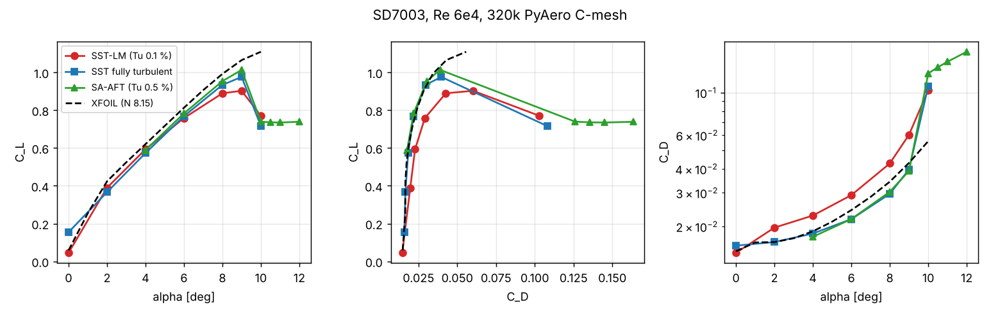

What the polar shows:

- At α = 0° and 2° LM follows XFOIL (C_L 0.045 and 0.390 against 0.058 and
  0.424), where the fully turbulent SST is 0.1 too high at 0°: the laminar
  bubble that takes lift off the suction side at low α is in the solution.
- From α = 4° upwards C_D is too high: 0.0228 against 0.0176–0.0188 at 4°, and
  0.0291, 0.0426, 0.0602 at 6°, 8°, 9° against 0.0218–0.0243, 0.0296–0.0342,
  0.039–0.043. At 8° the excess is nearly all pressure drag (C_Dp 0.0364
  against 0.0216 for SST and 0.0238 for AFT; the viscous part, 0.0062, is as
  AFT's 0.0065). That fits the late reattachment found at α = 4° (§11); the
  wall data of the other angles were not examined. C_L is 5–7 % below SST and
  AFT at 8° and 11 % below AFT at 9°.
- The stall comes earlier: the lift curve flattens from 8° (0.890 and 0.903 at
  8° and 9°, against 0.93–0.95 and 0.98–1.01) and falls at 10° (0.770) like all
  models; XFOIL still rises (0.99, 1.07, 1.11). The α = 10° point is a deep-stall state
  with C_D 0.103 and converged normally (7.6 orders in 122 iterations).
- All three models are stalled at 10° (C_L 0.72–0.77, C_D 0.10–0.13) and
  attached at 9°, so the early stall is a property of the RANS closures on
  this mesh as much as of LM.

Convergence and limits of the data. Five of the seven points (0°, 2°, 4°, 6°,
8°) are marked `converged = 0` in the CSV: they were ended by hand with the
`.stop` file or by the iteration limit, not by a criterion. The reason is the
γ residual, which stalls between 10⁻⁵·⁴ and 10⁻⁶ at the clip floor, so the
residual drop of 7 orders is never reached (about 2 to 2.6 orders). The cells
were identified afterwards (α = 4°, iteration 666, all 320 600 cells
searched): eight cells have γ = 10⁻⁴, three at x/c 0.52 above the bubble,
four at 0.61–0.64 in the turbulent shear layer, one at 0.92 near the wall,
each surrounded by cells with γ 0.2–0.4. Their γ residuals are −19 to −646
(the largest of the field; the residual is flux minus source, so they ask for
a *larger* γ), while 98 % of the raw Newton updates of these cells over 98
further iterations lowered γ (median −0.15, 1400 times the value): the √γ of
the production has the derivative 1/(2√γ) = 50 at the floor, which turns the
diagonal of the γ equation of such a cell negative, so the exact Newton step
points away from the root, the clip discards it and the cell stays. The same
cells kept the Newton–Krylov forcing term at its cap of 0.5 in every
iteration (the residual norm never fell), 20 GMRES products per iteration at
1.5 s each on this mesh: 73 % of the 43 s per iteration. The remedies
`physics.transition.positive_jacobian` (default from 1.1) and `newton_guard`
are described in `docs/configuration.md`; the polar above was run before
them (exact linearization, no guard).

*Measured with 1.1.* On the 320k case (α = 4°, restart from iteration 662,
`positive_jacobian = true`, no guard) the first update lifted the eight floor
cells off the floor (γ +0.37 to +0.70), none was at the floor afterwards, the γ
residual fell from 10⁻⁵·⁷ to 10⁻¹¹·⁷, and the run converged (7.1 orders) in 13
Newton–Krylov iterations (about 38 s each) at unchanged forces, C_L 0.593069,
C_D 0.022761, C_M 0.039252; the exact linearization had not converged in 98
further iterations.

The forces
themselves stood still to four or five digits: C_L and
C_D jitter by 2·10⁻⁶ to 5·10⁻⁶ per iteration, which is above the 10⁻⁶ and
10⁻⁸ of the Cauchy criterion first set; with an absolute change of 10⁻⁵ (about 4·10⁻⁴ relative to C_D; the criterion measures the relative change since the next release, so `cauchy_eps = 5e-4`) the criterion
would have ended α = 4° at about iteration 150 instead of 662. α = 0° was still
drifting (C_L 2·10⁻⁴ relative per iteration when stopped at iteration 162).
The CSV holds the last state of each run. α = 9° and 10° ended on the
criterion (`converged = 1`). No decreasing-α sweep was run, so the polar does
not show whether the bubble has hysteresis. At α = 0° the CFL stayed near 10³
(GMRES 30–50 iterations per step, 73 s per iteration against 20–30 s at the
other angles): `solver.newton_krylov.cfl_adapt_iterations` makes that cap
adjustable.

Summary of the LM polar: usable for the trend and for the low-α bubble
(C_L at 0° and 2°), not for drag. For drag and the stall angle use SA-AFT
(§8, §9), which is also closer to XFOIL; this is listed in §11.

[↑ back to table](#stage-table)

## 11. Known limits of the transition models

What the transition models do not reproduce, with the cause where it is
known. These are properties of the published models (implemented one to one)
or open questions, not solver defects; the model-choice guide follows from
them.

| model | case | limit | cause | use instead |
|---|---|---|---|---|
| SA-AFT2019b | T3A− (Tu 0.87 %), [§8](#sec-8) | onset at Re_x 5–6·10⁵ against 1.44·10⁶, about three times too early; with the decayed local Tu (N_crit 3.9–4.4) still 8.5·10⁵–1.0·10⁶ | AFT is an e^N model: the onset is Re_θ0 = 237 plus N_crit/0.0103, with N_crit from Mack/Drela, which is fitted for Tu below about 1 % and assumes Tollmien–Schlichting transition | SST-LM (C_f rise at 1.35·10⁶, [§10](#sec-10)) |
| SA-AFT2019b | T3B (Tu 6 %, bypass), [§8](#sec-8) | cannot transition before Re_x = 1.3·10⁵ (Re_θ0 = 237) | no bypass mechanism by construction; not run | SST-LM (bypass at the leading edge) |
| SST-LM | SD7003, Re 6·10⁴, α = 4°, [§10](#sec-10) | bubble too long: reattachment at x/c 0.71 against 0.60–0.67 (LES/DNS), C_D 3 % above the highest LES/DNS value; C_L and C_M inside the bands | transition is triggered in the LES/DNS window (γ_sep from x/c 0.45, ν_t/ν > 1 at 0.468); the turbulent shear layer after transition reattaches too slowly. Not diagnosed further (candidates: freestream decay of k and ω without sustaining terms, SST eddy viscosity in the separated layer) | SA-AFT (reattachment 0.644, inside the band) for low-Re laminar separation bubbles |
| SA-AFT2019b | E387, Re 2·10⁵, α = −2°, [§8](#sec-8) | no steady solution found: rerun from the converged α = 0° state with growth CFL (cap 10⁵) and the Cauchy criterion on C_L/C_D (2026-10-27) stays in the Newton–Krylov phase at CFL 10–200 (every step above ~150 fails or is rejected); residuals of p, u, v, ν̃ flat at 10⁻⁶·⁶–10⁻⁹·³, γ 10⁻³–10⁻⁴, ñ 10⁻⁴·⁸; C_L drifts from 0.148 to 0.161 over iterations 83–313 and the drift grows (10⁻⁴ per iteration), C_D 0.0089 → 0.0095 | transition moving slowly over many iterations, as Coder (2019) reports for AFT; not diagnosed further | forces at α = −2° are indicative only (the 2000-iteration polar value C_L 0.163 lies on the same drift). A time-accurate (BDF2) run is the likely remedy, as in §7 for BCM at α = 8°; not tried |
| SA-AFT2019b | E387, Re 2·10⁵, α = 8°, [§8](#sec-8) | not converged in 2000 iterations of the polar (SER CFL); not rerun | near the leading-edge bubble burst (XFOIL: transition at x/c 0.045); the BCM solution at α = 8° was a limit cycle (C_L 1.11–1.23, period about 0.25 c/U, `docs/e387_alpha8_ser_stall.md`), so a steady solution may not exist | forces at α = 8° are not reference values; a time-accurate run with cycle-averaged forces is the likely remedy (common practice for unsteady separation); not tried for AFT |
| SST-LM | SD7003, Re 6·10⁴, polar α = 0–10°, [§10](#sec-10) | C_D too high from α = 4° (+29 % at 4°, +41 % at 8°, +55 % at 9° against SA-AFT; pressure drag), C_L 5–11 % low at 8°–9°; five of seven points not converged by a criterion (γ residual at the clip floor, forces settled to 4–5 digits) | late reattachment as at α = 4°; the γ residual stalls because eight cells at the clip floor get Newton updates that point away from the root (√γ production derivative, §10), so only the force criterion could end a run; `positive_jacobian` (default from 1.1, `docs/configuration.md`) removes the cause: at α = 4° the restart converged in 13 Newton–Krylov iterations at unchanged forces; the polar has not been rerun with it | SA-AFT for drag and stall angle; LM for the low-α lift (0°, 2° close to XFOIL) |
| SA-AFT, SST-LM | turbulent C_f after reattachment (E387, SD7003) | 35–50 % below XFOIL | baseline turbulence model recovering from the bubble; open, not specific to the transition models | – |

Rule of thumb from these cases: SA-AFT for low freestream turbulence
(Tu up to about 0.5 %, flight and quiet tunnels, laminar separation bubbles
on airfoils; N_crit comparable with XFOIL), SST-LM for elevated freestream
turbulence (Tu from about 0.5 %, bypass transition).

[↑ back to table](#stage-table)

## 12. Compressible Euler (L1 stage C1)

The compressible solver (`physics.flow = "compressible"`, `docs/configuration.md`,
[Compressible flow](configuration.md#compressible-flow)) with the defaults:
Roe flux, entropy fix 0.001, MUSCL with the Venkatakrishnan–Wang limiter
(not frozen), implicit pseudo-time with Newton–Krylov. Runs of 2026-11-03 in
the cloud sandbox (4 cores, SuperLU instead of PARDISO; the wall times are
not representative).

**Compression ramp, M 2, 10° (verification).** `pyaeroflow.cases.oblique_shock`,
96 × 64 quadrilaterals (also `examples/cases/ramp_10deg_m2.toml`). The exact
weak oblique shock stands at 39.31° with p₂/p₁ = 1.7066 and M₂ = 1.6405.
On 60 × 40 cells the mean ramp wall pressure (cells between 30 % and 90 % of
the ramp) is p₂/p₁ = 1.7071 (+0.03 %), the Mach number of the wall cells
1.633 (−0.5 %); the residual reaches machine zero in 27 iterations with the
limiter active. The unit test checks 2 % at first order on 30 × 20 cells.

**NACA 0012, Euler (validation).** TMR NACA 0012 definition with the sharp
trailing edge (`airfoil_points(n, cut=1.0)`), O-grids from
`airfoil_ogrid` with the farfield at 100 chords, no vortex correction, wall
spacing 10⁻³ c. Reference: the continuum estimates of Vassberg & Jameson
(2010, Table 10 and 11: FLO82, OVERFLOW, CFL3D with and without vortex
correction, Karman–Trefftz O-grids to 4096² cells, farfield 150 chords) and
OVERFLOW on the 256² O-grid for M 0.85 (Vassberg et al. 2011). All runs
converged 10–11 orders (machine zero).

| case | quantity | 192 × 64 (12k) | 384 × 128 (49k) | reference (range of the codes) |
|---|---|---|---|---|
| M 0.5, α 1.25° | C_L | 0.1760 | 0.1770 | 0.17978–0.18035 |
| | C_D | 0.00089 | 0.00068 | 0.00000–0.00001 |
| | C_M | 0.0016 | 0.0018 | 0.00226–0.00228 |
| M 0.8, α 1.25° | C_L | 0.3415 | 0.3436 | 0.3482–0.3562 |
| | C_D | 0.02249 | 0.02251 | 0.02245–0.02268 |
| | C_M | 0.0350 | 0.0355 | 0.0374–0.0388 |
| M 0.8, α 0° | C_D | 0.00887 | – | 0.008342 |
| M 0.85, α 0° | C_D | 0.04665 | – | 0.04696 (OVERFLOW, 256²) |

C_M about the quarter chord, positive nose-down as in the paper. The
transonic drag is inside the band of the four reference solutions already
on 12k cells; the lift approaches it from below (−2 % at 49k against the
lower end) with first-order grid convergence, as Vassberg & Jameson find for
all their codes in the lifting transonic case (FLO82 needs 512² cells for
the asymptotic range; on 128² it gives C_L 0.3735). At M 0.5 the drag is the
spurious entropy drag of the coarse grids. For scale, FLO82 on its own
128² grid has C_D 0.000298. The 49k M 0.5 case (C_D 0.00068, down from 0.00089)
shows the drag converging towards zero with grid refinement.

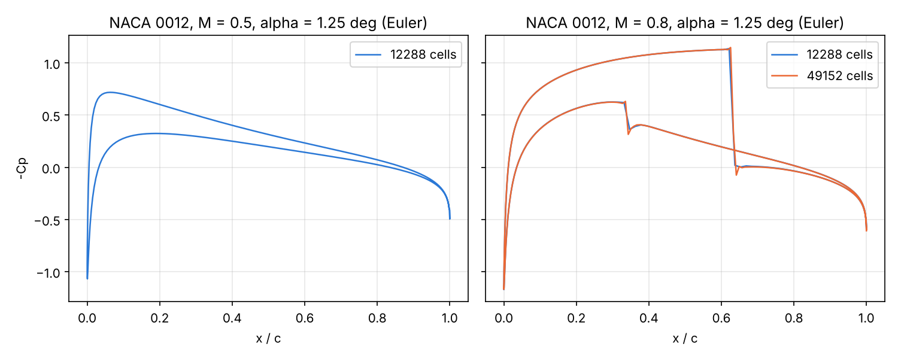

[↑ back to table](#stage-table)

## 13. Compressible laminar Navier–Stokes (L1 stage C2)

`physics.model = "laminar"` with `physics.flow = "compressible"`: viscous
stress with Sutherland's μ(T), heat flux with Pr = 0.72, no-slip adiabatic
or isothermal walls (see [Compressible flow](configuration.md#compressible-flow)).
Runs of 2026-11-03 in the cloud sandbox (4 cores, PARDISO), all converged
to machine zero (10–11 orders).

**Flat plate, M 0.5, Re_L 10⁵ (verification).**
`pyaeroflow.cases.flat_plate_compressible`, the B1 domain and mesh
(160 × 80 quadrilaterals, plate from x = 0 to 1, symmetry ahead of it),
velocity inlet with T∞, pressure outlet, farfield on top. Reference: the
compressible similarity solution (Howarth–Dorodnitsyn variables, White,
*Viscous Fluid Flow*, sec. 7-3, Sutherland and constant Pr, computed in the
module with `solve_bvp`). Means over 0.2 < x < 0.95, 24–26 iterations,
about 20 s each:

| wall | quantity | PyAeroFlow | similarity |
|---|---|---|---|
| adiabatic | C_f √Re_x | 0.6642 (+0.35 %) | 0.6619 |
| | T_w / T∞ | 1.04218 | 1.04238 (recovery factor 0.848 ≈ √Pr) |
| isothermal, T_w = T∞ | C_f √Re_x | 0.6657 (+0.33 %) | 0.6635 |
| | q_w √Re_x / (ρ∞ U∞ c_p T∞) | −0.01722 (−1.0 %) | −0.01739 |

The incompressible solver on the same mesh is +0.38 % above Blasius (the
leading-edge displacement effect of section 3), so the compressible to
incompressible ratio of C_f is 0.9964 against 0.9967 from the similarity
solutions. The unit test runs 48 × 32 cells.

**NACA 0012, M 0.5, α 0°, Re 5000 (validation).**
`examples/cases/naca0012_laminar_m05.toml` on the PyAero C-mesh
`examples/meshes/naca0012_pyaero_100k_y1.su2` (100k cells, sharp trailing
edge), all outer boundaries farfield, adiabatic wall, unlimited second order
(`numerics.limiter = "none"`, shock-free). Reference: Swanson & Langer
(2016), case 1, structured and unstructured codes on C-grids to 4096 × 2048
cells with the outer boundary at 10 chords.

| | PyAeroFlow (100k C-mesh) | Swanson & Langer, finest grids |
|---|---|---|
| C_D | 0.05592 (+0.6 %) | 0.05557–0.05565 |
| C_D pressure | 0.02303 (+1.0 %) | 0.02279–0.02284 |
| C_D friction | 0.03290 (+0.3 %) | 0.03278–0.03281 |
| x_sep / c (C_f = 0, interpolated) | 0.808 | 0.808 |
| iterations, wall time | 30 (10 Newton–Krylov), 170 s | – |

The trailing-edge separation is the sensitive quantity: a too dissipative
scheme moves it downstream (Swanson & Langer). On an O-grid
(`airfoil_ogrid`, 256 × 128, farfield 50 chords, wall spacing 2.5·10⁻⁴ c)
the same case gives C_D = 0.0605 and no separation at all; the
incompressible solver on that O-grid behaves the same (C_D 0.0577 on
128 × 64, attached), while on the C-mesh it separates at x/c = 0.90 (the
incompressible flow separates later). The O-grid resolves the wake and its
recirculation behind the sharp trailing edge with fanned, skewed cells: use
a C-mesh for viscous airfoil cases with trailing-edge separation.

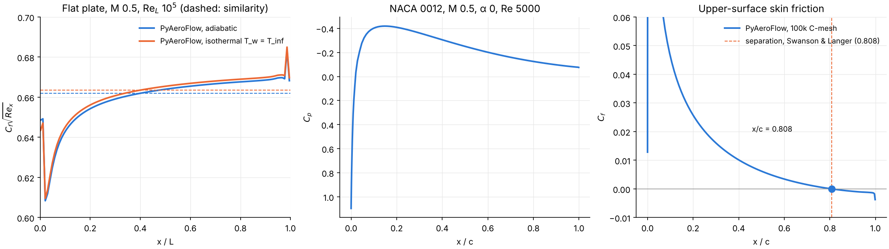

[↑ back to table](#stage-table)

## 14. Compressible SA-neg RANS (L1 stage C3)

`physics.model = "rans"` with `physics.flow = "compressible"` and
`turbulence = "sa-neg"`: the conservative compressible SA-neg of NASA TMR
(density-weighted convection and diffusion of ν̃, the −∇ρ·∇ν̃ term), μ + μ_t
in the stress, c_p(μ/Pr + μ_t/Pr_t) in the heat flux, Pr_t 0.9 (see
[Compressible flow](configuration.md#compressible-flow)). Runs of 2026-11-03
in the cloud sandbox (4 cores, PARDISO).

**Low-Mach correction.** At M 0.15 the plain Roe flux is too dissipative:
on the TMR 113 × 33 grid at α 10° the pressure drag is 26 % above INC
(C_Dp 0.0355 vs 0.0281) and the lift 2 % below; on 225 × 65 the pressure
drag is +10 %. `numerics.low_mach_correction = true` (Rieper's correction)
removes this: C_Dp 0.0173 on 113 × 33 and 0.0090 on
225 × 65, close to what the finer grids and CFL3D give, and the run converges
in far fewer iterations. It is off by default and recommended below about
M 0.3. All results below use it unless noted.

**TMR flat plate, M 0.2, Re 5·10⁶ (verification).**
`pyaeroflow.cases.tmr_flat_plate.solve(mach=0.2)` on the TMR domain with the
incompressible plate's mesh family (adiabatic plate, Sutherland with the TMR
reference temperature of 540 R). TMR finest grid (CFL3D/FUN3D mean):
C_f(0.97) = 0.0027055, C_D = 0.0028562.

| cells | solver | C_f(0.97) | C_D | iterations |
|---|---|---|---|---|
| 7.7k | INC | 0.0027418 (+1.3 %) | 0.0029076 (+1.8 %) | 91 |
| | compressible | 0.0027337 (+1.0 %) | 0.0029075 (+1.8 %) | 46 |
| | compressible, low-Mach corr. | 0.0027365 (+1.1 %) | 0.0028999 (+1.5 %) | 121 |
| 30.7k | INC | 0.0027360 (+1.1 %) | 0.0028979 (+1.5 %) | 146 |
| | compressible | 0.0027287 (+0.9 %) | 0.0028966 (+1.4 %) | 45 |
| | compressible, low-Mach corr. | 0.0027306 (+0.9 %) | 0.0028899 (+1.2 %) | 48 |

The compressible C_f is 0.2–0.3 % below INC, the direction and size that the
compressibility of the plate boundary layer at M 0.2 gives. The remaining
+0.9 % against TMR is the mesh (the same for INC, section 5).

**NACA 0012, M 0.15, Re 6·10⁶, α 10° (validation).**
`examples/cases/naca0012_sa_m015.toml`, the TMR 225 × 65 C-grid and the
449 × 129 rebuild (`examples/meshes/make_tmr_naca0012.py`), farfield 500
chords, no vortex correction, ν̃/ν = 3, adiabatic wall. CFL3D at the same
h = √(1/N) is the reference for each grid (family I); the INC runs are those
of `analysis/naca0012`.

| grid | run | C_L | C_D | C_Dp / C_Dv |
|---|---|---|---|---|
| 225 × 65, frozen limiter | CFL3D, same h | 1.0838 | 0.01449 | 0.00833 / 0.00616 |
| | INC | 1.0643 | 0.01759 | 0.01179 / 0.00581 |
| | compressible, plain Roe | 1.0730 | 0.01875 | 0.01295 / 0.00581 |
| | compressible, low-Mach corr. | 1.0784 | 0.01498 | 0.00896 / 0.00602 |
| 449 × 129, released limiter | CFL3D, same h | 1.0909 | 0.01273 | 0.00654 / 0.00619 |
| | INC | 1.0844 | 0.01267 | 0.00645 / 0.00622 |
| | compressible, low-Mach corr. | 1.0914 | 0.01270 | 0.00658 / 0.00613 |
| 897 × 257 | CFL3D / FUN3D | 1.0909 / 1.0983 | 0.01231 / 0.01242 | |

On 449 × 129 the lift is within 0.05 % of CFL3D (INC: −0.6 %, the
compressibility effect that INC cannot show) and the drag within 0.2 %. The
225 × 65 run uses the frozen limiter, which adds dissipation (INC and
compressible alike); with the correction it is 3 % above CFL3D at the same
grid. The 449 × 129 run stops at 6.6 orders, where the residual reaches
round-off and the line search rejects; the forces were constant to four
digits long before.

At α 15° (449 × 129) the run reaches 5.2 orders and C_L 1.5323, C_D 0.02254
(CFL3D 897 × 257: 1.5461, 0.02124). **Open:** α 0° on 449 × 129 does not
converge from the freestream start: the impulsive start leaves a large
separated region and the pseudo-time steps are rejected (tried: earlier
Newton–Krylov switch, restart from the α 10° state); α 0° on the
compressible solver is not validated yet (see section 15 for the cause of
the dead stop and its fix). SST is section 15; RAE 2822 is the next stage.

[↑ back to table](#stage-table)

## 15. Compressible k-ω SST RANS (L1 stage C4)

`physics.model = "rans"` with `physics.flow = "compressible"` and
`turbulence = "sst"`: the compressible SST-2003m (rows ρk and ρω with the
Roe mass flux, diffusion (μ + σμ_t)∇k, the incompressible sources times ρ
with −⅔k∇·v in the production, −⅔ρkδ_ij in the stress, wall ω
60ν_w/(β₁d₁²) with ν_w of the wall state; see
[Compressible flow](configuration.md#compressible-flow)). Runs of 2026-11-03
in the cloud sandbox (4 cores, PARDISO).

**TMR flat plate, M 0.2, Re 5·10⁶ (verification).**
`pyaeroflow.cases.tmr_flat_plate.solve(mach=0.2, turbulence="sst")`,
adiabatic plate, TMR SST freestream. TMR SST finest grid (CFL3D):
C_f(0.97) = 0.0026907, C_D = 0.0028488.

| mesh | solver | C_f(0.97) | C_D | iterations |
|---|---|---|---|---|
| 48 × 48 | INC | 0.0026840 (−0.25 %) | 0.0028690 (+0.71 %) | 153 |
| | compressible | 0.0026757 (−0.56 %) | 0.0028728 (+0.84 %) | 148 |
| 96 × 64 | compressible | 0.0026770 (−0.51 %) | 0.0028692 (+0.72 %) | 257 |

As with SA (section 14), the compressible C_f is about 0.3 % below INC.

**NACA 0012, M 0.15, Re 6·10⁶ (validation).**
`examples/cases/naca0012_sst_m015.toml`: TMR C-grids, low-Mach correction,
TMR SST freestream (μ_t/μ = 0.009, Tu 0.0516 %), adiabatic wall.

| grid | run | C_L | C_D | C_Dp / C_Dv |
|---|---|---|---|---|
| 225 × 65, frozen limiter, α 10° | INC SST | 1.0631 | 0.01722 | |
| | compressible SST | 1.0699 | 0.01468 | 0.00872 / 0.00596 |
| | compressible SA (section 14) | 1.0784 | 0.01498 | 0.00896 / 0.00602 |
| 449 × 129, released limiter, α 10° | INC SST | 1.0742 | 0.01273 | |
| | compressible SST (1200 it., 4.7 orders) | 1.0818 | 0.01280 | 0.00661 / 0.00620 |
| 897 × 257, α 10° | CFL3D SST | 1.0778 | 0.01236 | |

The 225 × 65 run (237 iterations, 4.7 orders) lies where SA does: lift
+0.6 % above INC, and the INC frozen-limiter drag excess is gone.
On 449 × 129 the run starts from the freestream with a large separated
region (C_D 0.088 at iteration 60) and takes a long pseudo-time transient:
C_L overshoots to 1.119 at iteration 600, then falls back (1.099 at 800,
1.087 at 1000, 1.0818 at 1200, still dropping by about 0.002 per 100
iterations) while the residual falls steadily (3.2 orders at 700, 4.7 at
1200). At 1200 iterations C_L is 0.7 % above INC SST and 0.4 % above CFL3D
897 × 257, and C_D is 0.6 % above INC (the compressible SA on this grid is
+0.6 % / +0.2 % against INC, section 14). The forces are not fully converged
(C_M −0.0079 vs INC −0.0059 and still moving), so the 449 row is a status,
not a final number. The line search takes ¼ steps for long stretches, the
same slow start-up as at α 0° (below).

**α 0° start-up: cause of the dead stop and fix.** On 449 × 129 at α 0°
(SA and SST) the run stopped dead after about 40 iterations: every
pseudo-time step was rejected, even at CFL 10⁻⁵. Two causes worked together.
(1) The low-Mach correction in the first-order Jacobian makes J + V/Δτ
singular near the stagnation cells once CFL reaches a few hundred (PARDISO
reported 5 perturbed pivots at CFL 300, 50 at CFL 1000, |Δu| ~ 10²⁶;
without the correction none). (2) The PARDISO session reuses the
ordering and pivoting of its first analysis, so after the bad matrix every
later factorization failed, while a fresh solver solved the CFL 1 matrix to
10⁻¹⁵. The Jacobian now takes the plain Roe flux
(`compressible.jacobian_convective_flux`; the residual keeps the
correction; an approximate first-order Jacobian of the plain flux is a
common choice) and a
rejected step makes PARDISO analyse the pattern again
(`linear.reset_analysis`). Afterwards α 0° runs on, but slowly: the line
search takes ¼ steps for most iterations, CFL settles at 200–250 and the
drag still falls after 60 iterations (SST C_D 0.0152, SA 0.0188; INC 449:
0.00809 / 0.00813). A fixed GMRES tolerance of 10⁻² instead of
Eisenstat–Walker did not remove the ¼ steps (SA 225 × 65, 107 iterations).
Converged α 0° results on the compressible solver are still **open**; a
start from a converged INC solution or a CFL ramp are the candidates.

[↑ back to table](#stage-table)

## 16. SLAU2 convective flux (L1 stage C5)

`numerics.convective_flux = "slau2"` (Shima and Kitamura 2011; Kitamura and
Shima 2013): face-local all-speed flux without tuning parameter, residual
only on interior faces (boundary faces keep Roe). Unit tests: consistency,
conservation, stationary contact, finite derivatives at rest, near-upwind
supersonic flux (`tests/unit/test_compressible.py`).

Runs on the 12k NACA 0012 O-grid (`make_meshes.py`, sharp trailing edge, PARDISO
unless noted):

| Case | Flux | Iterations | CL | CD | CM |
|---|---|---|---|---|---|
| M 0.8, alpha 1.25 | Roe | 92 | 0.3415 | 0.02249 | 0.0350 |
| M 0.8, alpha 1.25 | SLAU2, SLAU2 Jacobian (`auto`) | 64 | 0.33903 | 0.022393 | 0.03425 |
| M 0.8, alpha 1.25 | SLAU2, Roe Jacobian | not converged (200 it, diverges) | | | |
| M 0.5, alpha 1.25 | Roe | 28 | 0.17603 | 0.00089 | 0.00160 |
| M 0.5, alpha 1.25 | Roe + Rieper | 37 | 0.17648 | 0.00068 | 0.00168 |
| M 0.5, alpha 1.25 | SLAU2, SLAU2 Jacobian (`auto`) | 26 | 0.176244 | 0.000804 | 0.001648 |
| M 0.5, alpha 1.25 | SLAU2, Roe Jacobian | 34 | 0.176244 | 0.000804 | 0.001648 |

The Roe rows are from the SuperLU sandbox runs, the SLAU2 rows from PARDISO
runs (identical to the sandbox at M 0.8; at M 0.5 a SuperLU run with the
SLAU2 Jacobian stalled at CL 0.128, so use PARDISO). The `auto` Jacobian (SLAU2) converges at both Mach numbers; the
Roe Jacobian fails at M 0.8. Wall time 10-13 s each.

Low-Mach sweep (same O-grid, alpha 1.25, PARDISO, `jacobian_flux = auto`).
By the Prandtl-Glauert rule CL must grow only by 1/sqrt(1-M^2) from the
incompressible value (about 0.149) and the induced drag of the inviscid flow
is small:

| Mach | Flux | CL | CD |
|---|---|---|---|
| 0.1 | Roe | 0.14851 | 0.002296 |
| 0.1 | Roe + Rieper | 0.150547 (not converged) | |
| 0.1 | SLAU2 | 0.15012 | 0.000839 |
| 0.03 | Roe | 0.142826 | 0.006695 |
| 0.03 | Roe + Rieper | 0.145176 (stalls) | |
| 0.03 | SLAU2 | 0.14947 | 0.00085 |

Roe's dissipation scales with the sound speed and destroys the low-Mach
solution; the Rieper correction helps but stalls; SLAU2 is Mach independent
(CL 0.1495 to 0.1501, CD 0.00085). At M 0.03 the residual drop of 10 orders
is limited by the round-off floor; use `residual_drop` 8-9 for low-Mach Euler.
SLAU2 shows a long acoustic start-up transient from the freestream (tracked
separately with the slow alpha 0 start-up).

TMR NACA 0012, M 0.15, Re 6e6, alpha 10 (PARDISO; Roe rows use
`low_mach_correction`; 449 Roe rows are from sections 14 and 15):

| Grid | Model | Flux | Residual drop | CL | CD |
|---|---|---|---|---|---|
| 225 x 65 | SA-neg | Roe + Rieper | 1.7 (400 it) | 1.0856 | 0.01507 |
| 225 x 65 | SA-neg | SLAU2 | 7.0 (360 it) | 1.0726 | 0.01604 |
| 225 x 65 | SST | Roe + Rieper | 1.8 (400 it) | 1.0931 | 0.01715 |
| 225 x 65 | SST | SLAU2 | 5.5 (400 it) | 1.0627 | 0.01579 |
| 449 x 129 | SA-neg | Roe + Rieper | | 1.0914 | 0.01270 |
| 449 x 129 | SA-neg | SLAU2 | 3.1 (400 it) | 1.0922 | 0.012748 |
| 449 x 129 | SST | Roe + Rieper | (1200 it, drifting) | 1.0818 | 0.01280 |
| 449 x 129 | SST | SLAU2 | 4.9 (596 it) | 1.0800 | 0.012824 |

CFL3D: SA 225 1.0838 / 0.01449, SA 449 1.0909 / 0.01273; TMR SST 897
1.0778 / 0.01236. On 449 SLAU2 reproduces Roe + Rieper within 0.2 % and the
CFL3D values within 0.15 %; on 225 it converges 4-5 orders further (the
frozen limiter stalls the Roe runs) but its pressure drag is higher (SA CD
+6 % vs Roe on this coarse grid).

Default: `convective_flux` defaults to `slau2` for every compressible model;
it stays `roe` when `numerics.low_mach_correction = true` is set. The Roe
examples that quote Roe numbers (`naca0012_euler_m05/m08`, `ramp_10deg_m2`,
`naca0012_laminar_m05`) set `convective_flux = "roe"` explicitly. Not yet
run with SLAU2: laminar flow; RAE 2822 case 6 files are `examples/cases/rae2822_case6_roe.toml` and `rae2822_case6_slau2.toml` (user runs).

## 17. Wall suction: NASA wall-mounted hump (CFDVAL2004 Case 3)

Validation of `transpiration-wall` against an experiment: the NASA
wall-mounted hump with steady suction through a slot (Greenblatt et al. 2006;
CFDVAL2004 workshop Case 3, Rumsey et al. 2006; NASA TMR case 2DWMH). Re =
936 000 per hump chord, incompressible SA-neg (the experiment runs at M 0.1).

Setup (`examples/cases/nasa_hump_sa_{noflow,suction}.toml`): TMR no-plenum
grid 409 x 109 (`examples/meshes/make_nasa_hump.py`), inflow at x/c = -6.39,
outflow at x/c = 4, contoured slip upper wall. TMR boundary conditions
converted to incompressible gauge values: inflow total pressure Pt/Pref =
1.007 at M 0.1 gives `total_pressure = 0.5` (q_ref with U = 1), outflow
P/Pref = 0.99962 gives `pressure = -0.027143`. The slot exit (x/c = 0.6542 -
0.6585, the lip and the downstream corner of the slot of the CFDVAL2004 grid
with plenum, length L = 0.00456 c) is its own marker; the workshop allows a
boundary condition at the slot exit instead of the plenum. No flow control:
closed slot (`wall`). Suction: the measured 0.01518 kg/s over the 23 in slot
span gives C_q = m/(rho U c b) = 1.509e-3 and `normal_velocity` = -C_q U / (L/c)
= -0.33125 (uniform over the exit, normal to the wall).

Results (409 x 109: sandbox, SuperLU, 7 orders, no flow 112 iterations / 4.3
min, suction 2 min; 817 x 217: PARDISO, user runs; the figure shows 817 x
217), separation and reattachment where Cf changes sign:

| Case | Separation x/c | Reattachment x/c |
|---|---|---|
| No flow control, PyAeroFlow 409 x 109 | 0.662 | 1.271 |
| No flow control, PyAeroFlow 817 x 217 | 0.661 | 1.263 |
| No flow control, CFL3D / FUN3D SA 817 x 217 (TMR) | 0.661 | 1.26 - 1.27 |
| No flow control, experiment | 0.665 | 1.11 |
| Suction, PyAeroFlow 409 x 109 | 0.669 | 1.116 |
| Suction, PyAeroFlow 817 x 217 | 0.669 | 1.119 |
| Suction, RANS at the workshop (about) | | 1.10 - 1.11 |
| Suction, experiment | | 0.94 |

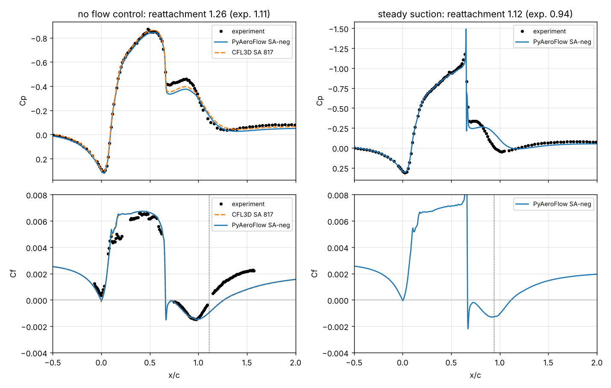

`python examples/cases/nasa_hump_plot.py NOFLOW.wall_wall.csv
SUCTION.wall_wall.csv OUT.png` draws the figure (built-in references
`tmr_hump_*`). Without flow control PyAeroFlow reproduces the CFL3D SA Cp and
Cf of the TMR (no Cp shift needed; the TMR shifted the CFL3D Cp by -0.015).
With suction the computed suction peak ahead of the slot and the Cp recovery
follow the experiment up to the slot; the computed bubble shrinks from 0.61 c
to 0.45 c, the measured one from 0.45 c to about 0.28 c (taking the measured
separation without control, 0.665, for both). Both bubbles are too long by
about 0.17 c, and the suction reattachment matches the RANS results of the
workshop: the known SA (and general RANS) shortfall of turbulent
shear stress in the separated shear layer, not a transpiration error. The
spike of Cf at the slot is the no-slip slot exit under suction (the sucked
tangential momentum; see the NACA 0012 slot cases).

The 817 x 217 grid (the grid of the TMR reference data) moves the reattachment
by less than 0.01 c, so the discrepancy is not a grid effect: without control
PyAeroFlow 1.263 matches the CFL3D/FUN3D SA band 1.26 - 1.27.

## 18. Viscous panel method (`pyaeroflow foil`)

`pyaeroflow foil` (since 1.7, `src/pyaeroflow/ibl/`) couples a
linear-vorticity panel method to an integral boundary layer: two-equation
laminar and turbulent closures with shear lag, the envelope e^N transition
criterion, and a wake. All of it is solved in one global Newton iteration, the
viscous–inviscid approach of XFOIL-type codes. It was written from the
published papers (Drela & Giles 1987, Drela 1989, Fidkowski 2022) and not from
code. The same boundary-layer solution builds the start field of
`initial.boundary_layer` ([recipe 15](recipes.md#ibl-start)). Three checks:
code-to-code against mfoil on the same panel nodes, the Eppler 387 polar
against two wind tunnels and XFOIL, and the SD7003 polar against XFOIL and
the CFD polars of §9 and §10.

`python examples/ibl_validation.py` runs the polars and the field of
§18.4 and draws the figures (about 1.5 min on 4 cores). Coordinates:
`examples/airfoils/e387.dat` and `sd7003.dat` (the PyAero airfoil library),
repanelled to 200 nodes, sharp trailing edge. The polars are run like
`pyaeroflow foil` runs them: each angle starts from the previous one, and an
angle that does not converge that way starts cold (§18.5).

### 18.1 Code-to-code: mfoil on the same nodes

mfoil (Fidkowski; the Python port pymfoil 0.1.0, MIT licence) is run only as
a reference, on the nodes of its own panelling, which are then passed to
`foil`, so both codes solve the same discrete geometry. The pymfoil copy used
was corrected in four places first. Two of them change results: `cl /= chord`
was inside the panel loop (C_L about 2 % high when the chord is not 1, as for
the SD7003 file), and the wake source influence (`Csig`, the linear sources
on the wake half panels) dropped the cross terms between neighbouring wake
panels. The other two (`X.shape(1)`, and a shape test on `R_x`) are
Python slips that stop the run on a sharp trailing edge. The SD7003 file has
a trailing-edge gap of 10⁻⁴ c, which pymfoil needs.

| case | C_L foil / mfoil | C_D foil / mfoil | x_tr upper foil / mfoil |
|---|---|---|---|
| NACA 2412, Re 10⁶, α 2° | 0.44919 / 0.44935 | 0.005784 / 0.005778 | 0.526 / 0.526 (lower 0.966 both) |
| SD7003, Re 6·10⁴, α 0° | 0.06153 / 0.06164 | 0.014796 / 0.014792 | laminar both |
| SD7003, α 2° | 0.43079 / 0.43093 | 0.017184 / 0.017167 ¹ | 0.8374 / 0.8374 |
| SD7003, α 4° | 0.62662 / 0.62673 | 0.019345 / 0.019333 ¹ | 0.5661 / 0.5661 |
| SD7003, α 6° | 0.81965 / 0.81945 ¹ | 0.025029 / 0.025011 ¹ | 0.3275 / 0.3276 |

N_crit 9 throughout; NACA 2412 CM −0.04800 / −0.04803, CDf 0.004116 both;
19 Newton steps. ¹ mfoil without the `Csig` correction. That correction moves
C_L by 10⁻⁴ at α 2° and 4°, and by 0.004 at α 0°, where the laminar
separated layer at the upper trailing edge puts a large mass defect into the
wake. Before it, the α 0° values differed by 0.004 in C_L. The two codes
agree to 3·10⁻⁴ in C_L and 0.1 % in C_D. Recorded 2026-11-12. The comparison
script stays outside the repository; it runs pymfoil.

### 18.2 Eppler 387, Re 2·10⁵

Free transition, N_crit 8.15 (Tu 0.1 % by Mack's relation, the setting of
§8). References: NASA TM 4062 (Langley LTPT, McGhee et al. 1988), Penn State
2007 (Somers & Maughmer, Tu ≈ 0.045 %) and XFOIL 6.99 at N_crit 8.15 on the
PyAero mesh contour (built-in `e387_xfoil_re200k`). The oil-flow bubble is
from Somers & Maughmer, table IV (Penn State).

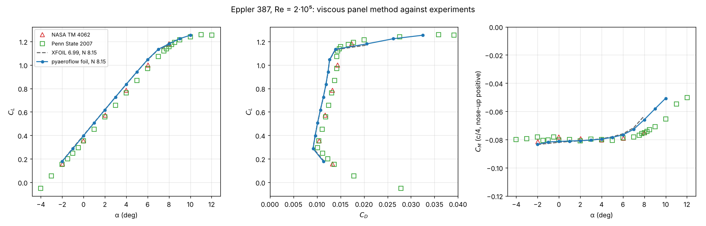

| α | C_L | C_D | C_M | ΔC_L / ΔC_D TM 4062 | ΔC_L / ΔC_D XFOIL 8.15 | x_tr upper | bubble LS–TR (oil flow) |
|---|---|---|---|---|---|---|---|
| −2 | 0.179 | 0.01137 | −0.084 | – | −0.000 / −1.3 % | 0.765 | 0.52–0.78 |
| −1 | 0.287 | 0.00918 | −0.082 | +0.035 / −23 % | −0.005 / 0.0 % | 0.734 | |
| 0 | 0.397 | 0.00962 | −0.081 | +0.046 / −8.5 % | −0.003 / −0.1 % | 0.706 | 0.48–0.72 |
| 2 | 0.618 | 0.01074 | −0.081 | +0.048 / −8.8 % | −0.001 / −0.1 % | 0.656 | 0.44–0.67 |
| 4 | 0.835 | 0.01192 | −0.080 | +0.049 / −10.4 % | −0.000 / −0.0 % | 0.599 | 0.40–0.61 |
| 5 | 0.942 | 0.01236 | −0.079 | +0.051 / −10.7 % | +0.001 / −0.1 % | 0.562 | 0.35–0.59 |
| 6 | 1.045 | 0.01270 | −0.077 | +0.050 / −11.7 % | +0.002 / 0.0 % | 0.508 | 0.34–0.55 |
| 7 | 1.134 | 0.01391 | −0.072 | +0.047 / −12 % | +0.003 / −0.3 % | 0.334 | 0.33–0.47 |
| 8 | 1.180 | 0.02061 | −0.066 | +0.001 / +19 % | +0.011 / 0.0 % | 0.040 | |
| 10 | 1.254 | 0.03253 | −0.051 | (Penn State +0.014 / +19 %) | – | 0.019 | |

ΔC_D relative. α 1°, 3° and 9° are in the CSV and in the figure. All 13 angles converge.
C_M is nose-up positive (the experiments' convention; the CFD solver writes
nose-down positive).

What the polar shows:

- `foil` reproduces XFOIL 8.15 from α −2° to 8°: C_L within 0.005 (0.011 at
  8°) and C_D within 1.3 %, the transition location within 0.01 c (0.508
  against 0.507 at 6°). Both
  are the same model, written independently, so this checks the
  implementation, not the physics.
- Against both wind tunnels, C_L is 0.04–0.05 (TM 4062) and 0.04–0.08 (Penn
  State) too high and C_D 8–12 % too low from 0° to 7°. That is the known gap
  of the e^N panel codes on this airfoil; XFOIL has it too (§8). The SA-AFT
  CFD of §8 is closer in C_L.
- The computed transition lies inside the oil-flow bubble at every angle
  from −2° to 7°. Up to 5° it is 0.01–0.03 c ahead of the measured
  reattachment; at 7° it is near the measured separation. The laminar bubble
  and its movement with α are captured.
- C_M follows the measurements to 0.002 up to 6°; above 7° the nose-up trend
  is steeper than measured.

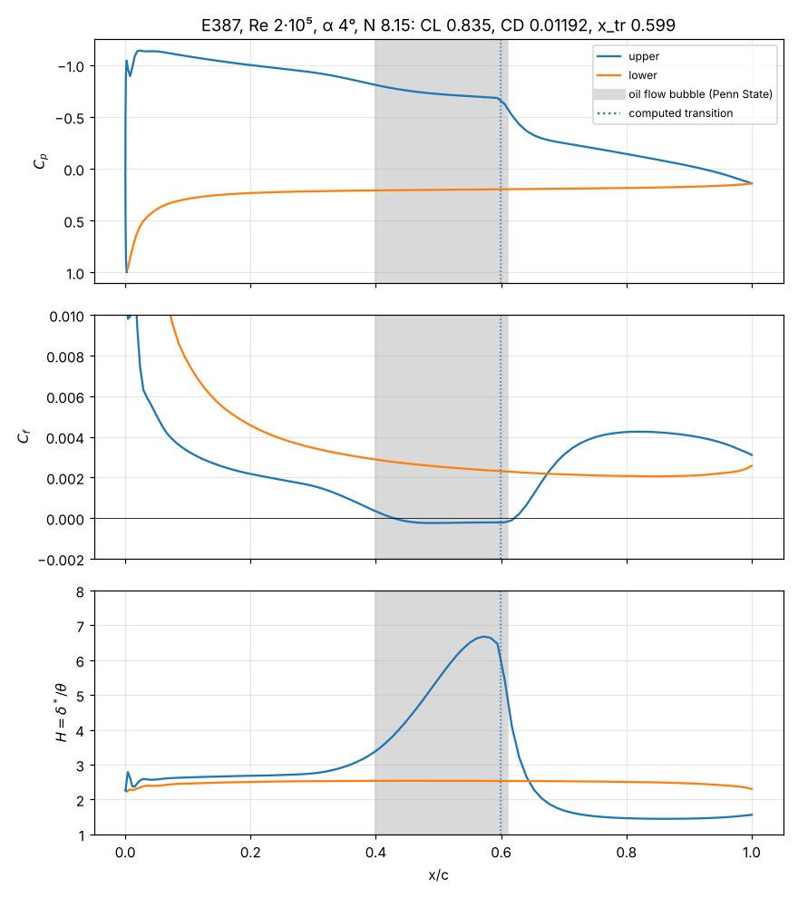

At α 4° the upper layer separates at x/c ≈ 0.45 (C_f < 0, H up to 6.7)
and transitions at 0.599. The measured bubble is 0.40–0.61. After transition
it reattaches within 0.04 c and H drops to 1.5.

### 18.3 SD7003, Re 6·10⁴

N_crit 8.15, α 0° to 10°, against XFOIL 6.99 (N_crit 8.15) and the CFD
polars of §9 and §10 on the 320k PyAero mesh (SA-AFT, SST-LM at Tu 0.1 %).

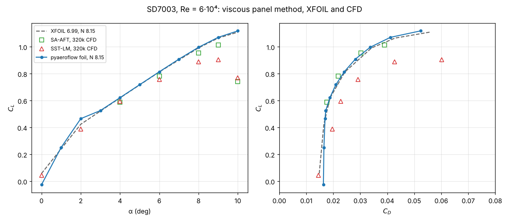

| α | C_L foil | C_D foil | C_L XFOIL | C_D XFOIL | x_tr upper |
|---|---|---|---|---|---|
| 0 | −0.026 | 0.01633 | 0.058 | 0.0148 | 0.993 |
| 2 | 0.466 | 0.01694 | 0.424 | 0.0165 | 0.800 |
| 4 | 0.622 | 0.01872 | 0.620 | 0.0188 | 0.549 |
| 6 | 0.814 | 0.02405 | 0.813 | 0.0243 | 0.317 |
| 8 | 0.997 | 0.03366 | 0.992 | 0.0342 | 0.163 |
| 9 | 1.070 | 0.04115 | 1.065 | 0.0429 | 0.112 |
| 10 | 1.118 | 0.05233 | 1.109 | 0.0557 | 0.084 |

From 4° to 10° `foil` matches XFOIL to 0.01 in C_L and 6 % in C_D. Like
XFOIL it does not show the early stall of the RANS models at 10°; it is an
attached-flow method and stays optimistic near stall. At 0° to 2° the
transition sits at the trailing edge (x_tr 0.8–0.99), the long bubble is
not closed on the airfoil, and the result depends on the panelling and on
N_crit: −0.026 and 0.466 against 0.058 and 0.424. At N_crit 9 the same
coordinates give C_L 0.059 at α 0° (run of 2026-11-12). Treat
low-α SD7003 values at Re 6·10⁴ as uncertain to ±0.05 in C_L.

### 18.4 The boundary-layer start field

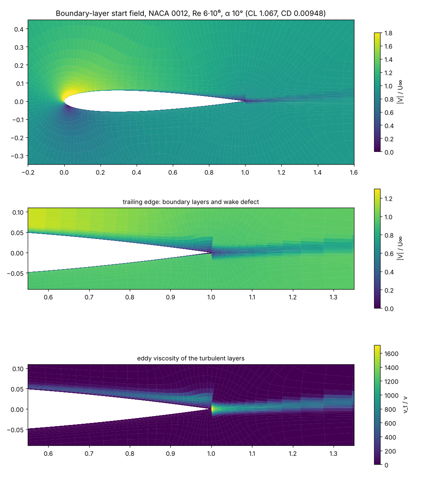

`initial.boundary_layer` builds the CFD start field from this solution: the
outer flow of the panel method with the displacement sources, a velocity
profile with the computed shape factor in the layers and the wake, and the
eddy viscosity of the turbulent layers (for SA). The figure shows it on the TMR
225 × 65 grid at Re 6·10⁶, α 10°, N_crit 9 (C_L 1.067, C_D 0.00948; upper
transition at 0.017). `examples/output/ibl/naca0012_ibl_field.vtu` holds
velocity, C_p and ν_t/ν per cell for ParaView. The effect on the iteration
count is in [recipe 15](recipes.md#ibl-start).

### 18.5 Start-up, robustness and limits

- **Start of one angle.** A single angle starts cold: the boundary layer is
  marched on the inviscid pressure, then the coupled Newton iteration runs
  (100 steps, `--max-iterations`). On the inviscid pressure the laminar layer
  can separate at the leading-edge suction peak and the march puts the
  transition there, far from the coupled answer. E387 α 6° is such a case:
  transition starts at x/c 0.05, the answer is 0.508, and Newton stalls with
  steps of 10⁻³. `foil` recognises the stall (15 steps below 5 % of the
  Newton step without halving the residual) and then solves a neighbouring
  angle that starts well (1°, 2°, 3° away, the side towards α 0° first) and
  approaches the requested angle from it, halving the step in α when a step
  fails. E387 α 6° comes from 5° (60 Newton steps in all), SD7003 α 8° from
  7°. The table that `foil` prints names the start (`cold`, `warm`,
  `continuation from 5`).
- **Polar.** Each angle starts from the previous converged one (`--cold`
  switches that off). A warm start that has not converged in 30 steps is
  dropped and the angle starts cold. It helps on the E387 (7 to 17 steps per
  degree up to 6°); on the SD7003 at 1° steps most angles fall back to the cold start,
  because the transition point moves one node per Newton step.
- **Uniqueness.** Where the transition jumps (E387 between 7° and 8°) two
  states can exist; the continuation comes from the lower |α|. Warm and cold
  results of this section agree to all printed digits.
- **Speed** (4 cores): about 0.06 s per Newton step, 1 s for an easy angle;
  E387, 13 angles: about 30 s. The compiled and the traced kernels are kept
  in `~/.cache/pyaeroflow` (`PYAEROFLOW_JAX_CACHE=0` switches it off): the
  first angle of a run takes about 6 s instead of 24 s, the very first run
  after an installation about 40 s.
- Incompressible only (no Kármán–Tsien correction), single element, no
  forced transition (trip) yet.
- Attached and mildly separated flow; C_L max and the post-stall branch
  are not predicted.

[↑ back to table](#stage-table)

## 19. Incompressible energy equation (variable density, stages V1 to V3)

`physics.energy = true` (configuration: [Energy equation](configuration.md#energy-equation-incompressible)).
Script: `pyaeroflow.cases.heat_transfer`; tests
`tests/verification/test_heat_transfer.py` (the Ra 1e4–1e6 cavities, the
turbulent plates and the Re 40 cylinder are `slow`); the cavity Ra 1e5,
the SA plate and the cylinder Re 40 are in `examples/cases/`
(`cavity_heated_ra1e5.toml`, `plate_heated_sa.toml`,
`heated_cylinder_re40.toml`; templates `cavity-heated`, `plate-heated-sa`;
`stanton_check.py` beside them), the other case files in the project folder
`cases/variable_density_v1/` (laminar), `cases/variable_density_v2/`
(RANS) with the checking script `similarity_check.py` and
`cases/closed_domain_v3/` (closed domains, unsteady).

| case | stage | reference | result |
|---|---|---|---|
| [natural convection in a cavity](#sec-19-cavity), Ra 1e3–1e6 | V1 | de Vahl Davis 1983 | Nu within 0.1–0.4 % |
| [heated laminar plate](#sec-19-plate), ΔT = 3 K | V1 | Pohlhausen | Nu_x within 0.1–1.7 % |
| [heated laminar plate, T_w/T_∞ = 1.5 and 2](#sec-19-plate-hot) | V1, variable properties | Howarth–Levy–Lees similarity | Nu_x within 1 % for x ≤ 0.5 |
| [heated cylinder](#sec-19-cylinder), Re 20 and 40 | V1 | Lange et al. 1998 | Nu +1.4 % / −0.8 % |
| [heated channel, uniform wall heat flux](#sec-19-channel) | V1, heat-flux walls | Shah & London | developed Nu −0.15 % |
| [turbulent heated plate](#sec-19-turbulent), SA and SST | V2 | Kays & Crawford | St −4 to +6 % |
| [turbulent heated plate, T_w/T_∞ = 2](#sec-19-turbulent) | V2, variable properties | Kays & Crawford property ratio | plausibility only |
| [non-Boussinesq cavity, Ra 10⁶, ε = 0.6](#sec-19-lequere) | V3, closed domain | Le Quéré et al. 2005 | Nu +0.09 / +0.15 %, p_th −0.03 / −0.04 % (128²) |
| [heated closed box](#sec-19-lequere) | V3, unsteady | energy balance of the ideal gas | exact per time step |

**Natural convection in a square cavity** (de Vahl Davis 1983). Hot left and
cold right wall, adiabatic top and bottom, Pr = 0.71, ideal-gas density at
ΔT/T = 1 % (the Boussinesq limit), meshes clustered at all walls (tanh,
β = 1.5), start from rest. Mean Nusselt number of the hot wall (the cold wall
agrees to 10⁻⁹, the energy balance), iterations of the case files
(start-up CFL 1000), 7–17 s each:

| Ra | mesh | Nu | reference | iterations |
|----|------|----|-----------|------------|
| 1e3 | 32² | 1.1167 | 1.118 | 18 |
| 1e4 | 48² | 2.2443 | 2.243 | 22 |
| 1e5 | 64² | 4.5246 | 4.519 | 35 |
| 1e6 | 96² | 8.8357 | 8.800 (Le Quéré 1991: 8.825) | 67 |

Boussinesq and ideal-gas density give the same Nu to 0.2 % at this ΔT.

**Heated laminar flat plate** (Pohlhausen). Re_L = 5·10⁴, Pr = 0.71,
isothermal plate 3 K above the freestream, 5376 cells (`make-mesh
plate-heated`). The similarity solution gives Nu_x = 0.29416 Re_x^½
(computed by `heat_transfer.pohlhausen`; 0.33206 at Pr = 1). Computed
Nu_x/Re_x^½: 0.2939 (x = 0.05), 0.2943 (0.1), 0.2947 (0.25), 0.2957 (0.5),
0.2970 (0.75), 0.2992 (0.95); mean Nu_L 132.0 against 131.5. C_D 0.00610
(Blasius 0.00594, leading-edge and outlet effects). 38 iterations.

**Heated laminar plate with variable properties.** The same plate with the
wall at 450 K and 600 K (T_w/T_∞ = 1.5 and 2), Sutherland's μ(T) (S =
110.4 K), ρ = p/(R T), k = μ c_p/Pr, 23–26 iterations. The reference is the
exact similarity solution for the low-speed limit (no dissipation, no
pressure work) in Howarth–Levy–Lees variables, (C f″)′ + f f″ = 0,
(C θ′/Pr)′ + f θ′ = 0 with C = ρμ/(ρ_∞μ_∞), computed by
`heat_transfer.similarity_plate` (it returns Pohlhausen's 0.29416 and
Blasius' 0.6641 at T_w = T_∞). It gives Nu_x/Re_x^½ = 0.2861 and 0.2790 and
C_f Re_x^½ = 0.6449 and 0.6279 for the two walls: the hot wall lowers both
(0.9732 and 0.9491 of the cold values for Nu, 0.9716 and 0.9460 for C_f).

| T_w | x | Nu_x/Re_x^½ | vs similarity | C_f Re_x^½ | vs similarity |
|-----|---|-------------|---------------|------------|---------------|
| 303 K | 0.1 / 0.5 | 0.2943 / 0.2957 | +0.1 % / +0.6 % | 0.6719 / 0.6812 | +1.2 % / +2.6 % |
| 450 K | 0.1 / 0.5 | 0.2868 / 0.2897 | +0.2 % / +1.2 % | 0.6595 / 0.6766 | +2.3 % / +4.9 % |
| 600 K | 0.1 / 0.5 | 0.2794 / 0.2838 | +0.1 % / +1.7 % | 0.6491 / 0.6738 | +3.4 % / +7.3 % |

Nu_x agrees within 1 % for x ≤ 0.25 and within 1.7 % for x ≤ 0.5 at
every wall temperature. The reduction by the hot wall (Nu 5 %, C_f 5 %
at 600 K) is reproduced in the ratio hot/cold to 1.2 % for Nu and to
2–5 % (too small a reduction) for C_f at x ≤ 0.5. C_f is higher than the
zero-pressure-gradient similarity and the difference grows with x and ΔT
(at x = 0.96: +7 %, +12 %, +17 % for 303, 450, 600 K): the plate
displaces the flow, the outlet at p = 0 pulls the wall pressure down
(c_p 0.012 → 0.001 along the plate at 303 K, twice that at 600 K), and the
resulting favourable gradient raises C_f. It is not discretization: the
192 × 96 mesh (19 968 cells) changes C_f by less than 2 points at every
x. A comparison without these effects would need a much longer domain;
`similarity_check.py` also prints the hot/cold ratios in which the common
part cancels.

**Heated cylinder in cross flow**, Re_D = 20 and 40, Pr = 0.71, wall 3 K above the
freestream, O-grid 128 × 72 with the farfield at 60 radii. Mean Nu
2.443 at Re 20 against 2.409 of the correlation of Lange, Durst & Breuer
(1998) (+1.4 %), C_D 2.006, 16 iterations; Re 40: Nu 3.255 against 3.281
(−0.8 %), C_D 1.509 (Dennis & Chang 1970: 1.52), 21 iterations, 16 s. With
the farfield at 10 radii (`cylinder-ogrid` default) the blockage gives Nu
2.477 and C_D 2.134 at Re 20. The case file of Re 40 is
`heated_cylinder_re40.toml`.

**Heated channel with uniform wall heat flux** (parallel plates, fully
developed Poiseuille inflow, Re_Dh = 40, Pr = 0.71, H = D_h/2, L = 8 H =
4 D_h, 64 × 24 cells, `heat_transfer.solve_channel`). Heat flux into the
fluid at both walls, 0.5 % bulk temperature rise over the channel
(ideal-gas density, constant μ).
Local Nu = q D_h/(k (T_w − T_b)) with the mixing-cup temperature of the
cross-section: 9.91 (x/(D_h Re Pr) = 0.008), 8.58 (0.017), 8.245 (0.034),
then 8.223 from x = 2 D_h to 3.5 D_h against 140/17 = 8.235 of the fully
developed flow (Shah & London): −0.15 %. It tests the heat-flux wall
condition, the enthalpy transport and the thermal entrance. 13
iterations, 10 s. The last cells before the outlet show the outlet effect
(8.35) and are left out of the test.

**Turbulent heated flat plate** (RANS, stage V2). Air at 300 K (ideal gas,
Pr = 0.71, Pr_t = 0.9), U = 78.4 m/s, Re = 5·10⁶ per metre, isothermal plate
3 K above the freestream, turbulent from the leading edge, NASA TMR plate
domain (`make-mesh plate-rans`, 96 × 64 on the plate, y⁺ ≈ 1). Reference:
the correlation of Kays & Crawford for the isothermal plate,
St Pr^0.4 = 0.0287 Re_x^−0.2 (stated for 5·10⁵ < Re_x < 5·10⁶;
`heat_transfer.kays_crawford_stanton`). Local St over the correlation:

| Re_x | SA 7 680 cells | SA 27 648 cells | SST 7 680 cells |
|------|---------------|-----------------|-----------------|
| 4·10⁵ | 0.970 | 0.961 | 0.973 |
| 1.2·10⁶ | 0.996 | 0.994 | 0.985 |
| 2.5·10⁶ | 1.026 | 1.024 | 1.002 |
| 5·10⁶ | 1.060 | 1.059 | 1.029 |
| 9.5·10⁶ (outside) | 1.098 | 1.097 | 1.064 |

The two SA meshes agree to 0.3 % at x = 1 m. The Reynolds-analogy factor
2 St/C_f is 1.17–1.19 (SA) and 1.16–1.20 (SST). C_D of the plate (q · 2 m)
is 0.002899 (SA, TMR 0.0028562 at M 0.2, the incompressible result lies
about 1 % above). 72 (SA) and 94 (SST) iterations from freestream at the
start-up CFL 1000, 28 s on the 7 680 cells. The same case in non-dimensional
form is `heat_transfer.solve_turbulent_plate` (test
`test_turbulent_heated_plate`, `slow`).

Large temperature difference: the same SA case with the plate at 600 K
(T_w/T_∞ = 2, Sutherland μ(T), k = μ c_p/Pr) converges in 53 iterations;
St and C_f fall to 0.81–0.82 and 0.81 of the 303 K values. The
property-ratio correction (T_w/T_∞)^−0.4 of Kays & Crawford gives 0.76 for
St, and the reference-temperature method with Eckert's T* = T_∞ + ½(T_w −
T_∞) gives 0.77 for C_f. The 5–7 % higher drop is the size of the scatter
of such correlations; this run is a plausibility check, not a validation.
The compressible RANS path (`physics.flow = "compressible"`, isothermal
wall) is the independent code to compare with, as a case file
(`plate_heated_sa_compressible_600K.toml`, not run: it needs PARDISO).

With `density_model = "constant"` at ρ = 1 the flow and turbulence residuals
and the first-order Jacobian of all five RANS models (SA, SA-BCM, SA-AFT,
SST, SST-LM) equal those of the constant-density solver to 10⁻¹⁶
(`tests/unit/test_rans_variable_density.py`).

**Non-Boussinesq cavity** (stage V3; Le Quéré et al. 2005, the benchmark for
low-Mach solvers). The de Vahl Davis cavity with ε = (T_h − T_c)/(T_h + T_c)
= 0.6 (ΔT/T₀ = 1.2): air as an ideal gas, T₀ = 600 K, hot wall 960 K, cold
wall 240 K, adiabatic top and bottom, P₀ = 101325 Pa, Pr = 0.71, γ = 1.4,
R = 287 J/(kg K), Ra = Pr g ρ₀² ΔT L³/(T₀ μ₀²) = 10⁶. T1: constant μ =
1.68·10⁻⁵ Pa s; T2: Sutherland's μ(T) (T* = 273 K, S = 110.5 K), k = μ c_p/Pr.
The domain is closed: p_th follows from the mass of the gas filled at P₀,
T₀ (`fluid.thermodynamic_pressure = "auto"`). Steady, start from rest at T₀,
start-up CFL 1000, meshes clustered at all walls (`make-mesh
cavity-clustered`, tanh β = 1.5). Nu = q L/(k₀ (T_h − T_c)) with k₀ = k(T₀),
mean over the hot wall (the cold wall agrees to 10⁻⁹):

| case | mesh | Nu | p_th/P₀ | iterations | time |
|------|------|----|---------|------------|------|
| T1 | 64² | 8.8913 (+0.36 %) | 0.855550 (−0.09 %) | 66 | 11 s |
| T1 | 128² | 8.8680 (+0.09 %) | 0.856103 (−0.03 %) | 137 | 44 s |
| T1 | Richardson | 8.8602 (+0.005 %) | 0.856287 (−0.006 %) | | |
| T1 | reference | 8.85978 | 0.856338 | | |
| T2 | 64² | 8.7310 (+0.51 %) | 0.923539 (−0.10 %) | 56 | 11 s |
| T2 | 128² | 8.6995 (+0.15 %) | 0.924098 (−0.04 %) | 89 | 42 s |
| T2 | Richardson | 8.6890 (+0.03 %) | 0.924284 (−0.02 %) | | |
| T2 | reference | 8.6866 | 0.924487 | | |

The errors fall by 3.8 (T1) and 3.4 (T2) from 64² to 128²: second order.
With a constant p_th (`"constant"`, the V1/V2 behaviour) the steady solution
keeps the operating pressure and holds about 1/0.856 − 1 ≈ 17 % (T1) more
gas than the cavity was filled with. The case files are `lequere_t1_ra1e6.toml`,
`lequere_t2_ra1e6.toml` and the unsteady start-up `lequere_t1_unsteady.toml`
in `cases/closed_domain_v3/`. The start-up (T1, 64², BDF2, Δt = 0.05 s =
0.8 L/U, 60 steps from rest with the wall temperatures switched on at t = 0)
takes 2.2 inner iterations per step and 36 s; p_th/P₀ falls monotonically,
0.994 after the first step, 0.924 at 0.95 s, 0.867 at 3 s, towards the
steady 0.8556 of this mesh.

**Heated closed box** (unsteady, `test_heated_closed_box_energy_balance`):
a closed box at rest with an isothermal wall and a heat-flux wall, constant
c_p. The energy rows sum to the wall heat flux, so (1 − R/c_p) A dp_th/dt =
Q holds per BDF1 step to 10⁻¹⁴ with the dp_th/dt work of the low-Mach energy
equation, and the mass stays M₀ to round-off; 6 inner iterations per step.
The closed-domain residual, pseudo-time term, first-order Jacobian, wall
heat flux and eddy viscosity equal those of an open domain at the same
p_th for all models, and the Newton product matches a central difference
including the global p_th coupling (`tests/unit/test_closed_domain.py`).

[↑ back to table](#stage-table)

## References

- Ghia, U., Ghia, K. N., Shin, C. T. (1982): High-Re solutions for
  incompressible flow using the Navier–Stokes equations and a multigrid
  method. J. Comput. Phys. 48, 387–411.
- Schäfer, M., Turek, S. (1996): Benchmark computations of laminar flow
  around a cylinder. In: Flow Simulation with High-Performance Computers
  II, Vieweg, 547–566.
- Turbulence Modeling Resource (TMR, formerly hosted by NASA Langley), 2D
  zero-pressure-gradient flat plate and 2D NACA 0012 airfoil cases,
  https://tmbwg.github.io/turbmodels/ (source repository
  github.com/TMBWG/turbmodels).
- Swanson, R. C., Langer, S. (2016): Comparison of NACA 0012 laminar flow
  solutions: structured and unstructured grid methods. NASA/TM-2016-219003
  (also Computers & Fluids 126, 102–128).
- White, F. M. (2006): Viscous Fluid Flow, 3rd ed. McGraw-Hill.
- Vassberg, J. C., Jameson, A. (2010): In pursuit of grid convergence for
  two-dimensional Euler solutions. J. Aircraft 47(4), 1152–1166.
- Vassberg, J. C., Harrison, N. A., Roman, D. L., Jameson, A. (2011): A
  systematic study on the impact of dimensionality for a two-dimensional
  aerodynamic optimization model problem. AIAA 2011-3176.
- Ladson, C. L. (1988): Effects of independent variation of Mach and
  Reynolds numbers on the low-speed aerodynamic characteristics of the NACA
  0012 airfoil section. NASA TM 4074.
- Gregory, N., O'Reilly, C. L. (1970): Low-speed aerodynamic
  characteristics of NACA 0012 aerofoil section, including the effects of
  upper-surface roughness simulating hoar frost. NPL Aero Report 1308 /
  ARC R&M 3726.
- McGhee, R. J., Walker, B. S., Millard, B. F. (1988): Experimental results
  for the Eppler 387 airfoil at low Reynolds numbers in the Langley
  low-turbulence pressure tunnel. NASA TM 4062.
- Herbst, S. L., Kähler, C. J., Hain, R. (2017): Influence of large-scale
  free-stream turbulence on an SD7003 airfoil at low Reynolds numbers.
  AIAA paper, Universität der Bundeswehr München (paper number to be added †).
- Selig, M. S., Guglielmo, J. J., Broeren, A. P., Giguère, P. (1995):
  Summary of Low-Speed Airfoil Data, Vol. 1. SoarTech Publications.
- Langtry, R. B., Menter, F. R. (2009): Correlation-based transition
  modeling for unstructured parallelized computational fluid dynamics codes.
  AIAA J. 47(12), 2894–2906.
- Ol, M. V., McAuliffe, B. R., Hanff, E. S., Scholz, U., Kähler, C. J.
  (2005): Comparison of laminar separation bubble measurements on a low
  Reynolds number airfoil in three facilities. 35th AIAA Fluid Dynamics
  Conference.
- Somers, D. M., Maughmer, M. D. (2007): Theoretical and experimental
  results for the Eppler 387 airfoil at low Reynolds numbers in the Penn
  State low-speed, low-turbulence wind tunnel. RDECOM TR 07-D-32.
- Roach, P. E., Brierley, D. H. (1992): The influence of a turbulent
  free-stream on zero pressure gradient transitional boundary layer
  development, Part I: test cases T3A and T3B. In: Numerical Simulation of
  Unsteady Flows and Transition to Turbulence, Cambridge University Press.
  Data: ERCOFTAC Classic Collection, case 020.
- Fidkowski, K. J. (2022): A coupled inviscid–viscous airfoil analysis
  solver, revisited. AIAA J. 60(5), 2961–2971 †. mfoil, the reference of
  §18.1.

### Turbulence and transition models, numerics, other codes

Entries marked † were added from memory in a documentation pass and still
need their volume, page or paper number checked.

- Spalart, P. R., Allmaras, S. R. (1994): A one-equation turbulence model for
  aerodynamic flows. La Recherche Aérospatiale 1, 5–21. SA-neg and the
  implementation notes: Allmaras, S. R., Johnson, F. T., Spalart, P. R.
  (2012): Modifications and clarifications for the implementation of the
  Spalart–Allmaras turbulence model. ICCFD7-1902 †.
- Menter, F. R. (1994): Two-equation eddy-viscosity turbulence models for
  engineering applications. AIAA J. 32(8), 1598–1605. SST-2003: Menter, F. R.,
  Kuntz, M., Langtry, R. (2003): Ten years of industrial experience with the
  SST turbulence model. Turbulence, Heat and Mass Transfer 4 †.
- Langtry–Menter intermittency source and F_turb: Menter, F. R., Langtry, R.
  B., Völker, S. (2006): Transition modelling for general purpose CFD codes.
  Flow, Turbulence and Combustion 77, 277–303.
- Coder, J. G., Maughmer, M. D. (2014): Computational fluid dynamics
  compatible transition modeling using an amplification factor transport
  equation. AIAA J. 52(11), 2506–2512. AFT2019b: Coder, J. G. (2019):
  Enhancement of the amplification factor transport transition modeling
  framework (AIAA 2019 paper) †, and the TMR page `aft_transition_3eqn`.
- Cakmakcioglu, S. C., Bas, O., Kaynak, U. (2018): A correlation-based
  algebraic transition model. Proc. IMechE Part C 232(21), 3915–3929 †. The
  2020 revision (SA-noft2 form): Cakmakcioglu, S. C., Bas, O., Mura, R.,
  Kaynak, U. (2020): A revised one-equation transitional model for external
  aerodynamics. AIAA 2020-2706 †.
- Mack, L. M. (1977): Transition prediction and linear stability theory.
  AGARD CP-224. Drela, M., Giles, M. B. (1987): Viscous–inviscid analysis of
  transonic and low Reynolds number airfoils. AIAA J. 25(10), 1347–1355.
  Drela, M. (1989): XFOIL: an analysis and design system for low Reynolds
  number airfoils. In: Low Reynolds Number Aerodynamics, Lecture Notes in
  Engineering 54, Springer, 1–12. N_crit from Tu (Mack with Drela's limit) and
  the XFOIL comparison values.
- SD7003 LES/DNS bands: Galbraith, M. C., Visbal, M. R. (2008): Implicit
  large eddy simulation of low Reynolds number flow past the SD7003 airfoil.
  AIAA 2008-225 †; Uranga, A., Persson, P.-O., Drela, M., Peraire, J. (2011):
  Implicit large eddy simulation of transition to turbulence at low Reynolds
  numbers using a discontinuous Galerkin method. Int. J. Numer. Methods Eng.
  87, 232–261 †. The ranges used in §9 and §10 are those compiled in the
  project's SD7003 reference notes (LES, DNS and flux-reconstruction runs);
  the quote of Ruiz & D'Ambrosio (2022) in §9 needs its full citation †.
- Knoll, D. A., Keyes, D. E. (2004): Jacobian-free Newton–Krylov methods: a
  survey of approaches and applications. J. Comput. Phys. 193, 357–397
  (Eisenstat–Walker forcing, `pseudo_time.py`).
- Economon, T. D. (2020): Simulation and adjoint-based design for variable
  density incompressible flows with heat transfer. AIAA J. 58(2), 757–769 †.
  The artificial-compressibility formulation of the incompressible solver.
- Shima, E., Kitamura, K. (2011): Parameter-free simple low-dissipation
  AUSM-family scheme for all speeds. AIAA J. 49(8), 1693–1709 †.
- Kitamura, K., Shima, E. (2013): Towards shock-stable and accurate
  hypersonic heating computations: a new pressure flux for AUSM-family
  schemes. J. Comput. Phys. 245, 62–83 †.
- Rieper, F. (2011): A low-Mach number fix for Roe's approximate Riemann
  solver. J. Comput. Phys. 230(13), 5263–5287 †.
- Krakos, J. A., Wang, Q., Hall, S. R., Darmofal, D. L. (2012): Sensitivity
  analysis of limit cycle oscillations. J. Comput. Phys. 231(8), 3228–3245 †.
  Windowed time averages (Hann, Hann-squared, bump) of the unsteady Cauchy
  criterion.
- Greenblatt, D., Paschal, K. B., Yao, C.-S., Harris, J., Schaeffler, N. W.,
  Washburn, A. E. (2006): Experimental investigation of separation control
  part 1: baseline and steady suction. AIAA J. 44(12), 2820–2830 (data:
  TMR 2DWMH and CFDVAL2004 Case 3 pages).
- Shah, R. K., London, A. L. (1978): Laminar Flow Forced Convection in
  Ducts. Academic Press †. Fully developed Nu of the parallel plates with
  uniform wall heat flux, 140/17.
- Dennis, S. C. R., Chang, G.-Z. (1970): Numerical solutions for steady flow
  past a circular cylinder at Reynolds numbers up to 100. J. Fluid Mech. 42,
  471–489 †.
- Kays, W. M., Crawford, M. E. (1993): Convective Heat and Mass Transfer,
  3rd ed. McGraw-Hill †. Turbulent flat-plate Stanton number
  St Pr^0.4 = 0.0287 Re_x^−0.2 and the property-ratio corrections.
- Le Quéré, P., Weisman, C., Paillère, H., Vierendeels, J., Dick, E.,
  Becker, R., Braack, M., Locke, J. (2005): Modelling of natural convection
  flows with large temperature differences: a benchmark problem for low
  Mach number solvers. Part 1. Reference solutions. ESAIM: M2AN 39(3),
  609–616. Test cases T1 and T2 (Ra 10⁶, ε = 0.6), Nu and P/P₀.
- Rumsey, C. L., Gatski, T. B., Sellers, W. L., Vatsa, V. N., Viken, S. A.
  (2006): Summary of the 2004 computational fluid dynamics validation
  workshop on synthetic jets. AIAA J. 44(2), 194–207 †.
